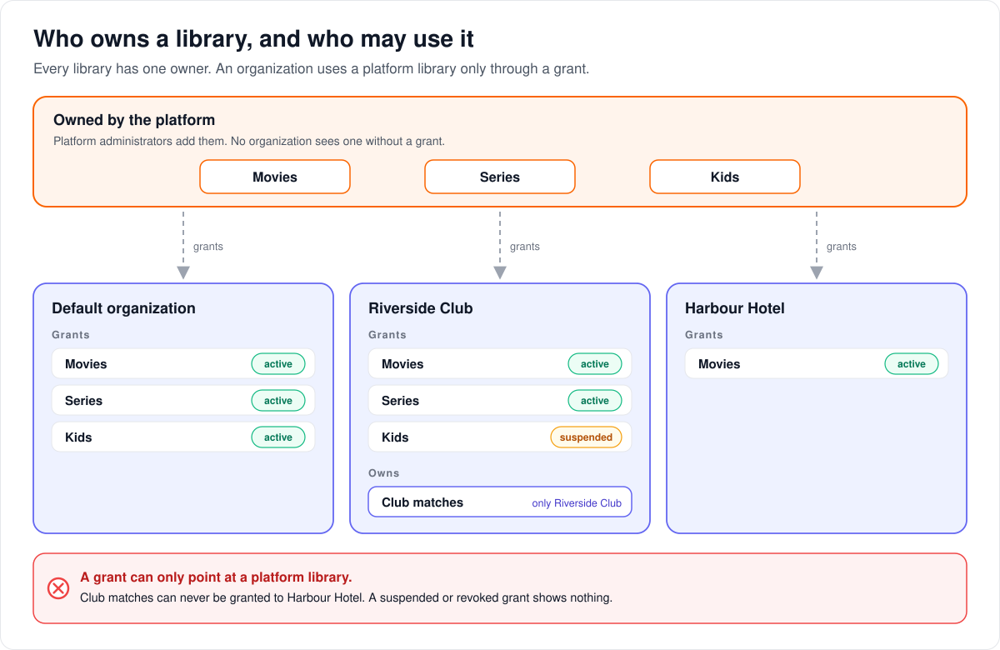

# How library ownership and grants work

> **Provenance and status.** Bloem page, rewritten on 2026-11-01 and checked against
> `main` at `b6039036d`. Resource tenancy is a Bloem addition: Silo has no resource
> owners, organizations or grants, and every library belongs to the whole server.
> This page explains it in plain language; the technical rules, the checking queries
> and the rollback boundary are in the [For developers](#for-developers) section.

Every library and plugin in Bloem has an owner, and an organization may only use
what it owns or what the platform has granted it. This page walks through who owns
what, how grants work, the starting set a new organization receives, what happens
to a library added through Silo's API, and why rolling back is limited once an
organization owns something.

## Who owns a library



1. **Every library has exactly one owner**: the platform, or one organization. The
   same goes for every installed plugin.
2. **A platform library** is added by a platform administrator. No organization sees
   it until it holds a **grant** for it.
3. **An organization's own library** is visible only to that organization. It is
   never granted to anyone else.
4. **A grant** is active, suspended or revoked. Only an active grant lets the
   organization use the library. A revoked grant stays on record as history, and an
   organization holds at most one live grant per library.

The libraries an organization owns plus the platform libraries it holds active
grants for are its **ceiling**. A plan, a group or a profile can narrow it but never
reach past it ([how organizations work](bloem-organizations.md)).

Organizations come by their own libraries through native storage: an organization
administrator adds a storage source and creates a library there, and the library
belongs to that organization ([native storage](bloem-native-storage.md)).

## The starting set


1. The platform keeps a **starting set**: a list of platform libraries and plugins
   that every new organization receives.
2. The starting set has **versions**. One version is active at a time, and a version
   never changes once it has been used.
3. When an organization is created, whether by a platform administrator or by the
   storefront, Bloem grants it everything in the active version, in the same step.
4. Moving to a newer version changes only what later organizations receive. Grants
   already made stay as they are.

When organizations were first introduced, version 1 of the starting set held every
library and plugin the server had, and the default organization was granted all of
them.

## Libraries added through Silo's API

Silo's API and apps built for Silo can still add libraries and plugins. They know
nothing about owners, so:

1. the new library is owned by the platform;
2. the default organization is granted it straight away;
3. it joins no version of the starting set. Giving it to future organizations needs
   a new version.

Nobody can use Silo's API to make an organization own something.

## Checking and rolling back

Read-only database queries confirm the rules: one platform owner, an owner for every
library and plugin, and a grant to the default organization for every platform
library. They are listed in the [For developers](#for-developers) section.

Before any organization owns a library, the change that introduced owners can be
undone with an ordinary schema rollback. Once one does, it cannot: rolling back
would lose who owns what. The only way back then is the previous application image
together with the database snapshot taken before the deployment.

## Who can change what

| Who | What they manage |
| --- | --- |
| Platform administrator | Platform libraries and plugins, and which organizations hold grants for them. |
| Organization administrator | Their organization's own libraries, through native storage. Suspending, restoring or withdrawing grants already made to their organization. |
| Bloem itself | Granting the starting set to a new organization, and granting a library added through Silo's API to the default organization. |
| Whoever runs the database | A new version of the starting set, and making it active. There is no console screen for it. |

## Words used in the code

| On this page | In the code and database |
| --- | --- |
| Owner | a `resource_owners` row, of kind `platform` or `organization` |
| Library, plugin | `media_folders`, `plugin_installations` (each a "root"), with `owner_id` |
| Grant | an `organization_entitlements` row: `active`, `suspended` or `revoked` |
| Starting set | the organization-creation default bundle, `entitlement_bundles` with `is_organization_creation_default`, named `default-platform-catalog` |
| Version of the starting set | a bundle revision: `entitlement_bundle_versions`, members in `entitlement_bundle_members`, `active_revision` |
| Granting the starting set | `tenancy.GrantDefaultBundleInTransaction`; `resourcetenancy.Materializer.MaterializeDefaultBundle` for an existing organization |
| Added through Silo's API | a compatibility-created root, granted by trigger with `granted_by_service='resource-root-compatibility'` |
| Code | `internal/resourcetenancy`, `internal/tenancy` |

## For developers

- **API:** organizations' libraries and grants are on the
  [organizations and administration](../bloem/api/organizations.md) page
  (`/api/bloem/v1/admin/organization/libraries` and `/entitlements/{folder_id}`). The
  policy side is in [OPA tenant authorization](opa-tenant-authorization.md).

Migration `20260813090000_resource_tenancy_roots.sql` establishes Bloem's first
resource-isolation boundary. The migration itself does not enable
organization-private resource creation, add public API fields, or activate row-level
security.

### Invariants

- `resource_owners` contains exactly one `platform` owner.
- Each organization has at most one `organization` owner (created by the
  `organizations_create_resource_owner` trigger).
- `media_folders.owner_id` and `plugin_installations.owner_id` are non-null and
  reference a typed owner.
- Roots that existed before the migration are platform-owned.
- An organization-owned root can be accessed only by that exact organization.
- A platform-owned root is visible to an organization only through an active, typed
  row in `organization_entitlements` (`entitlement_kind` `library_access` or
  `plugin_availability`; `root_kind` `media_folder` or `plugin_installation`).
- An entitlement cannot target an organization-owned root because its
  `(root_owner_id, root_owner_kind)` foreign key requires owner kind `platform`.
- Composite foreign keys prevent a media-folder or plugin entitlement from naming a
  root whose stored owner differs from `root_owner_id`.
- Only one active or suspended entitlement may exist for an organization/root.
  Revoked rows remain as history.

Repository checks enforce these invariants before OPA. OPA may narrow access, but it
cannot manufacture an owner or entitlement.

### Default platform catalog

The migration creates the active organization-creation bundle
`default-platform-catalog` at revision 1. Revision 1 contains every root found
during the migration. The default organization receives one explicit active
entitlement per member, with `granted_by_service` set to
`resource-tenancy-migration`.

A bundle revision is immutable once applied. Changing `active_revision` does not
rewrite entitlements previously materialized from an older revision. Creating an
organization applies the active creation-default bundle in the creating transaction
(`tenancy.GrantDefaultBundleInTransaction`, called by platform organization creation
in `internal/tenancy/admin_store.go` and by tenant provisioning in
`internal/tenancy/tenant_provisioning.go`), so a new organization starts with the
bundle's platform libraries and plugins. The grantor is the creating administrator's
account, or the service `organization-creation` when no account made it. A tenant
that provisioning adopts again is left as it stands, and creation proceeds without a
grant when no active creation-default bundle exists. Rows the organization already
holds are left as they are; a coverage shortfall afterwards is an error that rolls
the transaction back. `Materializer.MaterializeDefaultBundle` applies the same grant
to an existing active organization: it locks the organization and the active bundle,
applies one frozen revision transactionally, and leaves existing live entitlements
unchanged.

No Go code writes bundle revisions or changes `active_revision`; a new revision and
its activation are a reviewed database change.

### Compatibility-created roots

Legacy `/api/v1` create inputs do not contain ownership fields and remain unchanged.
During this expand phase:

- omitted root ownership defaults to the protected platform owner; and
- typed `AFTER INSERT` triggers (`media_folders_entitle_default_organization`,
  `plugin_installations_entitle_default_organization`) grant the default
  organization direct active access to a newly created platform root.

These direct compatibility grants use
`granted_by_service='resource-root-compatibility'`. They do not silently add the new
root to an already-frozen bundle revision. Adding it to the default for future
organizations requires an explicit new bundle version and audited activation.

No caller can use these compatibility paths to select an organization owner.
Organization-private library and plugin creation exists only through the
native-storage administration paths: native-storage library creation assigns the
creating organization as owner (`internal/nativestorage/library_mutations.go`,
`a62162cc5`, 2026-10-12), and organization administrators can add
organization-owned S3 sources (`ccce9b1ee`, 2026-10-15). Those paths remove the
compatibility grant from the new row before they assign the organization owner.

### Verification queries

The following queries are read-only.

Exactly one platform owner:

```sql
SELECT count(*) AS platform_owner_count
FROM resource_owners
WHERE kind = 'platform';
```

Expected: `1`.

No root without an owner, and no missing owner reference:

```sql
SELECT 'media_folder' AS root_kind, count(*) AS invalid_count
FROM media_folders AS roots
LEFT JOIN resource_owners AS owners ON owners.id = roots.owner_id
WHERE roots.owner_id IS NULL OR owners.id IS NULL
UNION ALL
SELECT 'plugin_installation', count(*)
FROM plugin_installations AS roots
LEFT JOIN resource_owners AS owners ON owners.id = roots.owner_id
WHERE roots.owner_id IS NULL OR owners.id IS NULL;
```

Expected: both counts are `0`.

Migration coverage for revision 1 and the default organization:

```sql
WITH root_counts AS (
    SELECT
        (SELECT count(*) FROM media_folders) +
        (SELECT count(*) FROM plugin_installations) AS roots
), bundle_counts AS (
    SELECT count(*) AS members
    FROM entitlement_bundle_members AS members
    JOIN entitlement_bundles AS bundles
      ON bundles.id = members.bundle_id
     AND bundles.active_revision = members.bundle_revision
    WHERE bundles.is_organization_creation_default
), entitlement_counts AS (
    SELECT count(*) AS entitlements
    FROM organization_entitlements AS entitlements
    JOIN organizations AS organizations
      ON organizations.id = entitlements.organization_id
    WHERE organizations.is_default
      AND entitlements.status = 'active'
      AND entitlements.source_bundle_revision = 1
)
SELECT roots, members, entitlements
FROM root_counts, bundle_counts, entitlement_counts;
```

Immediately after migration, all three values must match. Later
compatibility-created roots receive direct entitlements but are intentionally absent
from frozen revision 1; use the following ongoing visibility check:

```sql
SELECT 'media_folder' AS root_kind, count(*) AS unentitled
FROM media_folders AS roots
JOIN resource_owners AS owners ON owners.id = roots.owner_id AND owners.kind = 'platform'
WHERE NOT EXISTS (
    SELECT 1
    FROM organization_entitlements AS entitlements
    JOIN organizations AS organizations
      ON organizations.id = entitlements.organization_id AND organizations.is_default
    WHERE entitlements.media_folder_id = roots.id
      AND entitlements.root_owner_id = roots.owner_id
      AND entitlements.status = 'active'
)
UNION ALL
SELECT 'plugin_installation', count(*)
FROM plugin_installations AS roots
JOIN resource_owners AS owners ON owners.id = roots.owner_id AND owners.kind = 'platform'
WHERE NOT EXISTS (
    SELECT 1
    FROM organization_entitlements AS entitlements
    JOIN organizations AS organizations
      ON organizations.id = entitlements.organization_id AND organizations.is_default
    WHERE entitlements.plugin_installation_id = roots.id
      AND entitlements.root_owner_id = roots.owner_id
      AND entitlements.status = 'active'
);
```

Expected: both counts are `0`.

Ledger failures or quarantine:

```sql
SELECT phase, root_kind, status, count(*)
FROM resource_tenancy_migration_ledger
GROUP BY phase, root_kind, status
ORDER BY phase, root_kind, status;
```

Every migration row should be `complete` (the other states are `pending` and
`quarantined`).

### Rollback boundary

Before any organization-private root exists, stop the application and migrate to the
immediate predecessor:

```bash
make migrate-down-to VERSION=20260812190000
```

The Down migration removes only resource-tenancy functions, triggers, tables,
constraints, indexes, and root `owner_id` columns. It preserves all prior
media-folder and plugin-installation rows and columns.

Organization-private resources now exist (see
[compatibility-created roots](#compatibility-created-roots)), so on any database that
has used them, schema Down is not a valid rollback. Roll back the application image
and restore the named predeployment database snapshot; never discard ownership rows
to force the old schema to accept private resources.

### Row-level security

The plan of 2026-08-13 was for the next slice to move library/catalog repository
reads and writes onto required typed tenant/service scopes and lock `/api/v1` parity,
with row-level security disabled until executable repository/RLS decisions matched
exactly. Row-level security is still not enabled at `b6039036d` (no migration enables
it); tenant scope is applied by the policy engine and SQL predicates (see
[delivery boundary enforcement](delivery-boundary-enforcement.md)).

### History

The migration (`56e8cdf74`) and the first version of this page (`3189d96ea`) date
from 2026-08-13. Organization-owned roots arrived with native storage (`a62162cc5`,
2026-10-12; `ccce9b1ee`, 2026-10-15). `b43fb65e0` (2026-10-26) grants each new
organization the creation-default bundle.

Technical pages:

- [How organizations work](bloem-organizations.md): the tiers and the funnel from
  server to profile.
- [OPA tenant authorization](opa-tenant-authorization.md): how ownership and grants
  reach the policy engine.
- [Native storage](bloem-native-storage.md): organization-owned sources and
  libraries.
- [Lifecycle safety](bloem-lifecycle-safety.md): deleting a library the starting set
  still names.
- [Delivery boundary enforcement](delivery-boundary-enforcement.md).

The pictures are SVG files under `images/resource-tenancy-foundation/`, drawn by
`scripts/bloem/draw-pictures.py`. Redraw them there, not by hand.
