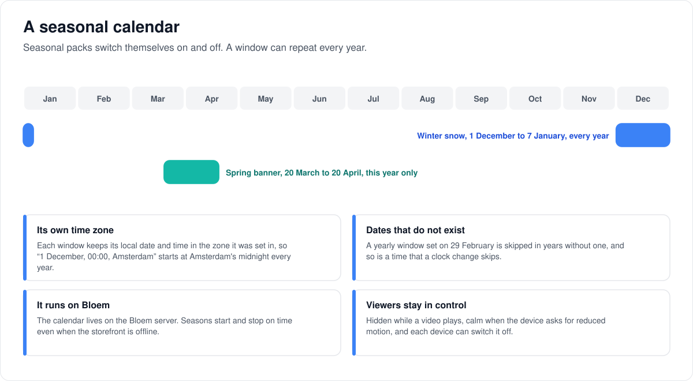
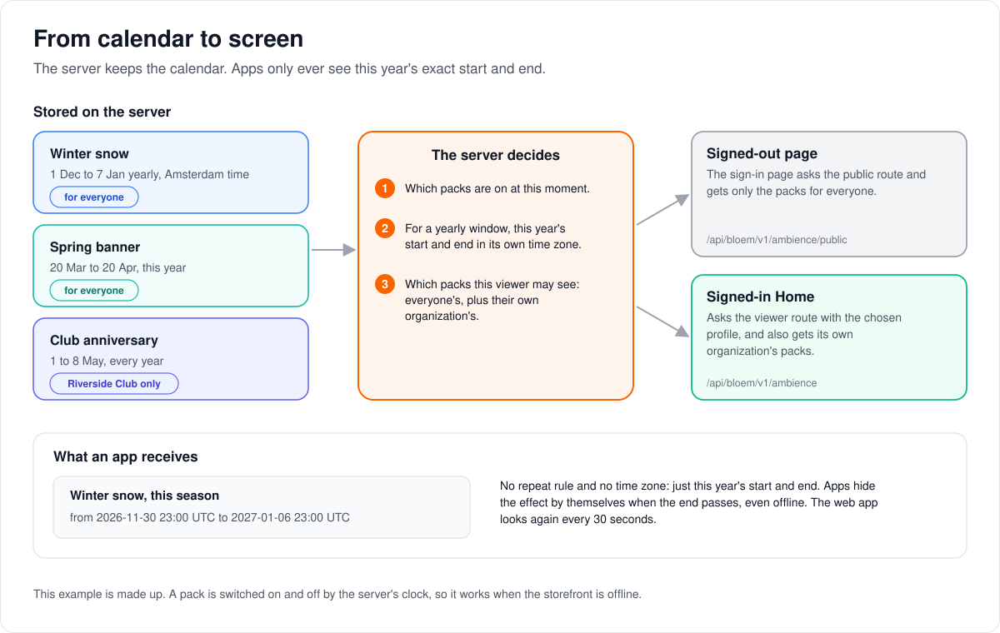

# How seasonal packs are scheduled

> **Provenance and status.** Bloem page, rewritten on 2026-11-01 and checked against
> `main` at `b6039036d`. Seasonal packs are a Bloem addition; Silo has nothing like
> them. This page explains how they switch on and off and who sees them, in plain
> language; the technical rules are in the [For developers](#for-developers) section.

A **seasonal pack** is a light decoration on Home and the sign-in page: falling snow,
a banner or a few small pictures for a season or an occasion. This page walks through
how a pack's calendar works, who sees which packs, what viewers can control, and where
its artwork is kept.

## A pack's calendar

Each pack has a **window**: a start and an end. The pack shows from the start until
just before the end.

1. **Once, or every year.** A window can happen once, or **repeat every year**, even
   across New Year, such as 1 December to 7 January. A repeating window must be
   shorter than a year, and never shows before its first start.
2. **In its own time zone.** A window keeps the date and time it was set in, in its
   own time zone. "1 December, 00:00, Amsterdam" starts at midnight in Amsterdam every
   year. Without a time zone it uses UTC.
3. **Dates that do not exist are skipped.** A yearly window set on 29 February is
   skipped in years without one, and so is a time that a clock change skips.
4. **The server keeps the calendar.** Seasons start and stop on time even when the
   storefront (Bloem Garden) or the admin console is closed.

## From calendar to screen

The server works out which packs are on at this moment. For a repeating window it
works out this year's exact start and end, so apps never need to understand a
calendar: they only receive a start and an end.

- **A signed-out page**, such as the sign-in page, sees only the packs meant for
  **everyone** on the server.
- **A signed-in Home** sees the packs for everyone plus the packs of the viewer's own
  **organization**, once a profile is chosen and its PIN, if it has one, is entered.
- **A new or removed pack** appears or disappears the next time the app checks; the
  web app checks every 30 seconds. **A pack that ends** disappears by itself, even
  if the app cannot reach the server.

## What viewers control

- **Effects hide while a video plays.**
- **Effects stay off when the device asks for reduced motion.**
- **Each device can switch them off** with the **Seasonal effects** button that
  appears in the corner while a pack is on. The choice is remembered in that browser.
- **One pack at a time.** When several packs are on, the web app shows one, so they
  never pile up.

## Artwork

A pack's banner and small pictures (**sprites**) are either uploaded or given as a web
address starting `https://`. Uploads are kept in the same store as the catalog's
artwork, on local disk or S3; see
[campaign and seasonal asset storage](bloem-campaign-asset-storage.md).

## Example: a winter season

This example is made up. A platform administrator creates "Winter snow" for everyone,
from 1 December to 7 January, Amsterdam time, repeating every year. On 30 November
at 23:00 UTC, midnight in Amsterdam, snow starts on every Home and sign-in page. Next
year it comes back by itself. Riverside Club's organization also has its own pack, a
club banner for its anniversary week in May; only Riverside Club's members see it,
and only after they sign in.

## Who can change what

| Who | What they manage |
| --- | --- |
| Platform administrator | Seasonal packs for everyone or for one organization, under **Campaigns & seasonal packs** in the Platform context. |
| The storefront (Bloem Garden) | The same packs, from its Seasonal effects page, with a platform administrator's API key. |
| Organization administrator | Nothing: they cannot publish packs. |
| Viewer | Switching effects off on a device. |

## Words used in the code

| On this page | In the code and database |
| --- | --- |
| Seasonal pack | an ambience pack (`internal/ambience`, table `ambience_packs`) |
| Window, repeat every year, time zone | `window.starts_at`, `window.ends_at`, `window.repeat_yearly`, `window.timezone` |
| For everyone, for one organization | `organization_id` null, or an organization's ID |
| Snow, banner, sprites | `effect_id` (`snow`), `assets.banner_url`, `assets.sprites` |
| Home, sign-in page | `surfaces`: `all`, `home`, `login` |
| Signed-out route | `GET /api/bloem/v1/ambience/public` |
| Signed-in route | `GET /api/bloem/v1/ambience`, advertised as `seasonal_viewer_v1` |
| The web layer | `web/src/components/seasonal/SeasonalLayer.tsx` |

## For developers

- **API:** [messages and promotions](../bloem/api/messages.md): the registry under
  `/api/bloem/v1/admin/platform/ambience`, `GET /api/bloem/v1/ambience`,
  `GET /api/bloem/v1/ambience/public` and `GET /api/bloem/v1/ambience/assets/{ref}`.
  The legacy registry routes are on
  [Bloem's routes on Silo's `/api/v1`](../bloem/api/v1-routes.md#seasonal-packs).

### History

Seasonal ambience is the S-3 "ambience" packs of the
[client engagement spec](../specs/client-engagement.md#c-ambience--seasonal-effects-s-3).
Annual schedules, migration `20260905090908_ambience_annual_schedule.sql` and the web
snow renderer arrived in `f764adad8` (2026-09-05). `53534d9f0` (2026-09-18) added the
embedded web authoring page (`web/src/pages/admin-platform/EngagementPage.tsx`), the
platform-context routes `/api/bloem/v1/admin/platform/ambience` (then in
`internal/api/router_bloem_engagement.go`; since `3eb77be33` mounted by
`mountBloemPlatformStorefront` in `internal/api/router_bloem_storefront.go`), the
viewer route `GET /api/bloem/v1/ambience` (`internal/api/bloem_seasonal_viewer.go`) and
the configured-S3 acceptance recorded below. Since `310c545f9` (2026-10-26) the
ambience evaluator runs inside the server rather than as a bundled worker process; see
[presentation evaluators](bloem-presentation-evaluators.md). On 2026-11-01
(`45abcda81`) the web app's signed-out layer moved from the `ambience` block of
`GET /api/v1/theme/branding` to `GET /api/bloem/v1/ambience/public`.

### Authoring

- Platform administrators manage the registry on the embedded web's **Campaigns &
  seasonal packs** page. The storefront's Seasonal effects page manages the selected
  linked server's same registry over the admin API. Schedules live on the media
  server, so neither authoring tool must stay online for activation or expiry. This is
  independent of announcement authoring.
- Native writes require a Platform administrative context or an enabled
  administrator's unscoped API key (`RequireBloemPlatformAdmin`); organization admins
  cannot publish packs. Editors review publication, confirm deletion and read back
  attempted writes without replay. The registry is last-write-wins, without revision
  locks.
- The admin ambience list answers `packs`, `storage_available` and
  `yearly_scheduling: true`.

### Validation (`ambience.Normalize`)

- `effect_id` is a required lowercase slug of at most 64 characters.
- The window needs both bounds, with `starts_at` before `ends_at`; both are stored in
  UTC. `timezone` must name an IANA time zone and defaults to `UTC`.
- A yearly window must be shorter than one year (`ends_at` before `starts_at` plus one
  year in that zone).
- `intensity` is within 0.0 to 1.0 and defaults to 1.0. `surfaces` come from `all`,
  `home`, `login`, default `["all"]`; `all` absorbs the rest.
- Asset URLs are absolute `https://` URLs or server paths under
  `/api/bloem/v1/ambience/assets/` (or the older `/api/v1/ambience/assets/`). A pack
  holds at most 32 sprites.

### Yearly occurrences

- A schedule window accepts `starts_at`, `ends_at`, `repeat_yearly` and an IANA
  `timezone`. Annual intervals cannot activate before the first start.
- Each occurrence preserves the original local month, day and time in that time zone,
  including seasons crossing New Year (`Window.At`, `internal/ambience/annual.go`).
- Missing calendar dates, such as 29 February in a non-leap year, and wall times
  skipped by daylight saving skip that occurrence. The end is exclusive.
- The server resolves recurring windows before projecting them to clients.
  Client-facing ambience windows are concrete start and end UTC instants; the
  recurrence fields are omitted (`Pack.Wire`). Existing clients, including Apple
  clients, do not need a recurrence interpreter. Jellyfin compatibility endpoints are
  unchanged; this is a Bloem presentation feature.

### Delivery

- `GET /api/bloem/v1/ambience/public` is public and returns the active
  deployment-wide packs (`organization_id` null), always as an array, empty when none
  are active (`ActivePublic`, `internal/api/handlers/bloem_public_ambience.go`). It is
  mounted by `mountBloemPlatformStorefront`.
- `GET /api/bloem/v1/ambience` is mounted only when every authority resolver is
  configured, and `seasonal_viewer_v1` is advertised only then
  (`mountBloemSeasonalViewer`). It requires authentication, native tenant resolution,
  the rate limit, viewer and PIN verification and a verified profile in the active
  current organization, and returns public packs plus that organization's packs
  (`ActiveForBloemViewer`, `internal/ambience/bloem_viewer.go`). Pack content, target
  and membership share one database snapshot, so a concurrent retarget cannot
  authorize an older pack's contents. Legacy account sessions resolve to the default
  organization; while it is still initializing they receive deployment-wide packs
  only. The default-deny route boundary excludes direct-profile sessions. Responses
  use `Cache-Control: private, no-store`.
- The phone apps still read the `ambience` block of `GET /api/v1/theme/branding`
  (public packs) and the packs echoed on `GET /api/v1/notifications/capability`.
- Publication or removal is visible on the next client refresh. Scheduled expiry does
  not require another network response. This matters when the storefront or the
  media server becomes unreachable.

### The web layer (`SeasonalLayer.tsx`)

- It renders snow, or validated banner and sprite artwork (at most six sprites,
  opacity `intensity × 0.2`), on Home (`/`) and sign-in (`/login`), and renders nothing
  while video playback is active or reduced motion is requested.
- It polls every 30 seconds, re-evaluates expiry locally every second and drops data
  older than 45 seconds. The device-local off toggle is stored under the
  `bloem-seasonal-effects` key, wrapped in try/catch.
- Authenticated Home uses `GET /api/bloem/v1/ambience` when `seasonal_viewer_v1` is
  advertised. Sign-in, and Home on a server without viewer delivery, fetch
  `GET /api/bloem/v1/ambience/public` without credentials; that answer is never taken
  for an authenticated one. Requests and cached results are bound to session, profile
  and PIN authority.
- The web app calls none of Silo's `/api/v1`.

### Android

The Android client (a separate repository; not verifiable here) uses the same
concrete windows, polls only while the surface is resumed, and offers its toggle under
Profile. This server change implements no new native-client delivery.

### Artwork storage

Seasonal asset upload uses Silo's catalog **Assets** blob store, the store branding
uses, so it works on local artwork storage as well as S3. `bloemWireServices`
(`cmd/silo/bloem_main.go`) falls back to the public S3 client only when no Assets store
is configured; this has been so since `f293cce0d` (2026-09-23), and earlier versions of
this page said public S3 was required. With no store at all, authoring still supports
HTTPS artwork references, but the registry reports uploads unavailable and the upload
endpoint returns `503`. See
[campaign and seasonal asset storage](bloem-campaign-asset-storage.md).

### Acceptance

Configured-S3 acceptance passed for banner and sprite uploads and decoded Home images,
exact image bytes, MIME types and dimensions, ETag revalidation, input rejection and
current-organization versus public filtering. Temporary assets and storage
configuration were removed and the original settings restored. This does not imply
that every deployment has S3 configured; see
[storage setup](../bloem/overlays/s3-storage-setup.md) and the
[coverage evidence](bloem-web-feature-coverage.md#acceptance-evidence-and-limits).

### Migration and tests

The schema change is additive and uses Goose migration
`20260905090908_ambience_annual_schedule.sql`. Apply it with the normal server
migration procedure before deploying the server implementation. Runtime smoke testing
and database-backed recurrence tests require a disposable PostgreSQL environment;
focused calendar tests do not substitute for that gate.

### Related pages

- [How messages and promotions work](bloem-messages-and-promotions.md).
- [Presentation evaluators](bloem-presentation-evaluators.md).
- [Campaign and seasonal asset storage](bloem-campaign-asset-storage.md).

The pictures are SVG files under `images/seasonal-scheduling/` and `images/messages/`,
drawn by `scripts/bloem/pictures/seasonal_scheduling.py` and `messages.py` through
`scripts/bloem/draw-pictures.py`. Redraw them there, not by hand.
