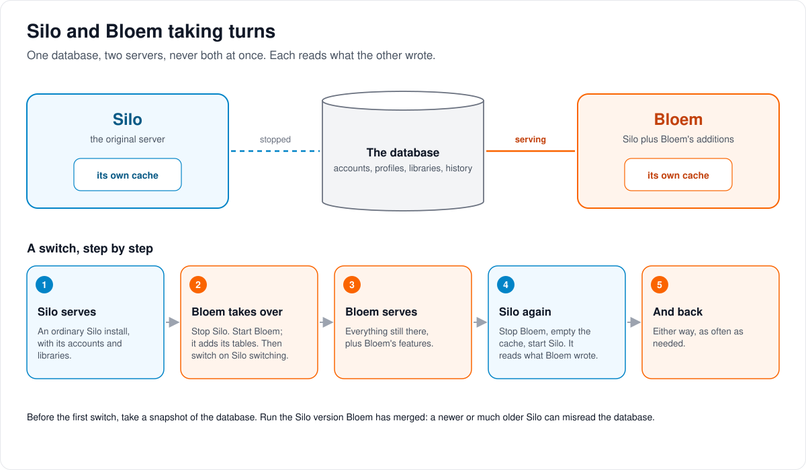
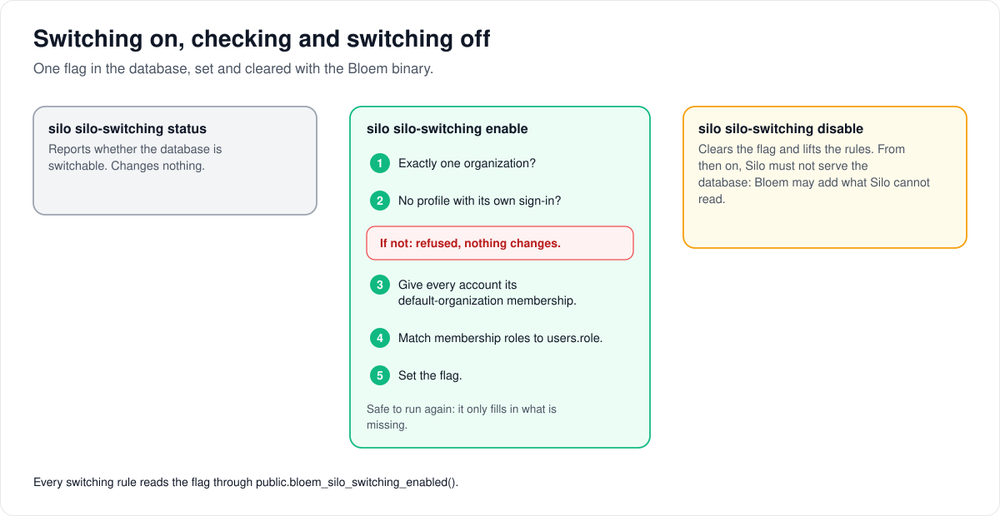
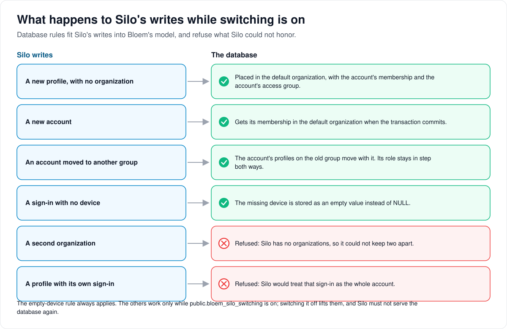

# How Silo backend switching works

> **Provenance and status.** Bloem page, rewritten on 2026-11-01 and checked against
> `main` at `b6039036d`. Silo switching is a Bloem addition: Silo knows nothing about
> it. Its job is to keep a database that Bloem serves readable and writable by an
> unmodified Silo image. The commands, database rules and checks are in the
> [For developers](#for-developers) section; the plain-language tour is
> [switching between Silo and Bloem](bloem-silo-switching-explained.md).

A database can be served by Silo or by Bloem, one at a time, and the person running
the server can switch between them in either direction without losing or corrupting
data. This is what lets a Silo installation try Bloem and go back. This page walks
through the one flag that makes it safe, what the database does with Silo's writes
while the flag is on, and how to switch.

## One database, one server at a time



Account settings live on the accounts table, where Silo keeps them, so both servers
read and write the same columns. What is left is the part of Bloem that Silo cannot
handle: several **organizations** (customers kept apart on one server) and
**profile sign-ins** (a profile with its own email and password). One flag in the
database, **Silo switching**, keeps the database inside what Silo can handle while it
is on.

## Switching on, and off again



1. **Check.** `silo silo-switching status` says whether the database is switchable.
2. **Switch on.** `silo silo-switching enable` refuses unless the database has exactly
   one organization and no profile has its own sign-in. Then it gives every account
   its place in the default organization and sets the flag. Running it again is safe.
3. **Switch off.** `silo silo-switching disable` clears the flag. From then on, Silo
   must not serve the database.

## What happens to Silo's writes



Silo writes accounts, profiles and groups the way Silo always has. While the flag is
on, rules inside the database fit those writes into Bloem's model:

- A new profile lands in the **default organization**, with the account's group.
- A new account gets its place in the default organization when it is saved.
- An account moved to another group takes its profiles on the old group with it.
- A second organization, or a profile with its own sign-in, is refused.

## What Silo doesn't see

While Silo serves, Bloem's extras do nothing, but their data stays in the database and
works again when Bloem serves: plans, Live TV and recordings, storage sources,
campaigns and seasonal packs, and organization domains and branding. Silo serves
every address with the server's own name and look. Jellyfin and Audiobookshelf apps
work with whichever server is running: both servers run Silo's own compatibility
servers.

## Who can change what

| Who | What they manage |
| --- | --- |
| The person running the server | Which server runs, the snapshot before the first switch, and switching on and off with the Bloem binary. |
| Platform administrator | Nothing extra. While switching is on, the database refuses a second organization or a profile sign-in. |

## Words used in the code

| On this page | In the code and database |
| --- | --- |
| Silo switching, the flag | `public.bloem_silo_switching`, read by `public.bloem_silo_switching_enabled()` |
| Switching on, off, check | `silo silo-switching enable`, `disable`, `status` (`cmd/silo/silo_switching_cmd.go`, `internal/tenancy/silo_switching.go`) |
| Default organization | `public.bloem_default_organization_id()` |
| A place in the organization | an `organization_memberships` row |
| Refused | `bloem_silo_switching_single_organization`, `bloem_silo_switching_direct_profile_login` |
| Fitting Silo's writes in | `user_profiles_00_silo_tenancy`, `users_silo_default_membership`, `users_silo_profiles_follow_group` |
| The switch check | `make silo-switch-check`, `make silo-switch-check-all-in-one` (`cmd/bloem-silo-switch-check`) |

## For developers

- **API:** none. The switch is a database contract, not an API: neither server calls
  the other.

History: introduced on 2026-10-09 (`474782ef1` for this page; migrations
`20261009131027_bloem_membership_policy_mirrored.sql` and
`20261009131835_bloem_silo_switching_writes.sql`; `ac79641f0` for profiles, roles and
ungrouped admins). `fc688aca3` (2026-10-13) kept Silo's compatibility data, and
`c84b4f3f8` (2026-10-14) restored the v1 health identity. The current single-flag
design comes from `c60b7008e` (2026-10-26, migration
`20261026003000_bloem_account_policy_on_users.sql`), which moved account policy back
onto `users` and removed the earlier three-phase membership-policy rollout.
`2393c41ee` (2026-10-18) restored Silo's Jellyfin and Audiobookshelf servers in Bloem.
`3b9e96939` (2026-10-31) added the all-in-one check and moved the check's driver to
Silo's `/api/v2`.

**Last verified on 2026-10-31:** both checks below passed with Silo `32a2f63e1` (its
`-base` image and its all-in-one image) against Bloem `4edbee99d`. No later run is
recorded. The November 1 merge of Silo through `63ef34b23` brought no Silo
migrations; it did change two `omnibus/` start scripts (the `NODE_URL` check moved
from `init-config` into Silo itself, and `init-envfile` refuses to start without
root). Bloem's
`20261101055208_bloem_organization_domains` adds two Bloem-only tables.

### The switch

Account policy lives on `users`, where Silo keeps it, so both servers read and write
the same columns. What remains is what Silo cannot honor, and one flag,
`public.bloem_silo_switching`, keeps the database inside it:

| Command | Effect |
|---|---|
| `silo silo-switching status` | Reports whether the database is switchable. |
| `silo silo-switching enable` | Refuses unless there is exactly one organization and no profile has its own login. Then gives every account its default-organization membership, reconciles membership roles from `users.role`, and sets the flag. Idempotent. |
| `silo silo-switching disable` | Clears the flag, lifting the guards below. Silo must not serve the database afterwards. |

Each command takes `-env` (default `.env`) for the bootstrap file that names the
database.

`public.bloem_silo_switching_enabled()` reads the flag; every guard and placement
trigger below checks it. A database that was in the `mirrored` membership-policy phase
before `20261026003000_bloem_account_policy_on_users` kept switching enabled through
that migration.

### Invariants while switchable

- **One organization.** Inserting a second organization, or a membership outside the
  default organization, raises `bloem_silo_switching_single_organization`. Silo has no
  organizations, so it cannot honor a second one. A second organization therefore also
  rules out [organization domains](bloem-organization-domains.md) for anyone but the
  default organization while switching is on.
- **Group moves carry profiles; roles follow both ways.** Bloem applies a profile's own
  access group, so when Silo moves an account to another group, the account's profiles
  that were on the old group move with it (`users_silo_profiles_follow_group`, which
  also lets Silo delete a group after moving its members). `users.role` and the
  membership's `legacy_role` are kept in step (admin or user; other account roles are
  ordinary members). An ungrouped admin stays ungrouped.
- **No direct profile logins.** A profile with its own `login_email` or `password_hash`
  raises `bloem_silo_switching_direct_profile_login`. Silo would treat such a session
  as the whole account.
- **Silo-shaped writes are placed in the default organization.** A profile inserted
  without an organization gets the default organization, the account's membership
  (created if missing) and the account's access group (`user_profiles_00_silo_tenancy`).
  An account still without a membership at commit gets one
  (`users_silo_default_membership`, a deferred trigger that exists only while
  switchable). A Bloem transaction that inserts an account and then alters the `users`
  table fails while switchable, because PostgreSQL refuses `ALTER TABLE` on a table
  with pending trigger events.
- **`auth_sessions.device_id` accepts NULL as `''`.** Upstream writes NULL when a
  client sends no device headers (`auth_sessions_00_device_id_blank`, migration
  `20261009130019_auth_session_device_id_blank.sql`, which applies whether or not
  switching is on).

A new NOT NULL column, constraint or trigger on a table upstream Silo writes (`users`,
`user_profiles`, `auth_sessions`, `access_groups`, ...) must accept Silo's writes while
switchable, with a test beside the existing switching tests
([BLOEM_AGENTS.md](../../BLOEM_AGENTS.md#silo-switching)).

### What Silo does not see

While Silo serves the database, Bloem-only features do nothing: organizations beyond
the default one, entitlement templates, profile logins, Live TV and DVR, native
storage, promotions and ambience, and organization domains and branding
(`bloem_organization_domains`, `bloem_organization_branding`). Their rows stay in the
database and work again when Bloem serves it. Silo answers every host with the
server-wide branding and public URL.

Silo's Jellyfin and Audiobookshelf compatibility servers are shared, not Bloem-only.
Bloem removed both protocols on 2026-10-13 and kept their tables, the author-count view
and their settings for Silo (`fc688aca3`). Since `2393c41ee` (2026-10-18) Bloem runs
both servers again as Silo ships them, so whichever backend is serving reads and writes
those tables. The Jellyfin setting `jellyfin_compat.server_id` (the server identity
that Jellyfin clients recognise) also supplies `server_id` on `GET /api/v1/health` in
both backends, as in Silo. See [protocol compatibility](bloem-compatibility-removal.md).

### Operating rules

- **One backend at a time.** Stop one before starting the other. Running both at once
  is not supported (background jobs, caches and scheduled work assume one owner).
- **Separate caches.** Each backend has its own Redis, flushed before it starts.
- **Silo version pin.** Run a Silo image whose source revision Bloem has already merged
  (an ancestor of the deployed Bloem commit) and that has every Silo migration Bloem
  has applied to the database. A newer upstream can apply database changes Bloem has
  not adapted to; an older one can expect a schema that a later Silo migration changed.
  For example, `20261019181724_hash_api_key_verifiers.sql` replaces the raw
  `api_keys.api_key` column with sha256 verifiers in `key_hash`, which a Silo image
  from before that migration cannot read. From Silo's `c3115d493` (#3319) on, a commit
  tag names Silo's all-in-one image, which runs Silo as `PUID` (911 unless set) rather
  than root. Its `<full SHA>-base` tag is the image Silo published before, which runs
  as root.
- **Rollback point.** Snapshot the database before the first switch.

### Installs on Silo's all-in-one image

Silo's Docker image now carries its own PostgreSQL and Redis, with their data in the
container's `/config` volume. That PostgreSQL listens only on a socket inside the
container (`listen_addresses = ''`), so Bloem's ordinary image cannot reach it. Bloem
wrapped in the same all-in-one layer can: `omnibus/` is Silo's, merged unchanged, and
building it on top of a Bloem image gives a container that opens the same `/config`.

```sh
docker build -f omnibus/Dockerfile --build-arg SILO_IMAGE=<bloem image> \
  -t bloem-server:all-in-one omnibus
```

To switch, stop the Silo container and start this image on the same `/config` with the
same `.env` (the same `SECRET_KEY` and `PUID`). Bloem migrates the database on its
first start. Enable switching from inside the container, as the `silo` account with the
container's environment:

```sh
docker exec -e PATH=/command:/usr/local/bin:/usr/bin:/bin <container> \
  with-contenv s6-setuidgid silo \
  sh -c 'cd /config/silo && HOME=/config/silo silo silo-switching enable'
```

`with-contenv` and `s6-setuidgid` are s6 tools under `/command`, which a `docker exec`
shell does not have on its `PATH`. The container environment holds `DATABASE_URL` and
is readable only by root, and the bundled PostgreSQL admits only the `silo` account, so
the command starts as root and drops to `silo`. `silo-switching status` works the same
way. The image's init scripts need root: since Silo's `01cb809f7` (#3338) a container
started as another user stops at `init-envfile`.

The bundled Redis keeps its data in `/config/redis`, which both images would share.
Delete what is in it while neither container runs, at each switch, so that each
backend starts with an empty cache. Bloem does not publish an all-in-one image; build
it from the Bloem image you deploy.

### Checking a change

`make silo-switch-check SILO_IMAGE=<silo image by digest> BLOEM_IMAGE=<tag>`
(`scripts/bloem/silo-switch-check.sh`) runs both images against one database:

1. Silo installs and creates accounts.
2. Bloem migrates the database and enables switching.
3. Bloem, Silo and Bloem again each read what the previous backend wrote and write
   something the next one must read.

`make silo-switch-check-all-in-one SILO_IMAGE=<Silo all-in-one image by digest> BLOEM_IMAGE=<tag>`
(`scripts/bloem/silo-switch-check-all-in-one.sh`) runs the same three steps on one
`/config` volume: Silo's all-in-one image creates it, and Bloem wrapped in the
all-in-one layer takes it over.

The steps talk to both servers through Silo's `/api/v2` (`cmd/bloem-silo-switch-check`),
so the check keeps working after Silo retires `/api/v1`. The scripts still wait on
`/api/v1/ready`, the operational probe Silo keeps.

Run both whenever a change touches a table that both servers write. Run them too after
merging upstream changes that add Silo writes to tables Bloem constrains, or that change
`omnibus/`. The database-level tests are in `internal/tenancy/silo_switching_test.go`,
`internal/tenancy/silo_switching_writes_test.go`,
`internal/auth/bloem_repository_switching_test.go`,
`migrations/bloem_account_policy_on_users_test.go` and
`migrations/auth_session_device_id_blank_test.go`; the Pastime removal's switching
test is `internal/tenancy/bloem_pastime_removal_switching_test.go`.

### Related pages

- [Switching between Silo and Bloem](bloem-silo-switching-explained.md): the same
  subject in plain language, with both install layouts.
- Silo's [omnibus image](omnibus-image.md): how the all-in-one container starts and
  where it keeps its data.
- [How organizations work](bloem-organizations.md): the default organization and why
  Silo can't keep a second one.
- [Bloem's adapters over Silo](bloem-upstream-adapters.md#migration-filesystem): the
  migration adapters a database replays before switching became one flag.

The pictures are SVG files under `images/silo-backend-switching/` and
`images/silo-switching/`, drawn by `scripts/bloem/draw-pictures.py`. Redraw them there,
not by hand.
