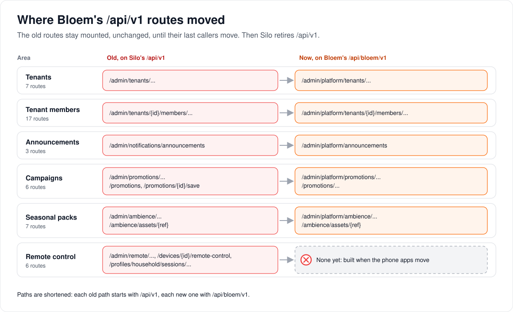

# Bloem routes on Silo's `/api/v1`

> **Gone since 2026-11-11.** Silo retired `/api/v1` (Silo #3200, merged into Bloem in
> `26cf9b3e4`), and every route on this page now answers `410 Gone` with
> `client_upgrade_required`. The page records what they were and where each one moved.

> **Provenance and status.** Bloem page, rewritten on 2026-11-01 from the handlers at
> `b6039036d`, and brought up to date on 2026-11-11, when these routes were retired. They
> were Bloem additions to Silo's `/api/v1`; no OpenAPI document described them, so this page
> is written by hand and names the retired paths as history. The technical record is in the
> [For developers](#for-developers) section. The typed `/api/bloem/v2` operations are on the
> [generated topic pages](README.md).

Before Bloem had its own API, it added some routes to Silo's `/api/v1`. Silo retired
`/api/v1` on 2026-11-11, and these routes went with it. This page says what they were, where
each one moved, and who still called them at the end.

## What these routes were and where they went

Bloem added six groups of routes to `/api/v1`:

- **Tenants** and **tenant members**: the storefront's view of a **reseller organization**
  and its members.
- **Announcements**: messages a platform administrator sends to viewers' inboxes.
- **Campaigns**: promotional cards on Home, on a title and around playback.
- **Seasonal packs**: the seasonal look of the apps, with uploaded artwork.
- **Remote control**: sending a command, such as pause, to a playing device.

Each group except remote control has a replacement on Bloem's own API, `/api/bloem/v2`.
Remote control is dormant until it has native routes. **Nothing is added here, and nothing in
Bloem calls these paths.**

## Who called them at the end

- **The storefront (Bloem Garden)** and **the web app** had left them by 2026-11-01.
- **Bloem's phone and TV apps** still called the viewer's campaign routes, remote control, and
  (on Apple) profile sign-in. Those calls now answer `410 Gone`.
- A copy of an old `/api/v1/ambience/assets/...` artwork path kept outside Bloem's tables,
  such as a campaign card someone saved to their inbox earlier, no longer loads.

See [leaving Silo's `/api/v1`](../../architecture/bloem-leaving-silo-v1.md) for the plan and
how it ended.

## Example: retiring a reseller organization

This example is made up.

Riverside Club cancels on the storefront. Before 2026-10-31 the storefront retired it with
`DELETE /api/v1/admin/tenants/{id}`. Now it sends `DELETE
/api/bloem/v2/admin/platform/tenants/{id}`: same handler, same result. Riverside Club stays on
record, suspended; its members are removed; and accounts with no other organization are
deleted. Since 2026-11-11 the old route answers `410 Gone`.

## Who can change what

| Who | What they manage |
| --- | --- |
| Platform administrator | Everything that was under `/api/v1/admin/...` here, with an account that had the `admin` role, acting as itself; today through `/api/bloem/v2/admin/platform/...`. |
| The storefront | Tenants, members and their accounts, now through `/api/bloem/v2/admin/platform/...`. |
| Viewers | Their own campaign cards and inbox saves, through the apps. |
| An account's main profile | Remote control of the household's own sessions. |

## Words used in the code

| On this page | In the code |
| --- | --- |
| These routes | `mountBloemLegacyAdminV1`, `mountBloemPromotionsV1` and `mountBloemPublicV1` in `internal/api/router_bloem_wiring.go`, and the household and device routes in `internal/api/router.go`, all removed on 2026-11-11 |
| Tenant | an organization, from the storefront's side (`internal/api/handlers/admin_tenants.go`) |
| Seats, shared video conversions | `limits.slots`, `limits.transcodes` |
| Suspended | `frozen`, with `frozen_reason` `quota` or `admin` |
| Campaign | promotion |
| Seasonal pack | ambience pack |
| Their replacements | `mountBloemPlatformStorefront` (`internal/api/router_bloem_storefront.go`) and the promotions viewer routes |

## For developers

- **API:** the replacements are on the generated pages:
  [organizations](organizations.md) (tenants, members, accounts, domains and branding) and
  [messages](messages.md) (announcements, campaigns, seasonal packs, `GET
  /api/bloem/v2/ambience/public`). The plan and how it ended are on
  [leaving Silo's `/api/v1`](../../architecture/bloem-leaving-silo-v1.md).

> **Retired.** Silo retired `/api/v1` on 2026-11-11, and these routes went with it: each
> answers `410 Gone` with `client_upgrade_required`. Each section names its replacement.
> The sections below record the contract as it was.

The routes were registered by `mountBloemLegacyAdminV1`, `mountBloemPromotionsV1` and
`mountBloemPublicV1` in `internal/api/router_bloem_wiring.go`, and the household and device
routes in `internal/api/router.go`; each block existed only when its service was wired. The
named handlers stay where native routes reuse them.

### Conventions

- **Base path.** Every path below started at `/api/v1` on the server's main address.
- **Administrative routes** (`/api/v1/admin/...`) sit behind Silo's acting-administrator gate:
  a bearer session or API key of an account with the `admin` role, acting as itself (see
  Silo's [admin API](../../admin-api.md)). These are platform-administrator routes;
  organization administrators use `/api/bloem/v2/admin/organization/...`.
- **Errors** use Silo's v1 body, `{"error": "<code>", "message": "<text>"}`. The codes for each
  route are listed with it.

| Area | Routes | Replacement |
| --- | --- | --- |
| [Tenants](#tenants-reseller-organizations) | 7 | `/api/bloem/v2/admin/platform/tenants` ([organizations API](organizations.md)) |
| [Tenant members](#tenant-members) | 17 | `/api/bloem/v2/admin/platform/tenants/{tenant_id}/members` ([organizations API](organizations.md)) |
| [Announcements](#announcements) | 3 | `/api/bloem/v2/admin/platform/announcements` ([messages API](messages.md)) |
| [Campaigns](#campaigns) | 6 | authoring: `/api/bloem/v2/admin/platform/promotions`; viewer cards: `/api/bloem/v2/promotions` ([messages API](messages.md)) |
| [Seasonal packs](#seasonal-packs) | 7 | `/api/bloem/v2/admin/platform/ambience` and the public `/api/bloem/v2/ambience/assets/{ref}` ([messages API](messages.md)) |
| [Remote control](#remote-control) | 6 | none: dormant ([admin remote control](../../architecture/admin-remote-control.md)) |

Bloem's other additions to `/api/v1/admin/users/{user_id}` (profiles, devices, sign-in
sessions) and account create and update with a plan are replaced by
`/api/bloem/v2/admin/platform/accounts` ([organizations API](organizations.md)); the rest of
the account routes were Silo's, whose replacement is Silo's `/api/v2/admin/users`. The
`ambience` block Bloem added to Silo's `GET /api/v1/theme/branding`, which the phone apps read
on signed-out pages, is replaced by the public `GET /api/bloem/v2/ambience/public`. Bloem's
`GET /api/v1/admin/host-stats` server-load reading has no replacement; Silo's
`GET /api/v2/admin/system/resources` reports the same measurements. An
organization's domains and branding exist only on the native routes
(`/api/bloem/v2/admin/platform/tenants/{id}/domains` and `.../branding`).

### Tenants (reseller organizations)

Handler: `internal/api/handlers/admin_tenants.go`. A tenant **is** an organization; these
routes are the storefront's view of one. The storefront states seats and conversions here;
Bloem enforces them when members are added (seats) and when playback starts (conversions and
the frozen flag).

#### The tenant object

| Field | Type | Description |
| --- | --- | --- |
| `tenant_id` | string (UUID) | The organization's ID. |
| `name` | string | Display name. |
| `external_ref.operator_id` | string | The storefront operator's reference. |
| `external_ref.service_id` | string | The storefront's service reference. Creation is idempotent on it. |
| `limits.slots` | integer | Seats: the most members the organization may have. At least 1. |
| `limits.transcodes` | integer | Shared video conversions for all members together. 0 or more. |
| `usage.slots_used` | integer | Members now. |
| `frozen` | boolean | Suspended: members are refused. |
| `frozen_reason` | string, optional | `quota` (more members than seats; lifts by itself) or `admin` (lifts only on thaw). |
| `applied_entitlement_revision` | integer, optional | The plan revision applied at creation. |

#### `POST /api/v1/admin/tenants`

Create a reseller organization. Idempotent on `external_ref.service_id`: a replay returns the
same organization instead of creating a second.

| Body field | Type | Required | Description |
| --- | --- | --- | --- |
| `name` | string | yes | Display name. |
| `external_ref.operator_id` | string | | Storefront operator reference. |
| `external_ref.service_id` | string | yes | Storefront service reference. |
| `limits.slots` | integer | yes | At least 1. |
| `limits.transcodes` | integer | | Shared conversions. |
| `entitlement_template_key` | string | | Plan to apply to the organization. |
| `entitlement_template_revision` | integer | | Exact revision of that plan. |

`201` with the tenant object. `400 invalid_json`; `422 validation` (no name, no service
reference, or no seat); `500 internal_error`.

#### `GET /api/v1/admin/tenants`

Every reseller organization, as a bare JSON array of tenant objects with live usage. `200`;
`500 internal_error`.

#### `GET /api/v1/admin/tenants/{id}`

One tenant object. `200`; `404 not_found` for a malformed or unknown ID (the two are not told
apart); `500 internal_error`.

#### `PATCH /api/v1/admin/tenants/{id}/limits`

Change seats and conversions in place. Body: `{"slots": <int ≥ 1>, "transcodes": <int ≥ 0>}`.
Dropping seats below the members in use suspends the organization at once with reason `quota`
until members are removed. `200` with the tenant object; `400 invalid_json`; `404 not_found`;
`422 validation`; `500 internal_error`.

#### `POST /api/v1/admin/tenants/{id}/freeze`

Suspend (reason `admin`), for example for non-payment: members are refused new sessions and
playback; data is kept. `204`; `404 not_found`; `500 internal_error`.

#### `POST /api/v1/admin/tenants/{id}/thaw`

Lift an `admin` suspension. An organization still over its seats stays suspended with reason
`quota`. `204`; `404 not_found`; `500 internal_error`.

#### `DELETE /api/v1/admin/tenants/{id}`

Retire the organization: it stays on record, suspended, with its external reference cleared;
its memberships are removed; accounts with no other organization and no platform obligation
are deleted. `204`; `404 not_found`; `503 tenant_unavailable` when retirement is not wired;
`500 internal_error`. See [lifecycle safety](../../architecture/bloem-lifecycle-safety.md).

### Tenant members

Handler: `internal/api/handlers/admin_tenant_members.go`. Every route answers `404 not_found`
for a malformed tenant or user ID, or a user who is not a member of that tenant.

#### The member object

| Field | Type | Description |
| --- | --- | --- |
| `user_id` | integer | The account ID. |
| `username` | string | Sign-in name. |
| `email` | string | Email address. |
| `status` | string | `active`, or `suspended` when the account is disabled. |

#### Members

| Route | Body | Result |
| --- | --- | --- |
| `GET /api/v1/admin/tenants/{tenant_id}/members` | | `200`, array of member objects. |
| `POST /api/v1/admin/tenants/{tenant_id}/members` | `username`, `email`, `password`; header `Idempotency-Key` (required) | `201` member; `200` for a replay of the same key and body. |
| `GET /api/v1/admin/tenants/{tenant_id}/members/{user_id}` | | `200` member. |
| `PUT /api/v1/admin/tenants/{tenant_id}/members/{user_id}` | optional `username`, `email` | `200` member. |
| `DELETE /api/v1/admin/tenants/{tenant_id}/members/{user_id}` | | `204`. |
| `POST /api/v1/admin/tenants/{tenant_id}/members/{user_id}/suspend` | | `200` member, `status: suspended`. |
| `POST /api/v1/admin/tenants/{tenant_id}/members/{user_id}/resume` | | `200` member, `status: active`. |
| `POST /api/v1/admin/tenants/{tenant_id}/members/{user_id}/reset-password` | `password` | `200` member. |

Errors: `400 bad_request` (invalid body); `400 idempotency_key_required`;
`422 slot_quota_exceeded` (no free seat); `409 username_conflict`; `409 idempotency_conflict`
(the key was used for a different command); `500 internal_error`.

#### Profiles, devices and sign-in sessions

These routes check the membership, then hand the request to Silo's own admin-user handler for
the same resource, limited to that organization. Bodies and responses are Silo's: see the
[admin users API](../../admin-users-api.md).

| Route | Silo handler |
| --- | --- |
| `GET`, `POST /api/v1/admin/tenants/{tenant_id}/members/{user_id}/profiles` | list, create a profile |
| `PUT`, `DELETE /api/v1/admin/tenants/{tenant_id}/members/{user_id}/profiles/{profile_id}` | update, delete a profile |
| `GET /api/v1/admin/tenants/{tenant_id}/members/{user_id}/devices` | list devices |
| `DELETE /api/v1/admin/tenants/{tenant_id}/members/{user_id}/devices/{device_id}` | remove a device |
| `GET /api/v1/admin/tenants/{tenant_id}/members/{user_id}/auth-sessions` | list sign-in sessions |
| `DELETE /api/v1/admin/tenants/{tenant_id}/members/{user_id}/auth-sessions/{session_id}` | end one session |
| `DELETE /api/v1/admin/tenants/{tenant_id}/members/{user_id}/auth-sessions` | end every session |

### Announcements

Handler: `internal/api/handlers/admin_announcements.go`; rules in
[server admin announcements](../../architecture/admin-announcements.md).

#### `GET /api/v1/admin/notifications/announcements`

`200 {"announcements": [Announcement, ...]}`, including withdrawn ones.

#### `POST /api/v1/admin/notifications/announcements`

Publish at once and deliver to every recipient's inbox. Body up to 64 KiB:

| Field | Type | Description |
| --- | --- | --- |
| `type` | string | `system.announcement` (informational) or `system.alert` (operational). |
| `body.title` | string | Up to 120 characters. |
| `body.body` | string | Up to 2,000 characters. |
| `body.severity` | string | `info`, `warning` or `critical`. A critical message is never dismissible. |
| `body.dismissible` | boolean | Whether viewers can dismiss it. |
| `body.deeplink`, `body.image_url` | string, optional | Up to 2,048 characters each. |
| `body.cta` | object, optional | `label` (up to 40 characters) and `url`. |
| `body.expires_at` | string (date-time), optional | When it disappears. |
| `targeting.audience` | string | `all`, `role`, `organization`, `library` or `explicit`. |
| `targeting.role` | string | For `role`: `admin` or `user`. |
| `targeting.organization_id` | string | For `organization`: its active members. |
| `targeting.library_id` | integer | For `library`: every profile that can see the library. |
| `targeting.user_ids`, `targeting.profile_ids` | arrays | For `explicit`: every profile of each listed account, plus each listed profile. |

`201` with the Announcement: `id`, `type`, `body`, `targeting`, `created_by`,
`recipient_count`, `created_at`, `withdrawn_at`. `400 bad_request` (invalid body or alert
fields); `422 no_recipients`; `503 unavailable`; `500 internal_error`.

#### `DELETE /api/v1/admin/notifications/announcements/{id}`

Withdraw it; the record stays. Idempotent. `404 not_found`; `503 unavailable`.

### Campaigns

Handlers: `internal/api/handlers/admin_promotions.go` (authoring) and
`internal/api/handlers/promotions.go` (viewers). The authoring routes use the same registry and
the same JSON as the typed platform routes, so their schemas are on the
[messages API page](messages.md): `BloemPromotionBody` in, `Promotion` out.

| Route | Result |
| --- | --- |
| `GET /api/v1/admin/promotions` | `200 {"promotions": [...], "surfaces": [...]}`. |
| `POST /api/v1/admin/promotions` | `201` Promotion. |
| `PUT /api/v1/admin/promotions/{id}` | `200` Promotion. |
| `DELETE /api/v1/admin/promotions/{id}` | `204`. |

Authoring errors: `400 bad_request`; `404 not_found`; `503 unavailable`; `500 internal_error`.

The viewer routes below are replaced by `GET` and `POST /api/bloem/v2/promotions...`, which
also serve Home cards with the row they go in, and by
`PUT /api/bloem/v2/promotions/{id}/dismissals/{surface}`. That last one replaces hiding a card
through Silo's `PUT /api/v1/home/dismissals/promo:<surface>/<id>`, which accepts the `promo:`
surfaces only on `/api/v1` (Silo's `/api/v2` dismissals take `continue_watching` and
`next_up`). The native viewer routes are advertised as `promotions_viewer_v1`.

#### `GET /api/v1/promotions?surface=<surface>&content_id=<id>`

The campaign cards for one surface, for the acting profile (requires `X-Profile-Id`).
`surface` is `detail`, `pre_playback` or `in_playback`; Home cards are not served by this
route. `200 {"surface": "...", "promotions": [Card, ...]}`. A card has `id`, `kicker`,
`headline`, `subtitle`, `image_url`, `deeplink`, `cta`, `dismissible` and `expires_at`, and
for `in_playback` also `playback_style` (`card` or `pip`), `video_url` and `duration_seconds`
(5 to 60). Child or unclassified profiles get no `in_playback` cards. `400 bad_request` (bad
surface); `503 unavailable`.

#### `POST /api/v1/promotions/{id}/save?content_id=<id>`

Save an `in_playback` campaign to the acting profile's inbox, after checking again that the
profile may see it. Retries are safe. `200 {"status": "saved"}`; `400 unavailable` when the
campaign cannot be saved for this profile; `503 unavailable` when the inbox is off. Details in
[playback overlays](../../architecture/playback-overlays.md).

### Seasonal packs

Handler: `internal/api/handlers/admin_ambience.go`. Same registry and JSON as the typed
platform routes ([messages API page](messages.md): `BloemAmbienceBody` in, `Pack` out).

| Route | Result |
| --- | --- |
| `GET /api/v1/admin/ambience` | `200 {"packs": [...], "storage_available": bool, "yearly_scheduling": true}`. |
| `POST /api/v1/admin/ambience` | `201` Pack. |
| `PUT /api/v1/admin/ambience/{id}` | `200` Pack. |
| `DELETE /api/v1/admin/ambience/{id}` | `204`. |
| `POST /api/v1/admin/ambience/assets` | Multipart `file` (PNG, WebP, JPEG or GIF); `201 {"url", "asset"}`. |
| `POST /api/v1/admin/ambience/{id}/assets` | Multipart upload attached to a pack's `banner` or `sprite` slot; `201 {"url", "slot", "pack"}`. |
| `GET /api/v1/ambience/assets/{ref}` | Public: served an uploaded artwork file, for the sign-in page. Replaced by `GET /api/bloem/v2/ambience/assets/{ref}`. |

Errors: `400 bad_request` (invalid body, bad slot, checksum mismatch); `404 not_found`;
`413 too_large`; `415 unsupported_image`; `503 unavailable` (no ambience, or no asset
storage); `500 internal_error`. Scheduling rules:
[seasonal scheduling](../../architecture/seasonal-scheduling.md).

### Remote control

Handler: `internal/api/handlers/remote_control.go`, removed on 2026-11-11 (the file keeps only the inert playback hooks); rules in
[admin remote control](../../architecture/admin-remote-control.md).

#### `PUT /api/v1/devices/{device_id}/remote-control`

A client advertises which commands its device accepts, for the calling profile. Body:
`{"version": <int>, "commands": ["pause", ...]}`; `200 {"device_id", "version", "commands"}`.
A device that advertised nothing is never sent a command.

#### `GET /api/v1/admin/remote/sessions`

Playback sessions in the administrator's scope, each with `remote_control` (`device_id`,
`connected`, `controllable`, `commands`) and a `plan_summary` (play method, codecs,
resolution, bitrates, `is_paused`, `position_seconds`): `200 {"sessions": [...]}`.

#### `POST /api/v1/admin/remote/sessions/{session_id}/commands`

#### `POST /api/v1/profiles/household/sessions/{session_id}/commands`

Send one command to a live session. The household route is for the account's main profile (or
an administrator) and only reaches the account's own sessions, with the reduced command set
`pause`, `unpause`, `play_pause`, `seek`, `stop`, `set_volume`, `set_audio_track`,
`set_subtitle_track` and `display_message`. Body:
`{"name": "<command>", "payload": {...}, "reason": "..."}`; `terminate` requires a `reason`.
Session commands are never queued, so `ttl_seconds` is refused. `201` with the Command.
Errors: `400 bad_request`, `unknown_command`, `invalid_payload`, `reason_required`;
`403 forbidden` (outside your scope), `command_not_allowed` (household); `404 not_found`;
`409 session_not_connected`, `replan_unavailable`; `429 rate_limited`;
`503 service_unavailable`.

#### `GET /api/v1/admin/remote/commands/{command_id}`

One Command: `command_id`, `scope`, `session_id`, `device_id`, `user_id`, `profile_id`,
`tenant_id`, `name`, `payload`, `issued_by`, `issuer_kind`, `reason`, `state` (`sent`,
`accepted`, `done`, `rejected`, `expired`, `rejected_unsupported`, `failed`), `result`,
`error` and the `created_at`, `sent_at`, `acked_at`, `finished_at` and `expires_at` times.
`404 not_found`.

#### `GET /api/v1/admin/remote/audit`

Commands newest first, filtered by `session_id`, `issued_by` and `issuer_kind`, paged by
`limit` (default 50) and `offset`: `200 {"commands": [...], "limit", "offset"}`.

Technical pages:

- [Leaving Silo's `/api/v1`](../../architecture/bloem-leaving-silo-v1.md).
- [How organizations work](../../architecture/bloem-organizations.md) and
  [lifecycle safety](../../architecture/bloem-lifecycle-safety.md).
- [Messages and promotions](../../architecture/bloem-messages-and-promotions.md).
- [Admin remote control](../../architecture/admin-remote-control.md).

The picture is an SVG file under `docs/architecture/images/v1-routes/`, drawn by
`scripts/bloem/draw-pictures.py`. Redraw it there, not by hand.
