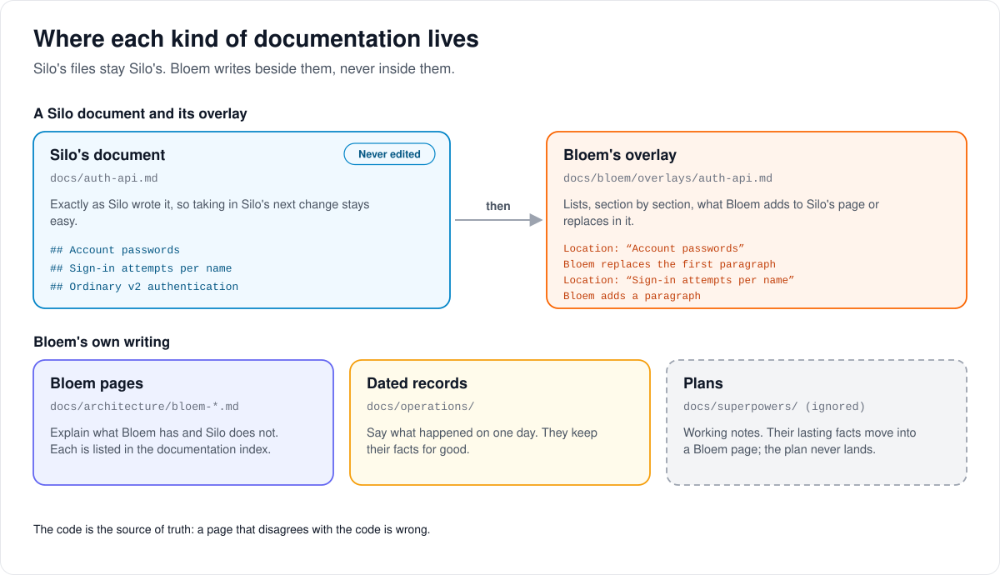
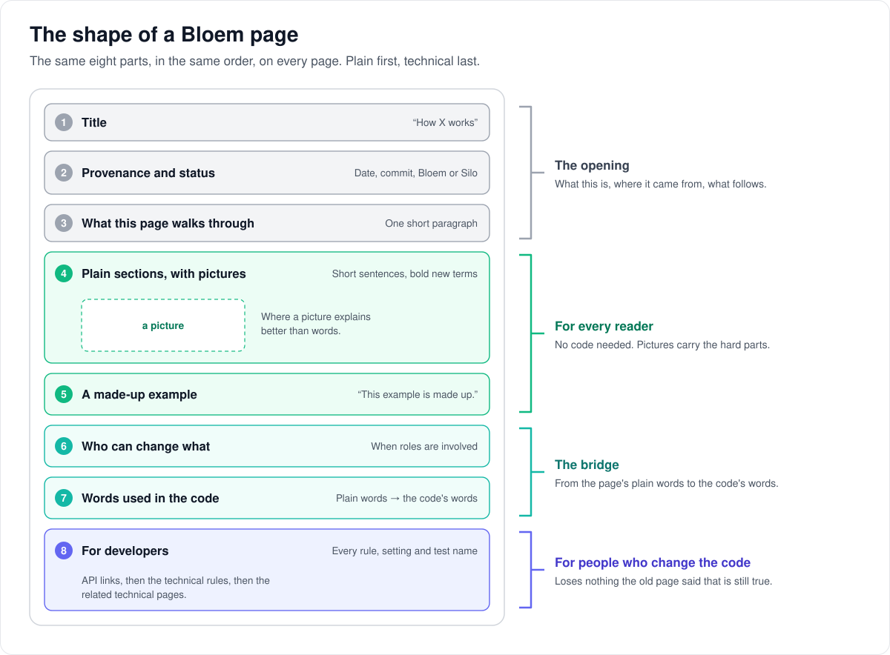

# Writing Bloem documentation

> **Provenance and status.** Bloem page, rewritten on 2026-11-01 and checked against
> `main` at `b6039036d`, which includes Silo through `63ef34b23`; its API facts were
> checked again on 2026-11-11, after Silo retired its v1 API. These rules are
> Bloem's own: Silo's documents stay as Silo wrote them, and Bloem writes its pages
> beside them. The technical rules are in the [For developers](#for-developers)
> section.

Every new or changed Bloem page follows the rules on this page. It walks through
where a page belongs, the shape every page takes, how its pictures are drawn, what
stays out of Bloem's pages, and what to check before a page lands. The model page is
[How organizations work](../architecture/bloem-organizations.md); read it first.

## Where a page belongs



Bloem Server is a **tracking fork** of Silo Server: it takes in Silo's work every
day ([how Bloem keeps up with Silo](../architecture/bloem-following-silo.md)). So
each kind of writing has its own home:

- **Silo's documents** are Silo's. A Markdown file that also exists in Silo's `main`
  stays exactly as Silo wrote it, so taking in Silo's next change stays easy.
- **An overlay** is a Bloem page that lists, section by section, what Bloem adds to
  one Silo document or replaces in it. It lives under `docs/bloem/overlays/`, at the
  Silo document's own path. A reader reads Silo's page first, then the overlay.
- **A Bloem page** explains something Bloem has and Silo does not, such as
  organizations, plans or Live TV. It lives in `docs/architecture/` (named
  `bloem-*.md`) or in `docs/bloem/`.
- **A dated record** says what happened on one day, such as a deployment and the
  checks run with it. It lives in `docs/operations/` and keeps its facts for good.
- **A plan** is a temporary working file. It stays in the ignored
  `docs/superpowers/` folder and never lands; its lasting facts move into a Bloem
  page first.

Every new Bloem page is also listed in the [documentation index](README.md).

## The shape of every page



A page has the same eight parts, in this order:

1. **A title** that names the subject plainly. "How X works" suits a page that
   explains a mechanism.
2. **A provenance note**, a quote block that starts "**Provenance and status.** Bloem
   page, rewritten on (date) and checked against `main` at (commit)." One or two
   more sentences say what the page is, whether it is a Bloem addition to Silo, and
   that the technical rules are in the For developers section.
3. **One short paragraph** that says what the page walks through.
4. **Plain sections** for a reader who does not work on the code. Use short
   sentences, active voice and everyday words. Put each new term in bold where it
   first appears, and explain it there. Number the steps of a sequence. Add a
   picture where a picture explains better than words: a flow, a set of tiers, who
   talks to whom, a before and after. Not every page needs one, but every major
   subject has at least one.
5. **A made-up example** where it helps. Say so first: "This example is made up."
   Never use a real customer.
6. **A "Who can change what" table** when roles are involved.
7. **A "Words used in the code" table** that maps the page's plain words to tables,
   packages, types, settings and routes.
8. **"For developers"**: links to the API pages, then every technical rule,
   invariant, protocol detail, setting, error code, file path and test name. The
   plain sections may simplify; this section loses nothing. Sub-headings are fine.
   It ends with the related technical pages.

An overlay keeps the same note and opening, then lists its changes by Silo's
sections (see [overlays](#overlays) below).

### How the words read

- Write plain English with the model page's spelling. Code identifiers keep their
  own spelling: prose may say "colours", code says `accent_color`.
- Keep Bloem's words, and keep them distinct: **platform**, **organization**,
  **default organization**, **reseller organization**, **account**, **profile**,
  **plan**, **seat**, **platform administrator**, **organization administrator**,
  and the **storefront** (Bloem Garden).
- Keep public text public. Never name private hostnames, IP addresses, container
  numbers, the production domain, customers, local folders or worktrees. Write "the
  server's public address" for the address people use. Link with
  repository-relative paths.
- Lead with what a reader needs. A page says what the code does today; history goes
  in For developers, with its commits and dates.

## Pictures


Pictures are drawn by code, never by hand, so the next change can redraw them:

1. **Write one drawing module per page** in `scripts/bloem/pictures/`, named after
   the page. A module named `foo_bar.py` draws into
   `docs/architecture/images/foo-bar/`. It lists its pictures in `PICTURES`, and
   each one gets a title and a description that a screen reader can read.
2. **Use the shared kit**, `kit.py`: its boxes, cards, arrows, header, footer and
   tier colours keep every picture in one visual language. Do not change `kit.py`
   or another page's module; put a small helper you need in your own module.
3. **Draw your pages only:**
   `python3 scripts/bloem/draw-pictures.py foo-bar`.
4. **Look at each picture** in a headless browser screenshot. Fix any text that
   overlaps, touches a border or runs off the edge, and any arrow that crosses
   text, then draw again.
5. **Link it from the page** with alt text that says what the picture shows, not
   just its title.
6. **Commit the module and its SVG files together.** CI redraws every picture and
   fails when a committed file differs.

## What stays out

- **Silo's own files.** A documentation change never edits a file that also exists
  in Silo's `main`. A Bloem difference goes in an overlay.
- **Dated records.** A record in `docs/operations/` keeps the facts of its day. A
  restyle leaves it alone, and a current page never presents an old record as
  today's state.
- **Plans and specs.** They stay in `docs/superpowers/` until their lasting facts
  move into a Bloem page.
- **Guesses.** The code is the source of truth. A page that disagrees with the code
  is wrong, so check each claim before you keep it.

## Overlays

An overlay page has this shape:

1. The title "Bloem overlay:" and the Silo document's title.
2. The provenance note, naming the Silo document it covers.
3. A plain opening: what Bloem changes in that document, and why.
4. "For developers", with where the overlay came from (its commits and dates) and
   then one block per Silo section, in the Silo document's order. Each block starts
   with its place in Silo's text, for example: **Location:** section "Account
   passwords", the first paragraph. **Bloem replaces** it with: … or **Bloem adds:** …

An overlay never copies a Silo section it does not change. When Silo rewrites a
section an overlay points at, the overlay moves its anchor and says so.

## Example: documenting a new feature

This example is made up.

Bloem adds a made-up feature: a limit on how many titles a profile can download.

1. A new page, `docs/architecture/bloem-download-limits.md`, explains it with the
   eight parts above. Its title is "How download limits work".
2. A drawing module, `scripts/bloem/pictures/download_limits.py`, draws one picture
   of the limit narrowing from plan to profile into
   `docs/architecture/images/download-limits/`.
3. Silo's `docs/downloads-api.md` gets nothing. The new refusal goes in an overlay
   at `docs/bloem/overlays/downloads-api.md`, under the Silo section it changes.
4. The documentation index lists both pages.
5. The writer runs the checks below, looks at the picture, and lands it all in one
   change.

## Who can change what

| Who | What they change |
| --- | --- |
| Silo | Silo's own files. Bloem takes them in unchanged through the daily sync. |
| A Bloem contributor | Bloem pages, overlays, the documentation index, and drawing modules for their own pages. |
| The generators | The API-by-topic pages, the API catalogue, the OpenAPI documents and the pictures. Change their source, then regenerate; never edit the output. |
| Nobody | The facts of a dated record. A later page may correct or supersede it, but the record stays as written. |

## Words used in the code

| On this page | In the repository |
| --- | --- |
| Silo's documents | any Markdown file that also exists in Silo's `main` (`git cat-file -e upstream/main:<path>` succeeds) |
| Overlay | a page under `docs/bloem/overlays/`, at the overlaid document's path relative to `docs/` (or the repository root) |
| Seam | a Silo-owned file Bloem edits, declared in `contracts/seams.txt` and checked by `make verify-seams` |
| Drawing module | `scripts/bloem/pictures/<page>.py`, exposing `PICTURES = [(name, draw), …]`; each `draw` returns a `kit.Svg` |
| The shared kit | `scripts/bloem/pictures/kit.py` |
| Drawing the pictures | `scripts/bloem/draw-pictures.py`, also run by `make bloem-docs` |
| Picture files | `docs/architecture/images/<page>/<name>.svg` |
| API by topic | `docs/bloem/api/`, generated by `scripts/bloem/api-topic-docs.py` |
| API catalogue | [api-catalogue.md](api-catalogue.md), generated by `scripts/bloem-api-catalogue.py` |
| Dated record | `docs/operations/<date>-<topic>.md` |
| Plan | a file in the ignored `docs/superpowers/` |
| Public-text check | `make verify-local-paths` (`scripts/check-local-path-leaks.sh`) |

## For developers

Documentation follows the implemented source. Keep API contracts, user
instructions, architecture and deployment evidence distinct, and link between
them. A generated DTO is not proof that a native client supports a workflow; a
passing health check is not proof of provider or playback acceptance.

Bloem's material lives in Bloem-owned files: see [fork provenance](../../FORK.md),
the [agent rules](../../BLOEM_AGENTS.md) and the [documentation index](README.md).

### What Silo does

The reviewed Silo server baseline is `63ef34b23` (November 1, 2026), the Silo
revision Bloem `main` integrates. Silo's [`docs/README.md`](../README.md) was last
changed in `42b39765b` (Silo #1635, September 28, 2026), which moved the operator
guides out of the server repository; it is unchanged at `63ef34b23`. It sends
people running a server to Silo's user manual and keeps this folder for people
changing the server. Architecture and invariants live under `docs/architecture/`;
API references live in `docs/*-api.md`. Go registrations generate OpenAPI and the
server embeds Swagger UI at `/api/v2/docs` ([api-docs.md](../api-docs.md)). New
plans are temporary working files. Between the baseline `3e2d306b2` and
`288f58200`, Silo added five architecture pages within that model:
[`omnibus-image.md`](../architecture/omnibus-image.md),
[`playback-lifecycle.md`](../architecture/playback-lifecycle.md),
[`request-discover-rows.md`](../architecture/request-discover-rows.md),
[`tcp-congestion.md`](../architecture/tcp-congestion.md) and
[`tmdb-client.md`](../architecture/tmdb-client.md). It added no documentation page
from `288f58200` through `63ef34b23`.

Silo's public manual is a separate repository,
[`Silo-Server/siloserver.org`](https://github.com/Silo-Server/siloserver.org),
reviewed at `b2197cad7c7384512fa6f76f82934682fa54d6f5`; its layout below was
re-checked at `35d859752` (October 24, 2026). It uses Astro/Starlight,
plain Markdown in `src/content/docs/docs/`, a curated task-based sidebar in
`src/data/sidebar.mjs`, redirects in `src/data/docs-redirects.mjs`, edit links,
last-updated metadata and `starlight-links-validator` during the build.
Its navigation groups getting started, viewer tasks, running a server and
reference material. The site source is AGPL-3.0-or-later; Silo's trademarks and
visual identity are separately restricted.

Bloem adopts that separation and task-based navigation. Its portable operator and
viewer pages currently remain in this repository, indexed by the
[manual index](overlays/wiki/index.md); no separately hosted Bloem manual is
established. A future Starlight site should publish those maintained pages or move
them with redirects, rather than create independently edited copies. Do not copy
Silo's branding, domain, deployment credentials or removed protocol instructions
into a Bloem site. Keep license/provenance notices on reused source.

### Where a change belongs

| Audience or change | Maintained source |
| --- | --- |
| Product overview, provenance and current source status | [Bloem front page](../../.github/README.md), [integration changelog](CHANGELOG.md) |
| Fork and merge policy | [FORK.md](../../FORK.md), [agent rules](../../BLOEM_AGENTS.md) |
| CI, the daily upstream sync and the published image | [Bloem CI](ci.md) |
| Viewer tasks | [User guide](../wiki/user-guide.md) |
| Installation, accounts, libraries, maintenance | [Admin guide](../wiki/admin-guide.md), [Docker guide](overlays/wiki/deployment/docker.md) |
| Upstream developer/API behavior | Existing Silo reference plus the relevant [Bloem overlay](README.md#overlays-on-upstream-documents) |
| Native API wire behavior | [Native reference](../bloem-api-reference.md), owned `internal/apiv2/bloem_*document*.go` declarations |
| Security, tenancy, storage and playback invariants | Bloem-owned files under `docs/architecture/`, listed in the [index](README.md) |
| Plain-language explanations with pictures | A Bloem page in this house style, such as [How organizations work](../architecture/bloem-organizations.md), with SVG pictures under `docs/architecture/images/<page>/` |
| Generated contract coverage | [API catalogue](api-catalogue.md) |
| Exact deployment evidence | Dated `docs/operations/` records with revision, checks and limits |
| Temporary implementation plan | Ignored `docs/superpowers/`; distill durable facts before committing |

Keep Silo-owned Markdown unchanged: a Markdown file that also exists in Silo's
`main` is Silo's, and Bloem differences go in an **overlay**, a Bloem-owned file
under `overlays/`, usually at the upstream document's path relative to `docs/` (or
the repository root), that names the upstream section and the Bloem replacement or
addition. Bloem-specific documentation never goes in a Silo-owned file: add it to
a Bloem-owned page (an overlay, for a change to an upstream document) and list it
in the [documentation index](README.md). Silo-owned files Bloem does edit are
**seams**, each declared in [`contracts/seams.txt`](../../contracts/seams.txt) (304
entries at `b6039036d`) and checked by `make verify-seams`; the count may only go
down, and a documentation change never adds one.

Historical deployment records retain their original facts; a current landing page
must not present an old record as live health. The files already tracked in
`docs/superpowers/` are historical records: preserve their facts, and add a
frozen-snapshot banner when one reads as current operating guidance. Before a
branch merges, distill its durable invariants, protocols and security rules into
`docs/architecture/`. Committed docs contain no local absolute paths or transient
worktree names (`make verify-local-paths`).

Operator/viewer pages use portable Markdown and frontmatter with `title`,
`description`, `summary`, `tags`, `audience`, `last_reviewed` and `related`.
Review dates describe a source review, not a device acceptance run. Link to
architecture for technical invariants instead of duplicating them in user steps.

### Drawing pictures

- Pictures are SVG files with a `<title>` and `<desc>`, so they render on GitHub
  and in editors and can be read by screen readers. `kit.Svg(width, height, title,
  desc)` writes both, plus `role="img"` and `aria-labelledby`.
- `scripts/bloem/draw-pictures.py` runs every module in `scripts/bloem/pictures/`
  except `kit.py` (and modules whose names start with `_`). The image directory is
  the module name with dashes for underscores. Each `(name, draw)` pair in the
  module's `PICTURES` becomes `docs/architecture/images/<dir>/<name>.svg`.
- `python3 scripts/bloem/draw-pictures.py` draws every page;
  `python3 scripts/bloem/draw-pictures.py <dir> [<dir> …]` draws named pages;
  `--check` writes nothing and fails, naming each file, when a committed SVG
  differs from what its module draws.
- Check a redrawn picture by rendering it, for example:
  `chromium --headless --no-sandbox --disable-gpu --hide-scrollbars --window-size=<w>,<h> --screenshot=<png> file://<svg>`,
  with the window the SVG's own width and height.
- Link a picture with a relative path: `images/<dir>/<name>.svg` from
  `docs/architecture/`, `../architecture/images/<dir>/<name>.svg` from
  `docs/bloem/`, and one more `../` for each level below that.

### API and Swagger sources

| Surface | Source and generated output | Viewer and authority |
| --- | --- | --- |
| `/api/v2` | `internal/apiv2` registries → `contracts/api/v2/openapi.json` | `/api/v2/docs` loads `/api/v2/openapi.json`; normal account/profile and acting-admin rules apply |
| `/api/bloem/v2` | Owned Bloem registrations → `contracts/api/bloem/v2/openapi.json` | Load the file in trusted local Swagger tooling; the v2 viewer does not include these extensions |
| Retired alpha v1 API | Silo's `410 Gone` tombstone (only the health and ready probes stay), pinned by `internal/api/v1_route_surface_test.go`; [contract overlay](overlays/architecture/api-contract.md) | Nothing in Bloem adds to it or calls it; `make verify-no-v1` checks Bloem's lines |
| Native client DTOs | `contracts/client/v1/registry.json` and Go wire types → Kotlin/Swift trees and graph digest | Server-owned generated files require explicit adoption by each client |
| Settings | `contracts/settings/v1/` → Go/TypeScript/Kotlin/Swift bindings | Inheritance, scope and null semantics are part of the contract |

Both OpenAPI artifacts are generated without a database or production credentials.
For a native chi handler, document the real token type, path spelling, trailing
slash, request wrapper, success status, error envelope and revision convention.
Do not reuse v2 Problem/If-Match rules unless the handler actually implements them.
Document optional service dependencies and capability gates. Binary and streaming
routes need their actual media type and authorization boundary, not a JSON stub.

The [catalogue](api-catalogue.md) reports any inventoried method/path without a
typed native declaration. Administration and Live TV declarations cover the
earlier inventory gaps; production mount tests enforce method-level agreement.
An all-method router mount is not an operation for every HTTP verb.
`methodOnly` wrappers are resolved by the catalogue generator; unknown dispatchers
remain unresolved. Production mount tests supplement the inventory for conditional
groups. Never add invented schemas simply to make a coverage number reach zero.

Document-only Go schema mirrors are separate from native-client DTO roots.
Give each exported mirror an explicit reason in the server's
[client coverage allowlist](../../contracts/client/v1/coverage.json), and verify
its wire shape against the handler. Adding a schema does not establish adoption
by either native client.

### Regenerate and verify

Commands assume the repository root is the cwd and the Go toolchain declared in
`go.mod`. Keep `SYNC_CLIENTS` unset or `0`; copying to sibling clients is a
separate action.

```sh
GOWORK=off make apiv2-openapi bloem-openapi route-inventory
GOWORK=off make apiv2-web-types settings-bindings
python3 scripts/bloem-api-catalogue.py
make bloem-docs
GOWORK=off make verify-apiv2-openapi verify-bloem-openapi verify-apiv2-web-types
GOWORK=off make verify-settings-bindings-all verify-client-digest verify-client-dtos verify-client-coverage
GOWORK=off make verify-route-inventory verify-apiv2-contract
make verify-bloem-api-catalogue
make verify-local-paths verify-seams
```

`make bloem-docs` regenerates the two kinds of generated documentation: the
[API by topic](api/README.md) pages from the native OpenAPI document
(`scripts/bloem/api-topic-docs.py`; a new path must match a topic in its `TOPICS`
table), and the explainer pictures under `docs/architecture/images/`
(`scripts/bloem/draw-pictures.py`). `make verify-bloem-api-catalogue`, which CI runs,
also runs the catalogue generator's tests and fails when the catalogue, the topic
pages or a picture is out of date. The [retired v1 routes](api/v1-routes.md) page and
the explainer pages are written by hand.

When Go wire types or registered roots change, also run `make client-dtos`.
Run `make client-digest` only after reviewing and recording a genuine graph change.
For a documentation-only update, `verify-client-dtos` regenerates into a temporary
directory using the existing source stamp, avoiding meaningless revision churn.
Inspect diffs; never change a digest or breaking approval solely to silence a gate.

For changed v2 responses, regenerate and check `apiv2-fixtures`; for a playback
protocol change use `playback-fixtures` and `verify-playback-fixtures`. Check
`verify-settings-bindings-all` prerequisites in the Makefile when a client toolchain
is unavailable; do not present an omitted platform runner as a pass.

Focused native mounting/schema checks:

```sh
go test -count=1 ./internal/api -run 'Test(EveryDocumentedNative|UndocumentedNative|NativeStorageDocumentMatchesMounted|BookRequestDocumentMatchesMounted)'
```

Also run focused `internal/apiv2` document tests for the feature changed. Check
local links and heading anchors in edited pages, and review navigation labels
against the source UI. If publishing a future manual site, build it with link
validation enabled. Full Go/web suites and backend switching are
integration/release evidence, not a substitute for checking documentation
accuracy. For a documentation-only change, check changed links and anchors,
`git diff --check`, `make verify-local-paths` and `make verify-seams`, and draw and
look at any picture you changed; a new full build or test suite is unnecessary.

### Facts a current page must not get wrong

Each was re-checked against the code at `b6039036d` (Silo through `63ef34b23`).
The first fifteen were first written down in October 2026, at `e852f92bf` and
`81c26179c`; the last four were added on 2026-11-01.

- Account policy lives on `users`, as in Silo (`c60b7008e`, migration
  `20261026003000_bloem_account_policy_on_users`). An organization membership
  only links an account to its one organization
  (`organization_memberships_one_per_account`, `UNIQUE (account_id)`); do not
  describe memberships as the policy authority or describe mirrored or finalized
  membership-policy phases as current.
- Nullable account `max_profiles` inherits the group limit; it does not mean
  unlimited profiles (`internal/accesspolicy/policy.go`). Explicit account
  overrides win, and a group with a managed profile limit applies its ceiling as
  well. Both client releases need the
  [contract transition](../architecture/bloem-contract-adjudications.md).
- Silo removed the administrator's colour overrides, fonts and custom CSS (Silo
  #2413) and kept one theme, Cinema Dark, whose one administrator customization is
  the accent colour, `branding.accent_color` (Silo #1534). Bloem's campaign and
  seasonal presentation are separate features. Organization branding is not: it
  answers Silo's own branding keys (`branding.PresentationSettingKeys()`) with each
  organization's values on its domains
  ([organization domains](../architecture/bloem-organization-domains.md)).
- Libraries can combine multiple local paths and selected roots from several
  storage sources ([native storage](../architecture/bloem-native-storage.md)).
  Preserve folder navigation and existing selections; provider and playback
  readiness remain separate from configuring a source.
- Silo's Jellyfin and Audiobookshelf compatibility servers run on their own ports
  (removed by Bloem on October 13, restored on October 18 in `2393c41ee`);
  Bloem's companion applications and compatibility gateway stay removed. See
  [protocol compatibility](../architecture/bloem-compatibility-removal.md).
- Pastime managed tracking is removed (merge `4835a698e`, migration
  `20261013231500_remove_pastime_managed_tracking`). Do not restore its
  API/setup guidance; any future ordinary plugin integration has its own
  contract. See [Pastime removal](../architecture/bloem-pastime-removal.md).
- Music is removed (`f9e1447f3`, migration `20261026020000_bloem_remove_music`).
  Silo has no music library type either: library types are movie, series,
  mixed, audiobook, ebook, podcast and manga (`internal/librarykind`).
- Lifecycle idempotency receipts are removed (`b017bfe84`); the
  `lifecycle_idempotency_v1` tokens are no longer advertised. Describe retries
  with the [retrying mutations](../bloem-api-reference.md#retrying-mutations)
  rules, not an `Idempotency-Key` replay for every lifecycle write.
- Promotions and ambience evaluate in-process (`310c545f9`); there are no
  bundled presentation worker binaries or `BLOEM_PRESENTATION_PLUGIN_DIR`.
- The header-authenticated media deployment gate (`545ed3a33`, October 9) and the
  `playback.strict_reconstruct_admission` setting (`e452f8fef`, October 26) are
  gone. Do not document them as operator controls.
- AI providers are connected once under AI Services and chosen per job (Silo
  #3106, merged in `68070f04b`); the embedding provider is chosen there too
  (Silo #3107). Pages that describe one key per AI feature are stale.
- Authenticated browse-only content policy does not by itself establish a public
  showcase. The server side of the preview principal, signed guest sessions,
  free play and catalogue hygiene is in this repository
  ([browse-only policy](../architecture/bloem-browse-only-content-policy.md));
  the Garden launch flow lives in Garden's own repository and is not checked
  here. Verify both deployed revisions, preview-host configuration and the
  launch/exchange journey before describing a live prospect flow as enabled. The
  [October 15 receipt](../operations/2026-10-15-preview-server-deployment.md)
  recorded public preview as disabled; no later receipt records enabling it.
  Native preview controls and later showcase presentation remain separate
  follow-up work.
- `docker-compose.yml` is Silo's all-in-one stack. It ignores `SILO_IMAGE` and
  starts Silo's image (Silo #3319). Bloem installs use
  `docker-compose.advanced.yml`, which `.env.bloem.example` selects through
  `COMPOSE_FILE`. Silo's VA-API and NVIDIA overlay files are gone (Silo #3279):
  document GPU settings as an operator's own override file.
- The access-token default is 8 hours (Silo #3250, migration
  `20261029170809_access_token_expiry_8h`), not 1 hour.
- Describe organizations with the tiers on
  [How organizations work](../architecture/bloem-organizations.md): one
  membership per account, the organization as the hard library ceiling, plans
  and account settings within it, profiles narrowing further. Production has one
  organization, the default one, with the server's public address registered as
  its primary domain; reseller organizations exist in the code but none is in
  use.
- Organizations can be served on their own domains, under their own name, logo
  and colours (`internal/orgdomains`, migration
  `20261101055208_bloem_organization_domains`, capability
  `organization_domains_v1`, platform routes
  `/api/bloem/v2/admin/platform/tenants/{id}/domains` and `/branding`). A domain
  decides presentation, never access. Emails link to the organization's primary
  domain. A sign-in on another organization's domain is refused with
  `409 wrong_organization_domain`, naming where to sign in; an organization
  without a domain signs in at the server's public address. A sign-in or sign-out
  through the OAuth provider (Authentik) stays on the domain it started on, so each
  domain's OAuth callback and its `/login` (the post-logout redirect) must be
  registered at the provider. See
  [organization domains](../architecture/bloem-organization-domains.md).
- Silo retired its v1 API on 2026-11-11: every v1 route answers `410 Gone`
  except the health and ready probes, and nothing in Bloem calls it. The web
  app's signed-out seasonal layer reads `GET /api/bloem/v2/ambience/public`. See
  [leaving Silo's v1 API](../architecture/bloem-leaving-silo-v1.md).
- A sign-in that started before its organization revoked the account is ended
  with `401 session_invalid` (`session_expired` on `/api/v2`), so the app asks the
  person to sign in again instead of showing a broken home page
  (`internal/api/middleware/bloem_viewer_session.go`).
- Bloem `main` includes Silo through `63ef34b23`, and the seam ledger has 304
  entries.

### When finishing

State the source revision, the changed docs and artifacts, the verification scope
and any remaining gaps. A source refresh alone neither deploys a server nor
publishes a manual or adopts contracts into a client release.

Related pages:

- [Bloem documentation index](README.md) and [fork provenance](../../FORK.md).
- [How Bloem keeps up with Silo](../architecture/bloem-following-silo.md): the
  daily sync, and why Silo's files stay Silo's.
- [Bloem CI](ci.md): the checks that run on every change, including the picture
  and catalogue checks.
- [API catalogue](api-catalogue.md) and [API by topic](api/README.md).
- [How organizations work](../architecture/bloem-organizations.md), the model page.

The pictures are SVG files under `docs/architecture/images/documentation-workflow/`,
drawn by `scripts/bloem/pictures/documentation_workflow.py` through
`scripts/bloem/draw-pictures.py`. Redraw them there, not by hand.
