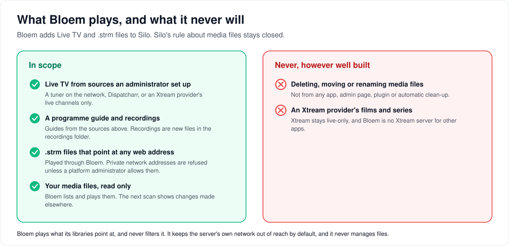

# What Bloem will not do

> **Provenance and status.** Bloem page, rewritten on 2026-11-12 and checked against
> `main` at `bf0fde82f`. This is Bloem's complete edition of Silo's
> [`docs/non-goals.md`](../../non-goals.md): read it *instead of* Silo's, not beside
> it. Bloem differs from Silo in two places: Live TV is in scope, and so are `.strm`
> files that point anywhere. The technical rules are in the
> [For developers](#for-developers) section.

Silo keeps a short list of features it will never accept, however well they are built.
This page walks through Bloem's version of that list: the two things Bloem adds back,
the one security default it keeps for `.strm` files, and the rule about media files
that Bloem keeps exactly as Silo wrote it.

## Live TV is in scope

Silo rules out Live TV, antenna tuners, internet TV, programme guides and recording for
good. Bloem ships them, as a maintained feature
([how Live TV works](../../architecture/bloem-live-tv.md)):

- **Tuners on the network.** HDHomeRun-compatible boxes, which Bloem can find by itself,
  and Dispatcharr, which presents internet TV sources as such a tuner.
- **Xtream providers**, for **live channels only**. Bloem signs in to the provider with
  its password stored encrypted, and calls only a fixed set of the provider's addresses.
  It never imports the provider's films or series, and never acts as an Xtream server
  for other apps.
- **A programme guide** from Schedules Direct, a Gracenote listings sync, or the Xtream
  provider's own guide.
- **Recordings and recording rules** (DVR).

Live TV channels still come only from a source an administrator set up. Xtream stays
live-only, as above.

### What Live TV is missing today, and is not a non-goal

These are current limits, not permanent decisions:

- A recording does not appear in the catalog by itself. An administrator adds the
  recordings folder to a library and scans it.
- A recording rule's "keep the last N" setting is stored but not applied: Bloem deletes
  no old recordings.
- A recording rule cannot be edited; remove it and make a new one.

## `.strm` files are in scope

Silo refuses **`.strm` files**: a small text file in the library whose content is the
web address of a video somewhere else. Bloem accepts them, wherever they point. Jim
decided this on 2026-11-12: "That might be a Silo goal but not Bloem, anything goes on
Bloem."

1. **A `.strm` file is a video.** Bloem reads the first line that is not empty, and
   treats the file as the movie or episode its name says, like any other video. It
   works in a library folder on disk and in a storage source such as an S3 bucket.
2. **Bloem looks inside the video** at the address, to learn its length, picture and
   sound, the same way it does for a file on disk.
3. **Bloem plays it through itself.** The app gets Bloem's own addresses; the remote
   address never reaches it. Bloem passes the bytes on as they are, rewraps them, or
   converts them, as it would for a file on disk.
4. **A changed address is a new version.** The next scan reads the file again, and a
   different address replaces the old one.

Bloem never filters what a `.strm` file points at. It keeps one **security default**,
which limits no content:

- Only addresses that start with `http://` or `https://`.
- By default, Bloem refuses an address that leads to the server's own private network:
  the server itself, link-local, private and CGNAT ranges, and cloud metadata services.
  Without this, a file in a library could make the server open its own internal
  services.
- Bloem checks this **every time it connects**, after it looks the name up and again
  at every redirect, so a name that changes its answer or a redirect into the private
  network is refused too.
- A platform administrator can switch on **Allow private addresses** when the videos
  really live on the private network.

This example is made up. A library holds `Harbour Lights (2019).strm`, whose one line
is `https://media.example.net/films/harbour-lights.mkv`. The film appears as "Harbour
Lights (2019)" with its length and tracks, and plays in any app. A second file whose
line is `http://10.0.0.5/admin` is refused at scan time, unless a platform
administrator has allowed private addresses.

## Deleting or managing media files

Bloem keeps Silo's rule unchanged: the server **reads** library files and never deletes,
moves, renames or reorganizes them. That holds for every app, admin page and plugin, and
for automatic clean-up such as removing a watched episode. Silo's
[reasons and alternatives](../../non-goals.md#deleting-or-managing-media-files) apply as
written: the shipped Compose file mounts the media folder read-only, Silo's
Jellyfin-compatible server reports items as not deletable, and library managers, file
managers or the shell look after the files, with the next scan showing their changes.

Bloem's own features stay inside that rule:

- **Storage sources** can only describe, list, check and read files. Removing a library
  location deletes nothing at the source.
- **Recordings** are new files in the recordings folder. Bloem removes only the partial
  pieces of its own recordings once it has joined them, and "keep the last N" deletes
  nothing.

## Who can change what

| Who | What they decide |
| --- | --- |
| Silo's maintainers | Silo's list in `docs/non-goals.md`, which Bloem never edits. |
| Bloem's maintainers | This edition: which Silo non-goals Bloem opens (Live TV and `.strm` files) and the security default for `.strm`. |
| Platform administrator | Which tuners, Xtream providers and guides a server uses, which libraries it scans, and whether `.strm` addresses may reach private addresses. |
| Anyone who can write to a library folder or bucket | What a `.strm` file points at. |

## Words used in the code

| On this page | In the code and settings |
| --- | --- |
| Live TV | `internal/livetv`, routes under `/api/bloem/v2/livetv` (`internal/api/router_livetv.go`) |
| Tuner on the network | a tuner of type `hdhomerun` |
| Xtream provider | a tuner of type `xtream`, created with `POST /api/bloem/v2/livetv/tuners/xtream` |
| Programme guide source | `schedules_direct`, `xml_sync` or `xtream` (at most 3) |
| Recording rule | a series rule, `livetv_series_rules`, with `keep_last` |
| Recordings folder | the `livetv.dvr_path` setting (default `/var/lib/bloem/dvr`) |
| `.strm` file | a `media_files` row with container `strm`; its address is in `bloem_remote_sources`, never in a path |
| Security default, the check | `internal/remotesource` (`Guard`, `BlockedAddr`, `BlockedName`) |
| Allow private addresses | the `bloem.strm.allow_private_addresses` setting (default `false`) |
| Storage source | the storage provider protocol, `proto/bloem/plugin/v1/storage_provider.proto` |
| Media folder | `MEDIA_ROOT`, mounted read-only |

## For developers

- **API:** [Live TV](../api/live-tv.md): every route under `/api/bloem/v2/livetv`.

### Where this edition came from

`.strm` support was added on 2026-11-12, when Jim reversed the earlier rule that kept
`.strm` files and other remote streams out of scope. Before then this edition listed
them under "Where Live TV stops".

Bloem's edition moved out of the Silo file in `47ea7c889` (2026-09-23), so Silo's file
stays exactly as Silo wrote it and Silo merges stay clean; see the
[documentation workflow](../documentation-workflow.md). Live TV has been in Bloem since
`ef2d38171` (2026-08-13, an attributed adaptation of Prairie Server's tuner and DVR
code); its routes later moved under `/api/bloem/v2/livetv`. Xtream providers followed on
2026-09-19. This edition took Silo's media-file-management non-goal at Silo `6de6d5e5e`.
It was reviewed on 2026-10-27 against Silo `3e2d306b2` and Bloem `e852f92bf`, and on
2026-11-01 against `b6039036d`; Silo has not changed `docs/non-goals.md` from
`3e2d306b2` through `63ef34b23`.

### Live TV boundary

Bloem ships Live TV: HDHomeRun-compatible tuner discovery, authenticated Xtream
live-provider consumption, guide data, channel playback, DVR rules and recordings are
maintained server features. See [Live TV tuner discovery](../../livetv-tuner-discovery.md)
and [Xtream live providers](../../architecture/xtream-live-tv.md) for supported
deployment paths. Xtream is live-only, with fixed reviewed endpoints (`player_api.php`,
`get_live_streams`, `xmltv.php` and live `.ts` requests), direct MPEG-TS and
provider-bound XMLTV; it does not expose an Xtream server API or import VOD/series.
Guide sources are `schedules_direct`, `xml_sync` (a native Zap2XML-style Gracenote
listings sync) and `xtream`; there is no generic XMLTV URL import and no M3U playlist
ingestion (Dispatcharr can present M3U sources as an HDHomeRun tuner).

Live TV itself takes no arbitrary stream addresses: channels come from the configured
tuner and provider integrations only. Arbitrary remote media enters the catalog through
`.strm` files instead (below).

Current implementation limits are distinct from these permanent non-goals. DVR does not
automatically import recordings into the catalog, enforce stored `keep_last`, or expose
a rule-update API (series rules are list, create and delete only). Completed unlinked
recordings require an administrator to scan the recording folder through a library. See
[Live TV client access](../../architecture/live-tv-client-access.md) and
[web coverage](../../architecture/bloem-web-feature-coverage.md) before promising those
workflows.

### `.strm` remote sources

- **Parsing.** The content is UTF-8 text of at most 8 KiB. The URL is the first
  non-empty line, trimmed. It must parse as an absolute `http` or `https` URL with a
  host; anything else rejects the file at scan time.
- **Storage.** The URL is stored in `bloem_remote_sources`, keyed by the catalog
  file's `file_path`, with a SHA-256 revision of the URL. `media_files.file_path` keeps the `.strm` file's own
  location; the URL never appears in a catalog path, a client stream URL, a playback
  recipe, a log line or an API response.
- **SSRF default.** `remotesource.Guard` resolves the host and refuses every resolved
  address in `127.0.0.0/8`, `::1`, `0.0.0.0/8`, `::`, `169.254.0.0/16`, `fe80::/10`,
  `10.0.0.0/8`, `172.16.0.0/12`, `192.168.0.0/16`, `fc00::/7`, `100.64.0.0/10`,
  multicast, broadcast, and IPv4-mapped, NAT64 and 6to4 forms of those, plus the names
  `localhost`, `metadata` and `metadata.google.internal`. The guard resolves each host
  itself at every dial, connects only to checked addresses and checks the socket
  address again in the dialer's `Control` hook, so DNS rebinding between check and
  connect is refused; the redirect policy re-validates every hop's scheme (at most 10
  hops), and every hop dials through the same checks.
  `bloem.strm.allow_private_addresses` (platform admin settings, default `false`)
  turns the address check off; the scheme check always stays.
- **Probe and ffmpeg.** ffprobe and ffmpeg never receive the URL. They read through a
  loopback bridge (`nativestorage.ToolInput`) whose reads are served by the guarded
  HTTP client, so every connection, redirect and reconnect passes the check.
- **Delivery.** Direct play proxies the remote bytes through Bloem's ordinary
  `/stream/{session}` route with `Range` passthrough; remux and HLS run on the API
  server.

### Media files

The storage provider protocol only describes, lists, stats and reads (`Describe`,
`List`, `Stat`, `Read`), and removing a library location deletes no provider files. The
DVR writes new recordings under `livetv.dvr_path` and removes only its own partial
segment files after merging them (`mergeSegments` in `internal/livetv/recorder.go`);
stored `keep_last` deletes nothing.

Technical pages:

- [How Live TV works](../../architecture/bloem-live-tv.md).
- [Live TV client access](../../architecture/live-tv-client-access.md).
- [Xtream live TV providers](../../architecture/xtream-live-tv.md).
- [Live TV tuner discovery](../../livetv-tuner-discovery.md).
- [Bloem web feature coverage](../../architecture/bloem-web-feature-coverage.md).
- [How `.strm` files play](../../architecture/bloem-strm.md).
- Silo's [non-goals](../../non-goals.md), and the summary in
  [BLOEM_AGENTS.md](../../../BLOEM_AGENTS.md).
- Index: [Bloem documentation](../README.md).

The picture is an SVG file under `docs/architecture/images/non-goals/`, drawn by
`scripts/bloem/draw-pictures.py` from `scripts/bloem/pictures/non_goals.py`. Redraw it
there, not by hand.
