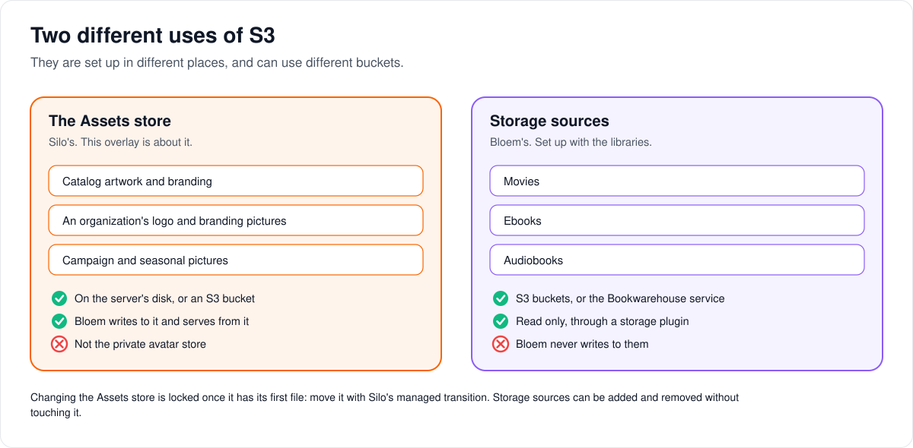

# Bloem S3 storage notes

> **Provenance and status.** Bloem overlay page, rewritten on 2026-11-01 and checked
> against `main` at `b6039036d` (Silo through `63ef34b23`). It overlays Silo's former
> `docs/s3-storage-setup.md`, which Silo deleted in `42b39765b` (#1635, 2026-09-28)
> when it moved operator guides out of the server repository. Silo's current
> reference for the same subject is [blob storage](../../architecture/blob-storage.md)
> (`internal/blobstore`), which applies to Bloem as written. This page adds only
> Bloem's notes beside it; the technical rules are in the
> [For developers](#for-developers) section.
> Its routes were checked again on 2026-11-11, after Silo retired its v1 API.

An *overlay* is a Bloem-owned page that records Bloem's additions to, or
replacements of, a Silo-owned document; Silo's files stay exactly as Silo wrote
them (see the [documentation workflow](../documentation-workflow.md)). This page
explains the two different ways Bloem can use S3, where Bloem's own uploads go,
and what to check before changing storage.

## Two different uses of S3

Bloem talks to S3 for two unrelated jobs. They are configured in different places
and can use different buckets:

- **The Assets store** is Silo's: artwork, branding and the other pictures Bloem
  writes and serves. It lives on the server's disk by default, or in an S3 bucket.
  This page is about this store.
- **Storage sources** are Bloem's: S3 buckets holding a library's movies, ebooks
  or audiobooks, which Bloem only reads, through a storage plugin. They are set up
  under the library settings, not here; see
  [how storage sources work](../../architecture/bloem-storage-sources.md).

## The Assets store in Bloem

S3 is optional. A single-server install keeps the Assets store on local storage by
default. S3 is recommended when several servers serve the same catalog. Bloem uses
Silo's generic S3 client, so the bucket can be on any S3-compatible service;
Silo's former guide named AWS S3, Ceph RGW, MinIO, Garage and Cloudflare R2.
Configure buckets in the admin interface as Silo's reference describes.

Bloem adds two kinds of upload to the same store:

- **Campaign and seasonal pictures.** Cards, season banners and sprites uploaded
  in **Campaigns & seasonal packs** go in a folder of their own, `ambience/`. They
  work on local storage as well as on S3. See
  [artwork storage](wiki/admin/artwork-storage.md).
- **Organization branding.** An organization's logo and other branding pictures,
  uploaded by a platform administrator, go to the same store through Silo's own
  branding service; see [organization domains](../../architecture/bloem-organization-domains.md).

Private avatar storage is never used for either.

## Before changing storage

Check the recorded storage identity before changing any bucket setting. Once the
first write records it, Silo refuses a change that would move the store to another
place. A store that started on local storage cannot simply gain a public bucket,
because that would change where it points on the next restart. Move a locked store
with Silo's managed transition instead.

## Checking that storage works

After configuring storage and applying any required restart, upload a picture and
read it back. Check its type, its size in pixels and that the browser can
revalidate it. A healthy server alone does not show that uploads work.

## Who can change what

| Who | What they manage |
| --- | --- |
| Platform administrator | The server's storage settings, campaign and seasonal uploads, and each organization's branding. |
| The storefront (Bloem Garden) | Campaign and seasonal uploads, with a platform administrator's API key. |
| Organization administrator | Storage sources for their own organization's libraries; not the Assets store. |

## Words used in the code

| On this page | In the code and settings |
| --- | --- |
| Assets store | Silo's `Assets` blob store (`internal/blobstore`); the public bucket on S3 |
| Private avatar storage | Silo's `Operational` store |
| Campaign and seasonal pictures | `internal/ambience`, key prefix `ambience/` |
| Organization branding | `branding.Service.UploadAsset`, called from `internal/api/handlers/bloem_organization_domains.go` |
| Recorded storage identity | the `artwork.storage_identity` row |
| Storage sources | native storage (`internal/nativestorage`) |

## For developers

### Where this overlay came from

Bloem's S3 notes moved out of the Silo file into this overlay in `47ea7c889`
(2026-09-23). Silo's blob storage reference (`internal/blobstore`) dates from
Silo's `b98d9af21` (2026-09-16). Campaign cards and seasonal packs are Bloem's own
upload service (`internal/ambience`, first commit `54ace4675`, 2026-09-01), which
has used the catalog Assets store since `f293cce0d` (2026-09-23). The review on
2026-10-27 (against Silo `3e2d306b2` and Bloem `main` at `e852f92bf`) corrected
the earlier claim that these uploads require public S3; it read
`cmd/silo/bloem_main.go`, `internal/ambience` and
`internal/api/handlers/admin_ambience.go`. Silo's `blob-storage.md` had changed
seven times since the page's previous edit (against Silo `8e2e84047`). Those
changes, which all apply to Bloem, included managed storage transitions, offline
artwork on local storage, trickplay previews, originals cached up to 4K, local
sidecar artwork, readiness before shutdown, and artwork uploads when `HeadObject`
answers `403` (`9e19d3440`, #2688, 2026-10-21). Since then Silo added, through
`63ef34b23`, that a local root reached through a linked parent directory keeps its
recorded identity (`SameLocalRoot`, `5444ec630`, #3177) and that `DeletePrefix`
honours cancellation (`01f6b023a`, #1661). Both apply to Bloem.

For installation wiring, use the [Bloem Docker guide](wiki/deployment/docker.md).
Index: [Bloem documentation](../README.md).

### Section "The two stores"

**Bloem adds:** two key prefixes in the Assets store.

- `ambience/`: campaign cards, season banners and sprites. The store is chosen in
  `cmd/silo/bloem_main.go`: the catalog Assets store when configured, else the
  public S3 client. Only with no store at all does the **Campaigns & seasonal
  packs** page report `storage_available: false` and refuse multipart uploads with
  `503` (`unavailable`); an HTTPS artwork URL can still be entered. The private
  (Operational) store is never used. Uploaded pictures are served publicly at
  `GET /api/bloem/v2/ambience/assets/{ref}`, the only artwork route and the only
  accepted path prefix since 2026-11-11. Migrations
  `20261031234831_bloem_native_ambience_asset_paths.sql` and
  `20261111215029_bloem_api_v2_ambience_asset_paths.sql` moved the paths stored in
  Bloem's own tables to it; the older v1 artwork route went with Silo's v1 API.
  The web app's signed-out seasonal layer reads the active packs from
  `GET /api/bloem/v2/ambience/public`. The design is in
  [campaign and seasonal asset storage](../../architecture/bloem-campaign-asset-storage.md).
- Organization branding assets: `PUT|DELETE
  /api/bloem/v2/admin/platform/tenants/{id}/branding/assets/{kind}` stores the
  upload through Silo's `branding.Service.UploadAsset`, as a content-hashed
  reference under Silo's `branding/` prefix. Without an asset store the upload
  answers `503 unavailable`; deleting an organization's asset only clears its
  setting row. See [organization domains](../../architecture/bloem-organization-domains.md).

### Section "Storage identity"

**Bloem adds:** a reminder to check the identity first. Once the first write
records `artwork.storage_identity`, Silo refuses a write that would move the store
(`409 artwork_storage_locked`). An `auto` backend that resolved to local cannot
simply gain a public bucket, because that would flip the resolution on restart.
Move a locked location with Silo's managed transition; see
[storage identity](../../architecture/blob-storage.md#storage-identity) and
[managed transitions](../../architecture/blob-storage.md#managed-transitions).
Bloem's `ambience/` and organization branding keys share the Assets store, so the
same lock covers them.

### Verifying storage

**Bloem adds:** after configuring storage through the admin UI and applying any
required restart, verify an actual upload and image read, including the MIME type,
dimensions and ETag revalidation. A registry write or a healthy server alone does
not show that upload storage works. The
[web coverage matrix](../../architecture/bloem-web-feature-coverage.md#acceptance-evidence-and-limits)
records disposable configured-S3 checks and their cleanup; those fixtures left no
storage override configured for other installations.

### Related pages

- Silo's [blob storage](../../architecture/blob-storage.md).
- [Artwork storage](wiki/admin/artwork-storage.md) and
  [campaign and seasonal asset storage](../../architecture/bloem-campaign-asset-storage.md).
- [How storage sources work](../../architecture/bloem-storage-sources.md) and
  [native storage](../../architecture/bloem-native-storage.md): S3 buckets as
  library sources.

The picture is an SVG file under `docs/architecture/images/s3-storage-setup/`,
drawn by `scripts/bloem/draw-pictures.py`. Redraw it there, not by hand.
