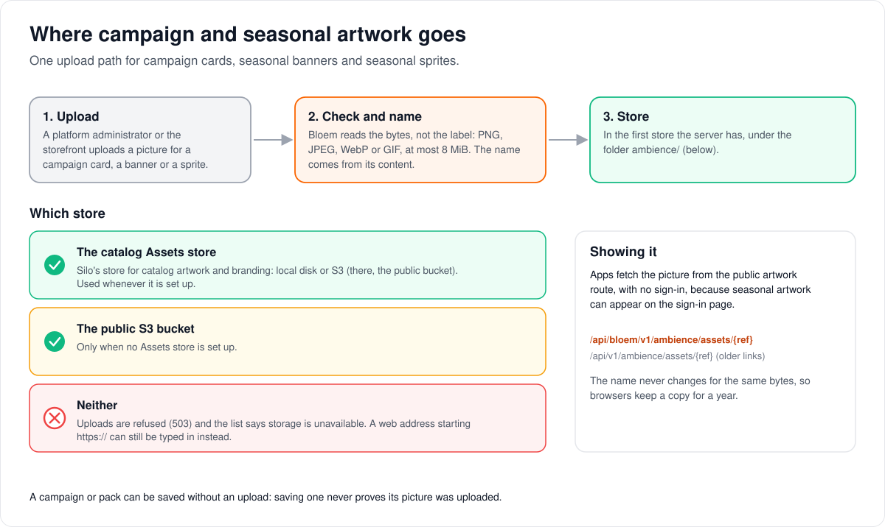

# Bloem artwork storage

> **Provenance and status.** Bloem overlay page, rewritten on 2026-11-01 and checked
> against `main` at `b6039036d` (Silo through `63ef34b23`). It overlays Silo's former
> operator page `docs/wiki/admin/artwork-storage.md`, which Silo deleted in
> `42b39765b` (#1635, 2026-09-28) with the rest of its in-repository wiki. Silo's
> current reference for catalog, branding and avatar storage is
> [blob storage](../../../../architecture/blob-storage.md), which applies to Bloem as
> written. This page adds only Bloem's campaign and seasonal artwork, a Bloem addition;
> the technical rules are in the [For developers](#for-developers) section.

An *overlay* is a Bloem-owned page that records Bloem's additions to, or replacements
of, a Silo-owned document; Silo's files stay exactly as Silo wrote them (see the
[documentation workflow](../../../documentation-workflow.md)). This page tells an
administrator where the pictures uploaded for campaigns and seasonal packs are kept,
and what to check before changing storage.

## Where uploads go

Pictures uploaded in **Campaigns & seasonal packs** go to the same **Assets store** as
the catalog's artwork and branding, in a folder of their own, `ambience/`:

- **With local artwork storage**, they are written under the local artwork root.
- **With S3**, they go to the public bucket.
- **With neither an Assets store nor a public S3 bucket**, uploads are unavailable.
  You can still enter a picture's web address starting `https://`. Initial server
  setup and catalog artwork are not affected.

Private avatar storage is never used for these pictures.

## Before changing storage

Silo's storage lock applies to these uploads too, because they share the Assets store.
Read the [S3 storage notes](../../s3-storage-setup.md) and Silo's
[storage identity](../../../../architecture/blob-storage.md#storage-identity) before
changing storage configuration.

## Who can change what

| Who | What they manage |
| --- | --- |
| Platform administrator | Uploading campaign and seasonal artwork; the server's storage settings. |
| The storefront (Bloem Garden) | Uploading the same artwork, with a platform administrator's API key. |

## Words used in the code

| On this page | In the code and settings |
| --- | --- |
| Assets store | Silo's `Assets` blob store (`internal/blobstore`) |
| The `ambience/` folder | the key prefix the ambience asset service writes under |
| Uploads unavailable | `storage_available: false`; multipart upload answers `503` |

## For developers

- The design is in
  [campaign and seasonal asset storage](../../../../architecture/bloem-campaign-asset-storage.md):
  store selection in `bloemWireServices` (`cmd/silo/bloem_main.go`), the upload rules,
  and the public route `GET /api/bloem/v2/ambience/assets/{ref}`.
- Store selection: the catalog Assets store when configured, else the public S3
  client; with neither, `storage_available: false` and multipart upload `503`, while an
  HTTPS artwork URL can still be authored. Private avatar storage is never used.
- Campaign cards and seasonal packs are Bloem features (`internal/ambience`, since
  `54ace4675`, 2026-09-01). Bloem's note moved out of the Silo page into this overlay in
  `47ea7c889` (2026-09-23).
- The review on 2026-10-27 (against Silo `3e2d306b2` and Bloem `main` at `e852f92bf`)
  corrected the earlier claim that these uploads require a public S3 bucket. They have
  used the catalog Assets store since `f293cce0d` (2026-09-23).

Related pages: [Bloem documentation](../../../README.md),
[S3 storage notes](../../s3-storage-setup.md) and Silo's
[blob storage](../../../../architecture/blob-storage.md).
