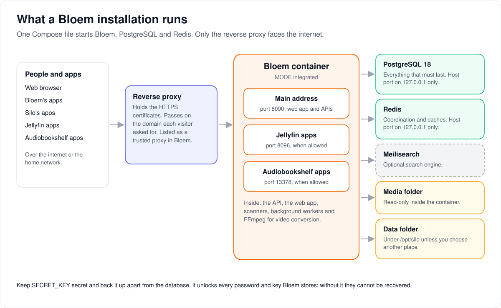
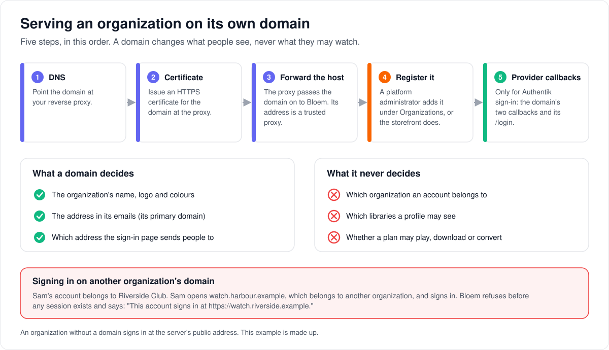
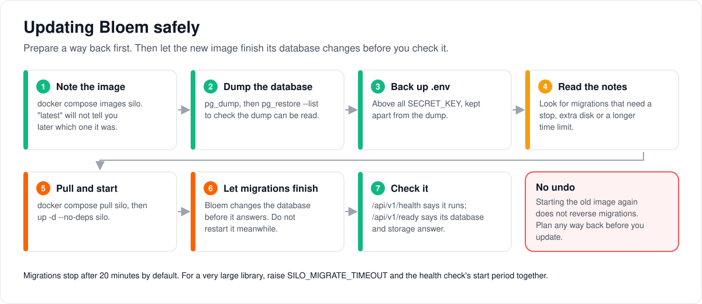

# Installing and running Bloem with Docker

> **Provenance and status.** Bloem page, rewritten on 2026-11-01 and checked against
> `main` at `b6039036d`, which contains Silo through `63ef34b23`. This is Bloem's own
> installation guide. It began as Silo's Docker guide, which Silo has since removed;
> Bloem runs Silo's code on Silo's multi-container Compose file, and serving an
> organization on its own domain is a Bloem addition. The technical rules are in the
> [For developers](#for-developers) section. Index: [Bloem documentation](../../../README.md).

This page walks through installing Bloem with Docker Compose: what runs, how to
start it, which image to use, where the data lives, how to put it safely on the
internet, how to serve an organization on its own domain, and how to add a graphics
card, a search engine or more servers. It ends with updating, backups, and moving a
database between Silo and Bloem.

## What you are installing



Docker Compose starts a few programs, each in its own **container**, from one file:

- **Bloem** itself, in **integrated** mode: one server that does everything. It holds
  the web app, the APIs, the library scanners, the background workers and FFmpeg,
  which converts video when a device cannot play a file as it is.
- **PostgreSQL 18** with the pgvector extension: the **database**, where everything
  that must last is kept.
- **Redis**: short-lived coordination and caches.
- **Meilisearch**, if you want it: a search engine that forgives typing mistakes.
  Without it, Bloem searches with PostgreSQL.

Bloem reads your **media folder** but never changes it, and keeps its own files in a
**data folder** on the host. In front of it all, a **reverse proxy** that you run
yourself holds the HTTPS certificates and is the only part that faces the internet.

Start here unless you already run PostgreSQL and Redis elsewhere or need separate
servers for streaming and converting video.

## Requirements

- Docker Engine or Docker Desktop
- Docker Compose 2.24 or newer
- Git and OpenSSL for the commands below
- The full path, on the host, of the folder that holds your media

For hardware acceleration, the host also needs the right graphics driver and
container runtime support.

## Install

1. Get the code and make your settings file, `.env`, from Bloem's example. The last
   command adds a database password and the **secret key**, both freshly generated:

   ```sh
   git clone https://github.com/bloem-studios/bloem-server.git
   cd bloem-server
   cp .env.bloem.example .env
   chmod 600 .env
   printf '\nPOSTGRES_PASSWORD=%s\nSECRET_KEY=%s\n' \
     "$(openssl rand -hex 24)" "$(openssl rand -base64 48)" >> .env
   ```

2. Tell Bloem where your media is, in `.env`:

   ```dotenv
   MEDIA_ROOT=/path/to/your/media
   ```

3. Check two lines the example already sets. Keep
   `COMPOSE_FILE=docker-compose.advanced.yml`: Silo's default `docker-compose.yml`
   starts Silo, not Bloem. And check `SILO_IMAGE`: the default `latest` follows
   `main`, and pulling it may need GitHub access (see
   [Container image selection](#container-image-selection)).
4. Start everything:

   ```sh
   docker compose up -d
   ```

5. Open <http://localhost:8090> and finish the setup in the browser. Compose has
   already connected PostgreSQL and Redis. Everything else (libraries, users,
   providers, storage, search, playback) is set in the admin console.

> [!CAUTION]
> `SECRET_KEY` is the master key for the passwords and keys Bloem stores. Keep it
> secret and back it up apart from database dumps. If it is lost, stored integration
> and storage credentials cannot be recovered.

## Container image selection

The **image** is the packaged Bloem program that Docker runs. `SILO_IMAGE` in `.env`
chooses it. Bloem keeps Silo's name for the variable so Silo's Compose files still
work. Bloem's example sets it to `ghcr.io/bloem-studios/bloem-server:latest`.

- **`latest`** is always the newest `main` commit that passed Bloem's tests. It
  changes often.
- **A full commit tag** (`ghcr.io/bloem-studios/bloem-server:<full sha>`) never
  changes. Use it, or the image digest, when you must be able to roll back or name
  exactly what runs:

  ```dotenv
  SILO_IMAGE=ghcr.io/bloem-studios/bloem-server:<full commit sha>
  ```

- **Your own build.** Run `docker build -t bloem-server:local .` in the checkout (the
  Dockerfile builds the web app itself) and set `SILO_IMAGE=bloem-server:local`. Do
  this if you cannot pull the published image.

> [!WARNING]
> **Use `docker-compose.advanced.yml` for Bloem.** `docker-compose.yml` is Silo's
> file. It ignores `SILO_IMAGE` and starts Silo's own all-in-one image instead.
> Bloem publishes no all-in-one image. `docker-compose.advanced.yml` runs Bloem,
> PostgreSQL and Redis in separate containers and reads `SILO_IMAGE`. Its own default
> is Silo's image too, so keep `SILO_IMAGE` set.

Bloem's tags and its one prerelease are in the
[release-versioning overlay](../../release-versioning.md). How the image is built and
tagged is under [Image publishing](#image-publishing).

## Storage and state

Bloem keeps its files in folders on the host, not in Docker volumes. `SILO_DATA_ROOT`
chooses the base folder and defaults to `/opt/silo`:

| Host path | Purpose |
| --- | --- |
| `/opt/silo/postgres` | Durable PostgreSQL data |
| `/opt/silo/redis` | Redis persistence |
| `/opt/silo/plugins` | Installed plugin cache |
| `/opt/silo/artwork` | Local artwork cache and uploaded artwork |
| `/opt/silo/compat` | Compatibility assets |
| `/opt/silo/transcode` | Transient transcode output, mounted at `/tmp/silo-transcode` |
| `/opt/silo/download-artifacts` | Prepared downloads, mounted at `/tmp/silo-download-artifacts` so they survive image updates |
| `/opt/silo/catalog-seeds` | Read-only catalog seed data |
| `/opt/silo/meilisearch` | Optional Meilisearch index |

To use another base folder:

```dotenv
SILO_DATA_ROOT=/srv/silo
```

The media folder, `MEDIA_ROOT`, appears read-only inside the container at
`MEDIA_CONTAINER_ROOT`, which defaults to `/mnt/media`. An existing installation must
keep the container path its libraries were created with.

What must last is in PostgreSQL. Redis holds coordination and cache-style data.
Transcode output is local and thrown away.

**SQLite user state is for one server only.** Bloem can keep per-user state in SQLite
files instead of PostgreSQL, but only when exactly one Bloem process ever runs.
Anything with more than one Bloem process needs PostgreSQL. The default Compose file
does not keep the SQLite folder, so before turning SQLite on, add this to the `silo`
service in an override file of your own:

```yaml
services:
  silo:
    volumes:
      - ${SILO_DATA_ROOT:-/opt/silo}/userdb:/var/lib/silo/userdb
```

Check the combined Compose configuration before recreating the container. Back up
the whole folder as one unit while Bloem is stopped. The rules for SQLite, including
moving it to another node, are under [SQLite user state](#sqlite-user-state).

## Ports and HTTPS

### Published ports

Change the host-side port variables in `.env` when a default clashes with another
service. The ports inside the container never change.

| Variable | Default | Purpose |
| --- | ---: | --- |
| `PORT` | `8090` | Main web application and API |
| `JF_PORT` | `8096` | Silo's Jellyfin-compatible server |
| `ABS_PORT` | `13378` | Silo's Audiobookshelf-compatible server |
| `PROXY_PORT` | `8083` | Commented standalone proxy example |
| `TRANSCODE_PORT` | `8082` | Commented standalone transcode example |

The main port serves the web app and the APIs. Compose publishes the Jellyfin and
Audiobookshelf ports as well, but each one listens only while its setting under
**Configure → Integrations → Compatibility** allows those apps. The bundled
PostgreSQL and Redis ports (`POSTGRES_PORT`, `REDIS_PORT`) are published on
`127.0.0.1` only.

### Putting Bloem on the internet

> [!WARNING]
> The application ports listen on every host interface by default and have no HTTPS
> of their own. Before anyone outside a trusted local network can reach them, put a
> correctly configured HTTPS reverse proxy and a firewall in front. Never expose
> PostgreSQL or Redis publicly.

Then, in the admin console under **Configure → Server → General → Network**:

1. Set **Silo public URL** to the HTTPS address people open, such as
   `https://watch.example.com`. Bloem uses it for links in emails and to check that
   the web app's live connections come from it. This is **the server's public
   address**.
2. Set **Trusted proxies** to the addresses your reverse proxy connects from. Bloem
   believes the visitor's address and the domain they asked for only when a trusted
   proxy passes them on. The default trusts private network ranges and the host
   itself.

## Serving an organization on its own domain



Each **organization** (one customer, see
[how organizations work](../../../../architecture/bloem-organizations.md)) can be
served on **domains** of its own. On its domains, people see the organization's own
name, logo and colours, and its emails link to its **primary domain**. An organization
without a domain uses the server's public address and the server's own look.

A domain only decides what people see. It never decides who may sign in or what they
may watch: an account belongs to one organization wherever it signs in.

In production on 2026-11-01 there is one organization, the default one, and the
server's public address is registered as its primary domain.

To add a domain:

1. **DNS.** Point the domain at your reverse proxy.
2. **Certificate.** Issue an HTTPS certificate for the domain at the proxy.
3. **Forward the host.** Route the domain to Bloem through the proxy. The proxy must
   pass on the domain the visitor asked for, either by keeping the original `Host`
   header or by sending it once in `X-Forwarded-Host`, and its address must be in
   **Trusted proxies**. For nginx, `proxy_set_header Host $host;` does it.
4. **Register the domain.** A platform administrator opens **Organizations**, picks
   the organization, and adds the domain in its **Domains** panel. The first domain
   becomes the primary; **Make it the primary domain** moves the primary to a later
   one. The storefront (Bloem Garden) can register domains for its organizations too.
   Set the name, logo and colours in the **Branding** panel next to it.
5. **Provider callbacks.** Only if people sign in through the OAuth provider
   (Authentik): register the domain's two callback addresses at the provider, and
   its `/login` page as a post-logout redirect address when provider sign-out is on.
   The exact addresses are under
   [Organization domains](#organization-domains). Do this before members use provider
   sign-in on the domain.

After a change, other Bloem servers in the same installation pick up the new domain
within about 30 seconds.

What people notice:

- **Signing in on the wrong domain.** Someone whose account belongs to another
  organization is refused, and told where to sign in instead.
- **No domain yet.** An organization without a domain signs in at the server's public
  address.
- **A sign-in through the provider** starts and ends on the same domain, and so does a
  provider sign-out.
- **Phone and TV apps** keep using the server's public address and its device sign-in
  page.

### Example: a club on its own domain

This example is made up. Riverside Club resells Bloem to its members and wants them to
see its own name and colours.

1. The club's host name, `watch.riverside.example`, gets a DNS record pointing at the
   reverse proxy, and the proxy gets a certificate for it.
2. The proxy routes it to Bloem and keeps the `Host` header.
3. A platform administrator adds `watch.riverside.example` in Riverside Club's
   **Domains** panel, where it becomes the primary, and uploads the club's logo in
   **Branding**.
4. The club's members sign in through Authentik, so the administrator registers
   `https://watch.riverside.example/api/v1/auth/oauth/<installation>/callback`,
   `https://watch.riverside.example/api/v2/auth/oauth/<installation>/callback` and
   `https://watch.riverside.example/login` at the provider.

Now invitations the club's administrator sends, and password resets asked for on the
club's domain, link to `https://watch.riverside.example`. When Sam, a member, opens
another organization's domain and signs in, Bloem answers: "This account signs in at
https://watch.riverside.example."

## Hardware acceleration

The default stack uses only the processor, so it starts on hosts without a graphics
card. Silo's Compose files carry the graphics settings as commented lines in the
`silo` service. Uncommenting them edits a Silo file that the next `git pull` updates,
so put them in a small override file of your own instead, for example
`compose.gpu.yml`, and add it to `COMPOSE_FILE`:

```dotenv
COMPOSE_FILE=docker-compose.advanced.yml:compose.gpu.yml
```

Windows uses `;` instead of `:` between the files in `COMPOSE_FILE`. Check the result
with `docker compose config --quiet` before starting it.

### Intel or AMD VA-API and Intel Quick Sync

On a Linux host with `/dev/dri`:

```yaml
services:
  silo:
    devices:
      - /dev/dri:/dev/dri
```

### NVIDIA NVENC

Install the NVIDIA driver and the NVIDIA Container Toolkit first. The `video`
capability mounts the NVENC/NVDEC libraries; without it FFmpeg sees the GPU but
encodes in software.

```yaml
services:
  silo:
    deploy:
      resources:
        reservations:
          devices:
            - driver: nvidia
              count: ${NVIDIA_GPU_COUNT:-1}
              capabilities: [gpu, compute, utility, video]
```

The admin **Nodes** page shows each server's processor, memory, disk and graphics
use. What those numbers measure is under [Node metrics](#node-metrics).

## Optional Meilisearch

PostgreSQL search needs no extra service. To offer Meilisearch as well:

1. Generate a key and add it to `.env`:

   ```sh
   openssl rand -hex 32
   ```

   ```dotenv
   MEILI_MASTER_KEY=replace-with-generated-value
   ```

2. Start the `search` profile:

   ```sh
   docker compose --profile search up -d
   ```

3. Under **Configure → Server → Search**, choose Meilisearch, set the URL to
   `http://meilisearch:7700`, enter the same key as the API key, test the connection
   and save.
4. Restart Bloem. It builds the search index in the background and retries failures
   every minute. The Search status panel shows whether Meilisearch, keyword-only
   Meilisearch or PostgreSQL is answering while the build runs; the manual rebuild
   button stays available.

Bloem keeps using PostgreSQL search until Meilisearch is chosen.

## External PostgreSQL and Redis

> [!IMPORTANT]
> `docker-compose.advanced.yml` defines its own PostgreSQL and Redis, writes Bloem's
> connection addresses into the file and waits for both to be healthy. Setting
> `DATABASE_URL` or `REDIS_URL` only in `.env` does not replace that.

To use a database and Redis you already run, write a Compose file or override that:

- gives the Bloem service the external `DATABASE_URL` and `REDIS_URL`;
- removes or replaces the waits on the bundled services;
- leaves the bundled PostgreSQL and Redis services out of the project;
- keeps the media, plugin, compatibility, transcode and catalog mounts;
- keeps the same `SECRET_KEY` on every Bloem role;
- sets `POSTGRES_TUNE=off`, unless you deliberately size the tuner for the database
  host; the bundled file defaults it to `auto` (see
  [PostgreSQL auto-tuning](#postgresql-auto-tuning)).

Check the combined configuration before starting it:

```sh
docker compose -f docker-compose.advanced.yml -f your-override.yml config --quiet
```

A database on its own virtual machine or a managed service is easier to upgrade, tune
and back up. Redis can stay local or move to shared infrastructure you already have.

## Server roles and distributed deployments

A Bloem process runs in one of four **modes**:

| Mode | Purpose |
| --- | --- |
| `integrated` | Recommended main server, with the API, frontend, scanners, workers, and configured local delivery. |
| `api` | Main control role for a custom distributed layout; configured local transcode fallback may still be used. |
| `proxy` | Dedicated stream and source-download delivery node. |
| `transcode` | Dedicated HLS and prepared-download worker. |

The Compose file has commented proxy and transcode examples. Leave them off on a
single host: `integrated` already streams and converts.

For several servers:

- connect every role to the same PostgreSQL and Redis;
- use the same `SECRET_KEY` on every role;
- give every process that serves media the same full media paths;
- keep the prepared-download folder on every process that can prepare downloads;
- restart a role after changing its download folder.

## PostgreSQL auto-tuning

The bundled Compose file turns on **auto-tuning**: each time Bloem starts, it sizes
PostgreSQL's memory, worker and connection settings for the machine and writes them
into the database server's configuration. It is Silo's tuner, unchanged.

> [!CAUTION]
> While tuning is on, Bloem reconfigures the database it connects to with
> `ALTER SYSTEM` **on every start**. Set `POSTGRES_TUNE=off` in `.env` before starting
> it against a PostgreSQL whose settings are managed some other way.

- **Restart PostgreSQL when Bloem asks.** Some settings take effect only after a
  PostgreSQL restart. Bloem then logs `postgres restart required to finish applying
  auto-tuned settings`. Restart both in a quiet moment:
  `docker compose restart postgres silo`. What the warning means exactly is under
  [The "restart required" warning](#the-restart-required-warning).
- **A database elsewhere.** The tuner sizes PostgreSQL for the Bloem container, not
  for the database's own machine. Keep `POSTGRES_TUNE=off` and tune the database
  yourself; see [External PostgreSQL](#external-postgresql).
- **Turning it off.** Set `POSTGRES_TUNE=off` and recreate the Bloem container.
  Values the tuner already wrote stay in `postgresql.auto.conf` until you
  `ALTER SYSTEM RESET` them (then reload or restart PostgreSQL). Re-tune the database
  by hand when its processors, memory or disk change.

Every setting the tuner reads is listed under [Inputs](#inputs).

## Backups and updates



Before an update:

1. Note the image that is running now (`docker compose images silo`), in case you
   need to go back. `latest` will not identify it later, and an older image does not
   necessarily work with database changes made by the new one.
2. Dump PostgreSQL and check that the dump can be read:

   ```sh
   docker compose exec -T postgres \
     pg_dump -U "${POSTGRES_USER:-silo}" -Fc "${POSTGRES_DB:-silo}" > silo-$(date +%F).dump
   pg_restore --list silo-$(date +%F).dump > /dev/null
   ```

   Do not copy `/opt/silo/postgres` while the container runs: a live copy of the data
   folder is inconsistent and may not start. If you must copy the folder,
   `docker compose stop postgres` first.
3. Back up `.env`, above all `SECRET_KEY`, apart from the dump.
4. Keep the Compose configuration in use and any overrides with the backup, somewhere
   only you can read.
5. Read the release notes for the new build. Look for database changes that need a
   stop, extra disk or more time. Listing the dump only checks that its table of
   contents can be read; practise the restore and the new migrations on a separate,
   throwaway database.

Some releases need more than this; the ones known so far are under
[Release-specific steps](#release-specific-steps).

Then set the `SILO_IMAGE` you want and update only the Bloem service:

```sh
docker compose pull silo
docker compose up -d --no-deps silo
docker compose logs -f silo
```

Bloem changes the database (**migrations**) when it starts, before it answers anyone.
Follow the logs until it has started, and do not restart the container during a
migration. Migrations stop after 20 minutes by default; for a very large library,
raise `SILO_MIGRATE_TIMEOUT` (a Go duration such as `60m`, or `0` for no limit) before
updating.

> [!WARNING]
> Starting the old image again does not undo migrations. Check what was applied with
> `docker compose run --rm silo --migrate-status`, and follow that release's own
> guidance. Never run an automatic Down migration or restore a backup over live data
> without a reviewed recovery plan: restoring the pre-update dump loses everything
> written since.

`docker compose config` prints the database password and `SECRET_KEY`. Keep its output
private, never paste it into issues or logs, and remove those values before sharing it.

After an update, check both addresses on the host-side `PORT` (replace `8090` if you
changed it):

```sh
curl -fsS http://localhost:8090/api/v1/health
curl -fsS http://localhost:8090/api/v1/ready
```

`health` says the process is running. `ready` also checks what it depends on,
including PostgreSQL and configured S3 storage.

## Switching between Silo and Bloem

Bloem can serve an existing Silo database and hand it back. Both servers keep working
on the same data; only one runs at a time. See
[Silo backend switching](../../../../architecture/silo-backend-switching.md).

**Before the first switch**

1. Back up the database, or snapshot the volume or container that holds it. This is
   the way back from the takeover itself.
2. Pin Silo's image by digest to the Silo release Bloem last merged (at the time of
   writing, `63ef34b23`):
   `SILO_IMAGE=ghcr.io/silo-server/silo-server@sha256:...`. Do not leave Silo on
   `latest`. Which image to pin, and why, is under
   [Silo switching details](#silo-switching-details).
3. Give Bloem Silo's `DATABASE_URL` and the same `SECRET_KEY` (encrypted settings are
   unreadable with any other key). Give Bloem its own Redis.
4. Copy Silo's plugin folder to Bloem's data folder, and mount the media at the same
   container paths Silo uses, so library paths keep matching.

**Taking over**

1. Stop Silo and start Bloem. Bloem applies its migrations to the Silo database as it
   starts; on the first takeover this is one-off work.
2. Run `silo silo-switching enable` in the Bloem container. It needs exactly one
   organization and no profile logins, creates missing memberships, reconciles roles
   from Silo's accounts, and prints a report line
   (`silo switching enabled: memberships_created=… roles_reconciled=… already=…`)
   followed by `silo switching: true`. `silo silo-switching status` prints the
   current state alone.
3. Restart Bloem and point your reverse proxy at it.

**Switching either way afterwards**

1. Stop the running server and wait until it has closed its database connections.
2. Clear the other server's Redis.
3. Start the other server and wait for `/api/v1/ready`.
4. Point the reverse proxy at it.

The server ID apps see is stored in the database, so apps follow the switch without
signing in again.

While Silo serves, Bloem-only features are unused but kept: more organizations and
profile logins are refused, and Live TV, DVR and plans wait for Bloem. A second
organization ends switching. `silo silo-switching disable` ends switching: it lifts the one-organization and
profile-login guards, and Silo must not serve the database afterwards.

## Migrating from Continuum

Read the [SQLite bridge preflight](../../../../architecture/sqlite-bridge-preflight.md)
before migrating a legacy SQLite installation, and use the migration procedure for
that schema. Keep the old container media path if existing library records store it,
and keep the migration backup until scanning, metadata, users, plugins and playback
have all been checked.

## Who can change what

| Who | What they manage |
| --- | --- |
| Whoever runs the host | `.env`, the Compose files and overrides, the image, backups, the reverse proxy, DNS, certificates, the OAuth provider's registered addresses, and Silo switching. |
| Platform administrator | The public URL, trusted proxies, search, which compatibility apps may connect, and every organization's domains and branding. |
| The storefront (Bloem Garden) | Registering domains for its organizations, with a platform administrator's API key. |
| Organization administrator | Nothing on this page. Domains and branding are set by the platform. |

## Words used in the code

| On this page | In the code and configuration |
| --- | --- |
| Bloem container | the `silo` service in `docker-compose.advanced.yml`, running `SILO_IMAGE` with `MODE: integrated` |
| Data folder | `SILO_DATA_ROOT` (`/opt/silo`) |
| Media folder | `MEDIA_ROOT`, mounted read-only at `MEDIA_CONTAINER_ROOT` (`/mnt/media`) |
| Secret key | `SECRET_KEY` |
| The server's public address | the `server.public_url` setting, labelled **Silo public URL** (Silo's label, `GeneralSettings.tsx`) |
| Trusted proxies | `clientip.trusted_proxies`, or `SILO_TRUSTED_PROXIES` at start-up |
| Organization domain | a `bloem_organization_domains` row (`internal/orgdomains`) |
| Organization branding | `bloem_organization_branding` rows, one per `branding.*` key |
| Server role | `MODE`: `integrated`, `api`, `proxy`, `transcode` |
| Auto-tuning | `POSTGRES_TUNE` and `internal/database/postgres_tune.go` |
| Migrations | Goose migrations in `migrations/sql/`, limited by `SILO_MIGRATE_TIMEOUT` |
| Silo switching | `silo silo-switching enable`, `status` and `disable` |

## For developers

- **API:** [organizations and administration](../../../api/organizations.md#get-apibloemv1adminplatformtenantsiddomains):
  the platform routes for an organization's domains and branding under
  `/api/bloem/v1/admin/platform/tenants/{id}`. Sign-in errors are in
  [authentication](../../../../auth-api.md#ordinary-v2-authentication), and
  distributed download delivery in the
  [Downloads API](../../../../downloads-api.md#411-distributed-proxy-delivery).

### Where this guide came from

This is Bloem's maintained Docker guide, a complete Bloem edition rather than a
section-by-section overlay. It began as Silo's own operator guide,
`docs/wiki/deployment/docker.md`. Bloem edited that guide in place from August 2026
(SQLite single-node fencing, Bloem image names, Bloem deployment records) and moved its
edition here in `47ea7c889` (2026-09-23), so the Silo file could return to upstream
verbatim. Silo then deleted its guide in `42b39765b` (#1635, 2026-09-28) when it moved
operator guides out of the server repository, so there is no current Silo page to read
alongside this one. Bloem runs on Silo's multi-container Compose file,
[`docker-compose.advanced.yml`](../../../../../docker-compose.advanced.yml), with Silo's
[`.env.example`](../../../../../.env.example) and Silo's code; Bloem's own template is
[`.env.bloem.example`](../../../../../.env.bloem.example). Silo's default
[`docker-compose.yml`](../../../../../docker-compose.yml) does not start Bloem.

It was reviewed on 2026-10-27 against `e852f92bf` (Silo through `3e2d306b2`); the
Compose file, image selection and hardware acceleration sections again on 2026-10-31
against `81c26179c` (Silo through `288f58200`), when Bloem's image was started with
`docker-compose.advanced.yml`; and the whole page on 2026-11-01 against `b6039036d`
(Silo through `63ef34b23`).

### Image publishing

- Since `04a69c0fe` (2026-10-11) Bloem images are published only by the
  [Bloem Image workflow](../../../../../.github/workflows/bloem-image.yml). It runs
  after Bloem CI passes on a push to `main`, builds that exact commit and pushes it
  under the full 40-character commit SHA: `ghcr.io/bloem-studios/bloem-server:<full sha>`.
  It never creates a `build-N` or short-SHA tag. See [CI additions](../../../ci.md).
- Since `6d0adcfe9` (2026-10-27) the workflow also points `latest` at that image if
  the commit is still `main`'s head, so `latest` follows `main`, and a late run for an
  older commit cannot move `latest` backwards. Before that change nothing moved
  `latest`: it was `build-152`, a September 24, 2026 image left from the earlier
  publishing path.
- Silo's `Docker Image` workflow, which produces the `build-N`, `latest` and short-SHA
  tags that Silo's [release versioning](../../../../release-versioning.md) describes,
  follows Silo's `CI` workflow, and that runs only in Silo's own repository. In Bloem
  both are skipped.
- On 2026-10-27 the container package was private, so pulling it needed a GitHub
  account with access to it. Without access, build the image from the checkout.

### Compose files

- Since Bloem's October 29 merge (`d562d7628`), `docker-compose.yml` is Silo's file
  again. It ignores `SILO_IMAGE`, reads `SILO_OMNIBUS_IMAGE`, and starts
  `ghcr.io/silo-server/silo-server:latest`: Silo's all-in-one image with PostgreSQL
  and Redis inside, which runs Silo as `PUID`:`PGID` rather than root (Silo #3319).
  The image's own default is 911; Silo's Compose files pass `${PUID:-1000}` and
  `${PGID:-1000}`.
- `docker-compose.advanced.yml` (named `docker-compose.split.yml` before Silo #3319)
  runs the application, PostgreSQL (`pgvector/pgvector:pg18`) and Redis
  (`redis:alpine`) in separate containers and takes `SILO_IMAGE`, defaulting to Silo's
  image. It passes `PUID` and `PGID` too; Bloem's image, built from the repository's
  `Dockerfile` (the same file as Silo's), has no `USER` and its entrypoint is the
  `silo` binary, so it ignores them and runs as root.
- The `silo` service sets `stop_grace_period: 2m` so a stopping server can fail
  readiness, keep serving for `SILO_SHUTDOWN_DELAY` (default 5s) and finish in-flight
  requests. A single server with no load balancer in front can set
  `SILO_SHUTDOWN_DELAY=0`.
- It adds `cap_add: [NET_ADMIN]`, which lets a start-up helper turn on kernel BBR
  congestion control and a larger TCP send buffer for client connections, then drop
  the capability; Bloem and its child processes never keep it. Remove the line to
  undo it, or set `SILO_NET_TCP_CONGESTION=off` and `SILO_NET_TCP_SEND_BUFFER=off`.
  See [TCP congestion](../../../../architecture/tcp-congestion.md).
- The container always listens on 8080, 8096 and 13378 (`PORT`, `JF_PORT` and
  `ABS_PORT` in the service's environment); the `.env` values change only the
  published host ports.
- `MEILISEARCH_IMAGE` defaults to the pinned `getmeili/meilisearch:v1.54.0`, because
  Meilisearch will not open data written by another version. The `search` profile
  refuses to start without `MEILI_MASTER_KEY`. `MEILI_UPGRADE_DB` defaults to
  `false`. `MEILISEARCH_HOST` (default `127.0.0.1`) and `MEILISEARCH_PORT` (default
  `7700`) choose where it is published.
- Silo removed its `docker-compose.vaapi.yml` and `docker-compose.nvidia.yml`
  overlays (Silo #3279, merged in `8065e5746`); its Compose files now carry the same
  settings as commented lines in the `silo` service.
- `.env.bloem.example` sets `COMPOSE_FILE=docker-compose.advanced.yml` and
  `SILO_IMAGE=ghcr.io/bloem-studios/bloem-server:latest`.

### SQLite user state

PostgreSQL is the required user-state backend for any deployment that may run more
than one Bloem application process. SQLite user state is a deliberately single-node
mode: local files are written under `/var/lib/silo/userdb`, there is no built-in
S3/Litestream replication, and startup reserves one durable `SILO_NODE_NAME` in
PostgreSQL. A second process using that identity, or a different node trying to use the
same SQLite deployment, fails startup before opening user databases. After an unclean
stop, wait at least 45 seconds for the old heartbeat to become stale before restarting
the same node identity.

Single-node admission does not give SQLite transactional profile creation. Account
flows that require a default profile, including fresh setup and invitation acceptance,
need the PostgreSQL provider's transaction capability. Unsupported providers fail
before account/membership insertion or opening SQLite files. Profileless provisioning
retains its existing behavior; see
[authentication](../../../../auth-api.md#ordinary-v2-authentication).

Do not place the userdb directory on independently mounted replica-local volumes.
Moving a SQLite deployment to another node is an explicit maintenance operation: stop
the old process, copy and verify the complete userdb directory, update the singleton
owner in PostgreSQL, and only then start the replacement with its stable
`SILO_NODE_NAME`. Never run the old and replacement processes concurrently. Prefer
migrating user state to PostgreSQL instead of performing repeated handoffs.

### Compatibility listeners

Silo's Jellyfin- and Audiobookshelf-compatible servers listen on ports of their own,
and only while `jellyfin_compat.enabled` or `audiobookshelf_compat.enabled` (both
default on; changing either needs a restart) allows them. Bloem's companion
enrollment is removed; see
[protocol compatibility](../../../../architecture/bloem-compatibility-removal.md).

### Organization domains

The design is in [organization domains and branding](../../../../architecture/bloem-organization-domains.md);
the code is `internal/orgdomains`, migration `20261101055208_bloem_organization_domains`,
capability `organization_domains_v1`.

- **Request host.** `orgdomains.WrapListener` wraps the whole listener. The host is
  `X-Forwarded-Host` only when the transport peer is a trusted proxy and the request
  carries exactly one `X-Forwarded-Host` value with no `,`, `/`, `?`, `#`, `@`, space or
  tab; otherwise it is `Host` (`(*clientip.Resolver).RequestHostOf`). A client that is
  not a trusted proxy cannot choose an organization by sending the header. The host is
  compared lower case, without its port.
- **Trusted proxies** are `clientip.trusted_proxies`; `SILO_TRUSTED_PROXIES`, when
  set, overrides the stored value at start-up. The default is
  `10.0.0.0/8,172.16.0.0/12,192.168.0.0/16,127.0.0.0/8,::1/128`.
- **Registered hosts only.** A stored host is lower case with at least one dot and no
  scheme, port or path (at most 253 characters). Sign-ins on unregistered hosts, such
  as IP addresses and LAN names, are never refused, so an administrator can always
  reach the server.
- **Presentation, never access.** An account's organization comes from the account or
  session, whatever the domain. A domain picks only the branding and the address links
  use. The default organization uses the server's own branding (its branding routes
  answer `409 default_organization`). Another organization's unset branding value is
  Bloem's built-in default on its domains, never the server's.
- **Primary.** An organization's first domain is primary. Adding one with `primary`
  moves the primary to it; `PUT …/domains/{host}/primary` sets it; removing the primary
  makes the oldest remaining domain primary.
- **Branding and links follow one organization:** the one named with
  `orgdomains.WithOrganization`, else the authenticated request's tenant, else the
  request's domain (`OrganizationFor`). Invitation and password-reset links answer
  `server.public_url` as `<scheme>://<primary domain>` of that organization.
  `WithOrganization` has no caller yet, so a password reset follows the domain it was
  asked on, and an invitation follows the inviting administrator's organization: one a
  platform administrator sends into another organization links to the default
  domain.
- **Sign-in.** A sign-in on a domain registered to another organization than the
  account's is refused before a session exists with `409 wrong_organization_domain`,
  "This account signs in at https://<primary domain>"; `/api/v2` renders it as
  `conflict`. The address falls back to the server public URL when the account's
  organization has no primary domain, and such an organization's accounts are let in
  on that URL's host even when it is registered to the default organization.
  Impersonation sessions are not refused.
- **Provider callbacks.** A web sign-in through the OAuth provider stays on the domain
  it started on (`Directory.OAuthBaseURL`, installed with
  `auth.OAuthHandler.SetRequestBaseURL`; `internal/auth/oauth_handler.go` is a declared
  seam). Register, per domain:
  `https://<domain>/api/v1/auth/oauth/<installation>/callback`,
  `https://<domain>/api/v2/auth/oauth/<installation>/callback`, and, when provider
  sign-out is on, `https://<domain>/login` as a post-logout redirect URI. Silo's plugin
  installation page and the `/api/v2/auth/provider-logout` description name only the
  public URL's addresses.
- **Who registers.** The platform routes under
  `/api/bloem/v1/admin/platform/tenants/{id}` (`domains`: list, add, set primary,
  remove; `branding`: read, update, and `PUT|DELETE …/branding/assets/{kind}`) take a
  Platform administrative context or an administrator's unscoped API key. An API key
  records a domain with source `garden`, anything else as `platform`.
- **Caching.** `orgdomains.Directory` reloads every `DirectoryTTL` (30 seconds) in the
  background and keeps serving the old map meanwhile; the node that made a write reads
  again on its next request, and other nodes within about 30 seconds.
- **Limits.** App (native) sign-in through a provider keeps the public URL. A provider
  sign-in refused on another organization's domain gets the OAuth handler's generic
  failure, not the address message. The device sign-in page (`/activate`) and the
  server address apps are told (`/api/v2/system/identity`) stay on the public URL, and
  a device-code sign-in is not checked against the domain. The Jellyfin address and the
  email sender are server-wide.
- **Production.** On 2026-11-01 the server's public address was registered to the
  default organization as its primary domain (source `platform`); see the
  [November 1 deployment record](../../../../operations/2026-11-01-organization-domains-deployment.md).

### Node metrics

This section describes Silo's node sampler (`internal/nodemetrics`), which Bloem runs
unchanged. Silo's current reference for it is
[node resource sampling](../../../../architecture/observability.md#node-resource-sampling).

Every Silo process — the API host and each proxy or transcode node — samples its own
CPU, memory, disk, network and GPU usage every five seconds. The numbers appear on the
admin Nodes page, in each node's `/health` and `/status` responses, and as
`streamapp_node_*` gauges on that process's `/metrics` endpoint. `/metrics` is
unauthenticated on node listeners, matching the API listener; it exposes host resource
counters, not media. Disk series are labeled by role — `mount="scratch"`,
`mount="library-1"` — rather than by path, so an anonymous scrape cannot enumerate
where your media lives. A node's `/health` is unauthenticated for the same reason and
withholds paths on the same terms. The paths themselves are reported by the
admin-authenticated `GET /api/v2/admin/system/resources` and by each node's
bearer-authed `/status`.

At most eight mounts are sampled per host — the transcode scratch directory first, then
library roots in order. The cap bounds probing, not just reporting: each mount costs a
`statfs` call per interval, and one on an unresponsive network mount cannot be
interrupted. A deployment with more roots than that logs how many go unsampled rather
than quietly reporting a subset.

Sampling is current-sample only. Silo stores no history — point Prometheus at
`/metrics` if you want trends or alerts.

**Works out of the box.** System metrics and per-device GPU busyness need no extra
packages, no privileges and no configuration. GPU usage comes from DRM fdinfo, which
the kernel exposes for any process holding a `/dev/dri` device, so the standard VA-API
override above is enough for Intel (i915, xe) and AMD (amdgpu). It measures Silo's own
ffmpeg processes only: a GPU shared with something outside Silo will read as less busy
than it is. Each device reports a `source` field saying which measurement it used.

**NVIDIA needs the container toolkit.** The proprietary driver implements no fdinfo, so
`nvidia-smi` is the only signal — and it is a whole-GPU one, so it also sees other
tenants. It is already required for NVENC, so the NVIDIA override above gives you GPU
utilization, encoder/decoder utilization and VRAM with no extra step. If the binary is
missing or fails repeatedly, that device reports `source: unavailable` and nothing else
degrades.

**Whole-GPU Intel sampling is not implemented yet.** Reading Intel utilization across
all tenants needs `intel_gpu_top`, which requires `CAP_PERFMON` (or root) plus a
permissive `kernel.perf_event_paranoid` — privileges a plain `/dev/dri` passthrough
container does not have and should not be given by default. Until that lands, Intel
GPUs report the fdinfo baseline only, and `total_busy_pct` is absent rather than zero.

**What the numbers mean inside a container.** `/proc/stat` and `/proc/meminfo` describe
the *host*, not the container, so Silo corrects both against the container's cgroup.
Memory reports the cgroup limit and working set (page cache excluded), which is what the
kernel will OOM-kill against. CPU reports the cgroup's own consumption against its own
quota, so a container limited to `cpus: 2` on a 64-core host reads 100% when it is
pegged — not the 3% of the host machine that same work amounts to — and `cores` is the
quota, not the host's core count. `/proc/net/dev` is already per-namespace, so network
throughput is the container's own traffic. Disk figures come from `statfs` on the paths
the container can see — the transcode scratch directory on every node, plus the
configured library roots on the API host. A mount that stops responding reports its
last good numbers marked `stale` and never delays a health response; a path a node
cannot see at all is reported `unavailable` rather than as an empty disk.

**LXC hosts running Docker nested inside them.** The cgroup correction above only works
when the limit is visible on *this* container's own cgroup. On an LXC host, a Docker
container nested inside the LXC sees the raw kernel's `/proc/stat`, `/proc/loadavg`,
and `/proc/meminfo` — the physical machine's totals, not the LXC's — while its own
cgroup shows no limit at all, because the LXC's cap lives on an ancestor cgroup outside
the nested container's namespace. lxcfs, which every LXC container mounts for exactly
these files, virtualizes them to the LXC's own limits, so bind-mounting that virtualized
view into the Docker container fixes it. `docker-compose.advanced.yml` already carries
these mounts on the `silo` service; a Compose file of your own needs them too:

```yaml
volumes:
  - /proc/meminfo:/host/proc/meminfo:ro
  - /proc/stat:/host/proc/stat:ro
  - /proc/loadavg:/host/proc/loadavg:ro
```

No setting turns this on: the sampler uses each file under `/host/proc` when it is
present and falls back to its own `/proc` when it is not, per file, so the mounts take
effect on the next sample and removing one reverts it.

These three mounts are only useful when the Docker host is itself an LXC/lxcfs
container — on a bare-metal or VM Docker host they are the same files Silo reads anyway,
so they do no harm and add nothing. Without them, a node running nested this way
reports the bare-metal host's CPU, memory, and load totals instead of its own.

One caveat: lxcfs only virtualizes `/proc/loadavg` when it runs with loadavg accounting
enabled (its `-l` flag; on Proxmox, `lxcfs` defaults to off). With it off, cores and
memory are container-scoped but `load1` remains the physical host's — visibly higher
than the container's core count under host contention.

### Search maintenance

Background search maintenance builds the catalog search index automatically after the
restart and retries failures every minute. Settings that change the index format,
including enabling meaning-based search, also trigger an automatic background rebuild
after restart. A compatible older Meilisearch index keeps serving keyword results while
its replacement is built.

### Prepared downloads in distributed deployments

Prepared downloads can run on transcode nodes. The node keeps the result on its own
disk and serves it through Bloem's authenticated artifact API, so nodes need no shared
artifact mount. Dedicated transcode nodes default to a protected directory inside the
transcode volume; `download.artifact_dir` overrides that for transcode nodes and for
the integrated/API fallback. Whatever path you configure must be mounted on every
process that can prepare downloads. While `download.artifact_dir` is blank, Silo keeps
prepared downloads beside the transcode directory rather than in it, which is why the
Compose file mounts `/tmp/silo-download-artifacts`; with another
`playback.transcode_dir`, mount the `silo-download-artifacts` directory beside that
instead. No storage budget applies until `download.artifact_max_bytes` is set.

Downloads with a server-wide or per-user bandwidth limit are always served by the API
server, so the limits stay exact regardless of topology. The client-facing contract is
in the [Downloads API](../../../../downloads-api.md#411-distributed-proxy-delivery).

### PostgreSQL auto-tuning in detail

The tuner is Silo's and Bloem runs it unchanged: the recommendations and `ALTER SYSTEM`
calls are in Silo's
[`internal/database/postgres_tune.go`](../../../../../internal/database/postgres_tune.go)
(added upstream in `dc0392dee`, 2026-06-03), and the start-up call is Silo's
`maybeApplyPostgresTuning` in [`cmd/silo/main.go`](../../../../../cmd/silo/main.go).
This section began as the tuning section of Silo's former Docker guide. On 2026-10-27
it was corrected against that code, and on 2026-11-01 the restart warning was corrected
for Silo's `63ef34b23` merge.

The bundled
[`docker-compose.advanced.yml`](../../../../../docker-compose.advanced.yml) turns the
tuner on. Its `silo` service sets `POSTGRES_TUNE: ${POSTGRES_TUNE:-auto}`, so it runs
unless `.env` says `POSTGRES_TUNE=off`. A process started without the variable, for
example from a Compose file of your own, does not tune.

#### What happens on each start

Every `integrated` or `api` process runs the tuner on every start. `proxy` and
`transcode` nodes never do. It runs after migrations and before the server opens its
HTTP listener, under a 30-second limit, and:

1. reads the database's major version and size
   (`pg_database_size(current_database())`) and computes
   [pgtune](https://github.com/le0pard/pgtune)-style OLTP values from them and from the
   inputs below;
2. runs `ALTER SYSTEM RESET` for each setting on its managed list that it does not
   recommend this time. With the default inputs on PostgreSQL 18, `io_method` is always
   reset, and below 16 CPUs so are `autovacuum_max_workers` and `io_workers`. A reset
   also removes a value an operator set for that setting with `ALTER SYSTEM`;
3. runs `ALTER SYSTEM SET` for each recommended setting. `ALTER SYSTEM` writes
   `postgresql.auto.conf` in the database's data directory, whose values override
   `postgresql.conf`;
4. calls `pg_reload_conf()`, which applies the reloadable settings immediately.

It does not compare its values with those already in place. It writes the full set every
time, so a managed setting changed by hand with `ALTER SYSTEM` is overwritten or reset on
the next start. The 23 managed settings are `max_connections`, `shared_buffers`,
`effective_cache_size`, `maintenance_work_mem`, `checkpoint_completion_target`,
`wal_buffers`, `default_statistics_target`, `random_page_cost`,
`effective_io_concurrency`, `work_mem`, `huge_pages`, `jit`, `wal_compression`,
`autovacuum_max_workers`, `autovacuum_work_mem`, `min_wal_size`, `max_wal_size`,
`max_worker_processes`, `max_parallel_workers_per_gather`, `max_parallel_workers`,
`max_parallel_maintenance_workers`, `io_method` and `io_workers`.

The `DATABASE_URL` role must be allowed to run `ALTER SYSTEM`. The bundled `postgres`
service's `POSTGRES_USER` is a superuser, so it can. When a statement is refused, the
server logs `postgres auto-tuning setting failed` for that setting and carries on.
Tuning never stops the server from starting, and an invalid `POSTGRES_TUNE` value only
logs `postgres auto-tuning disabled`.

#### The "restart required" warning

After a run the server may log, at WARN:

```text
postgres restart required to finish applying auto-tuned settings settings=<names>
```

The candidates are the restart-only settings the run wrote or reset, those whose
`pg_settings.context` is `postmaster`. On PostgreSQL 18, the version in the bundled
`pgvector/pgvector:pg18` image, those are `io_method`, `max_connections`,
`shared_buffers`, `wal_buffers`, `huge_pages` and `max_worker_processes`; on PostgreSQL
17 and earlier, `autovacuum_max_workers` takes the place of `io_method`.

Since Silo's `63ef34b23` merge (`postgresSettingsPendingRestart`), the server keeps only
the candidates PostgreSQL has yet to apply: it re-reads the configuration files through
`pg_file_settings`, and a setting is pending when the last file entry for it carries an
error (PostgreSQL cannot apply it without a restart), or, when no file sets it any more,
when it still runs on a configuration-file value other than its built-in default. A
setting given on the postgres command line (`-c`) is never pending. With nothing
pending, no warning is logged. When the role cannot read `pg_file_settings`, or the
configuration files contain errors, the full candidate list is logged, and then the
warning appears on every start and is not evidence that a restart is still needed.
Before that merge the full list was logged on every start.

To check yourself, ask PostgreSQL:

```sql
SELECT name, setting, pending_restart FROM pg_settings WHERE pending_restart;
```

No rows means nothing is waiting. When rows are returned (typically after the first
boot, or after you change the memory, CPU or connection inputs), restart during a quiet
window. The warning is logged before the server starts serving, but startup does not
wait: PostgreSQL keeps the old values of those settings until it restarts. Restarting
only PostgreSQL drops every open Bloem connection, so restart both:

```sh
docker compose restart postgres silo
```

#### External PostgreSQL

The tuner always sizes the database from the **server's** environment, not the
database's:

- `POSTGRES_TUNE_CPUS=auto` uses Go's `runtime.NumCPU()` in the server process: the
  CPUs that process may run on. A Compose CPU quota such as `cpus: 2` does not lower
  it; a cpuset does.
- `POSTGRES_TUNE_MEMORY=auto` uses the server container's cgroup memory limit if it has
  a finite one. Otherwise it reads `/host/proc/meminfo`, which the bundled Compose file
  mounts from the server's host, and then `/proc/meminfo`. Inside a container with
  neither a limit nor that mount, it refuses a `/proc/meminfo` total above 128 GiB.
  Tuning is then skipped with a warning.
- `POSTGRES_TUNE_STORAGE` defaults to `ssd`, whatever disk the database uses.

Only the major version and the database size come from PostgreSQL itself. So with a
database on another machine or container, auto-tuning sizes PostgreSQL for the server
container unless `POSTGRES_TUNE_CPUS` and `POSTGRES_TUNE_MEMORY` (and, where it matters,
`POSTGRES_TUNE_STORAGE`) are set to the database's own values. For example, a 32-CPU
application container tuning a 12-CPU database writes `max_worker_processes = 32`,
`max_parallel_workers = 32`, `autovacuum_max_workers = 5` and `io_workers = 8` instead
of 12, 12 and the defaults of 3 and 3.

For an external database, keep `POSTGRES_TUNE=off` and tune the database directly, out
of band, with a separate administrative credential. Silo's former guide gave the same
advice. The server uses its one `DATABASE_URL` identity for normal operation and for
tuning, so turning tuning on means granting the application credential `ALTER SYSTEM`.
If that credential is compromised, it can then change server-wide configuration. Enable
tuning against an external database only in a trusted deployment that accepts that
risk, with `POSTGRES_TUNE_CPUS` and `POSTGRES_TUNE_MEMORY` set as above.

**Bloem's production** runs its database in a separate container from the application
server. Since 2026-10-27 it runs with `POSTGRES_TUNE=off` and tunes that database
container directly. Until a correction earlier that morning, the tuner had sized the
database's CPU-based settings for the application container. The values it last wrote,
sized for the database container, remain in that container's `postgresql.auto.conf`.
See the [October 27 deployment record](../../../../operations/2026-10-27-main-deployment.md#follow-up-postgresql-tuning-sized-for-the-database-container).

#### Inputs

Each variable except `POSTGRES_SHM_SIZE` also accepts a `SILO_`-prefixed name (for
example `SILO_POSTGRES_TUNE_CPUS`); the unprefixed name wins when both are set. The
bundled Compose file passes `.env` to the server through `env_file`.

| Variable | Default | Description |
| --- | --- | --- |
| `POSTGRES_TUNE` | `auto` in the bundled Compose file; off when unset | `auto`, `on`, `true`, `yes`, `1` or `oltp` turn tuning on; `off`, `false`, `no`, `0`, `none` or `disabled` turn it off. |
| `POSTGRES_TUNE_PROFILE` | `oltp` | Tuning profile; only `oltp` is supported. |
| `POSTGRES_TUNE_MEMORY` | `auto` | RAM to size for, such as `8GB` or `32GB`. An explicit value is used in full. |
| `POSTGRES_TUNE_MEMORY_BUDGET_PERCENT` | `75` | With `auto` memory only: the share of detected RAM (1–100) PostgreSQL is sized for, leaving the rest for the server, Redis, plugins, transcodes and the operating system. |
| `POSTGRES_TUNE_CPUS` | `auto` | CPU count for the worker and `work_mem` settings; `auto` is the server process's CPU count. |
| `POSTGRES_TUNE_STORAGE` | `ssd` | `hdd`, `ssd`, `san` or `nvme` (`optane` means `nvme`). Sets `effective_io_concurrency` (2, 200, 300, 1000) and `random_page_cost`. |
| `POSTGRES_TUNE_DB_SIZE` | `auto` | `less_ram`, `mid_ram` or `greater_ram`. `auto` compares `pg_database_size` with the memory budget. |
| `POSTGRES_TUNE_CONNECTIONS` | `100` | PostgreSQL `max_connections`, raised to at least the server's own pool (`database.max_connections`, 20 by default) plus 20. With several processes (API, proxy and transcode nodes), cover every pool plus admin sessions. |
| `POSTGRES_TUNE_OS` | `linux` | Any other value omits `effective_io_concurrency`; `mac` or `darwin` also turns `huge_pages` off. |
| `POSTGRES_TUNE_IO_METHOD` | unset | PostgreSQL 18 and later: sets `io_method` when given and not `auto`; otherwise `io_method` is reset to PostgreSQL's default. |
| `POSTGRES_SHM_SIZE` | `8gb` | Docker `/dev/shm` size for the bundled PostgreSQL. |

A server with tuning off logs no tuning lines and leaves `postgresql.auto.conf` as it is.

### Migrations and the health check

Bloem applies pending migrations during startup, under a database lock, before it opens
its HTTP listener. The image's health check (Silo's `Dockerfile`, since Silo's
`8d212bb79`, 2026-10-08) gives startup a 20-minute start period, matching the default
migration timeout; checks run every 15 seconds with a 5-second timeout and three
retries, against `/api/v1/health`. Failed checks inside the start period do not count,
and the first passing check marks the container healthy. A migration that runs past the
start period can still show `unhealthy` while it is working; if you raise
`SILO_MIGRATE_TIMEOUT`, raise the health check's `start_period` to match in a Compose
override. Restarting the container during a migration abandons the run and can leave a
lock-holding backend behind.

Some releases rewrite large tables in place. The bigint id widening, for example,
rewrites `users`, `media_files`, and `media_folders` and holds an ACCESS EXCLUSIVE lock
on every table that references them for the duration, so nothing can read or write most
of the schema until it commits. A rewrite needs free disk for a second copy of the table
plus its rebuilt indexes, and on a large library the `media_files` copy can run past the
20-minute default, so set `SILO_MIGRATE_TIMEOUT` higher (or to `0`) before starting the
update. The release notes name the releases that carry a migration like this.

`health` reports process liveness. `ready` also checks required dependencies, including
PostgreSQL and configured S3 storage. Both are retained operational probes: they keep
these paths after the `/api/v1` contract is retired, so probe configuration does not
change when the server moves to `/api/v2`. Apart from these probes, the web app and the
storefront call none of Silo's `/api/v1`; see
[leaving Silo's `/api/v1`](../../../../architecture/bloem-leaving-silo-v1.md).

### Release-specific steps

- **September 19 policy-array and Xtream migrations.** Quiesce all application writers,
  allow table/index rewrite headroom and adequate migration time, then recycle
  application pools. Upgrade every API/worker binary before adding Xtream providers. A
  migration lock alone does not quiesce other application writers. The
  [deployment record](../../../../operations/2026-09-19-xtream-deployment.md) documents
  one completed rollout, not a substitute for these checks on your installation.
  Rollback is image/config first, retaining additive schema and data. Older binaries
  must not administer Xtream providers. Policy Down refuses out-of-range values, and
  Xtream Down refuses remaining provider, guide, credential or lease state. Any explicit
  schema downgrade or backup restore needs a separately reviewed recovery plan.
  Bootstrap compatibility does not certify every older workflow.
- **Native-storage onboarding, migration `20261006145307`,** explicitly requires an
  offline upgrade. Stop and drain every API, worker, autoscan, administrative job and
  direct scanner on every node before applying it. Verify that application processes and
  their database connections have ended; empty scan/job tables alone do not prove
  quiescence. Start the replacement Bloem binary only after this check. Keep PostgreSQL
  and Redis available. Native Down migrations refuse retained state, and restarting an
  older binary is not an automatic recovery strategy. The
  [October 7 deployment record](../../../../operations/2026-10-07-native-storage-deployment.md)
  records the executed checks and the rollout-specific decision to omit a database
  backup; that decision does not change the general backup guidance above.
- **September 30 integration.** The binary also supplies an owned adapter for upstream
  request-group migration on finalized Bloem membership databases. Use the built Bloem
  binary for migration commands; raw upstream SQL is not equivalent. See
  [the integration record](../../../../operations/2026-09-30-upstream-deployment.md) and
  [migration adapter](../../../../architecture/bloem-upstream-adapters.md#migration-filesystem).

### Silo switching details

- Pin Silo's image by digest to the release Bloem last merged. A newer upstream can
  apply database changes Bloem has not adapted to. An older one may not read a schema a
  later Silo migration changed: a Silo image from before Silo's `ba2de9827` (#2715)
  cannot read API keys stored as verifiers. See the
  [Silo version pin](../../../../architecture/silo-backend-switching.md#operating-rules).
- From Silo's `c3115d493` (build-1875) on, a Silo commit tag, `build-N` and `latest`
  name the all-in-one image, which bundles PostgreSQL and Redis. It runs Silo as
  `PUID`/`PGID` (911 when unset) instead of root, re-owns Silo's bind-mounted
  directories to that account on first start, and will not start with a container
  `user:`. To keep the runtime Silo had before, pin the same commit's base image, tagged
  `<full SHA>-base`. Otherwise set `PUID`/`PGID` to an account that can read the media.
  With Silo's `DATABASE_URL` and `REDIS_URL` set, the bundled services stay off either
  way.
- Switching needs exactly one organization; a second organization ends it. Silo's
  code does not read the domain and branding tables, so domains registered to the one
  organization are unused while Silo serves.

Technical pages:

- [Organization domains and branding](../../../../architecture/bloem-organization-domains.md):
  host resolution, branding overlay, sign-in check and provider callbacks.
- [How organizations work](../../../../architecture/bloem-organizations.md).
- [Secret encryption at rest](../../../../architecture/secret-encryption.md).
- [Silo backend switching](../../../../architecture/silo-backend-switching.md).
- [Protocol compatibility](../../../../architecture/bloem-compatibility-removal.md).
- [SQLite bridge preflight](../../../../architecture/sqlite-bridge-preflight.md).
- [Policy-array migration](../../../../architecture/core-id-range.md#apply-and-rollback).
- [Xtream fleet prerequisites](../../../../architecture/xtream-live-tv.md#deployment-and-acceptance).
- [Release versioning](../../../../release-versioning.md) and Bloem's
  [release-versioning overlay](../../release-versioning.md).
- [S3 storage setup](../../s3-storage-setup.md).
- [Downloads API](../../../../downloads-api.md).
- Deployment records: [October 7 native storage](../../../../operations/2026-10-07-native-storage-deployment.md),
  [September 30 upstream integration](../../../../operations/2026-09-30-upstream-deployment.md),
  [September 19 Xtream](../../../../operations/2026-09-19-xtream-deployment.md).
- Source: [`docker-compose.advanced.yml`](../../../../../docker-compose.advanced.yml),
  which Bloem uses; [`docker-compose.yml`](../../../../../docker-compose.yml), Silo's
  all-in-one stack, which does not start Bloem;
  [`.env.bloem.example`](../../../../../.env.bloem.example).

The pictures are SVG files under `docs/architecture/images/docker-deployment/`, drawn
by `scripts/bloem/draw-pictures.py` from `scripts/bloem/pictures/docker_deployment.py`.
Redraw them there, not by hand.
