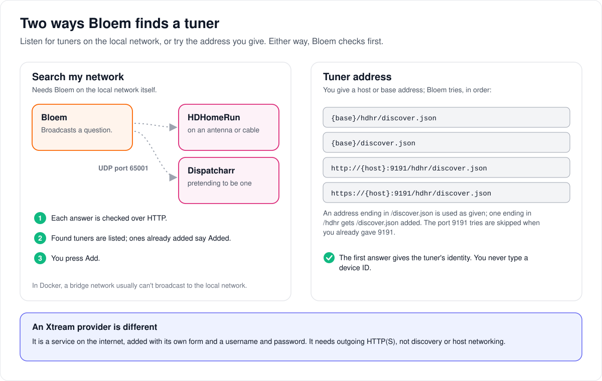
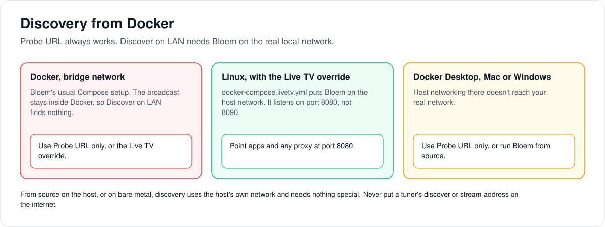

# How Live TV finds tuners

> **Provenance and status.** Bloem page, rewritten on 2026-11-01 and checked against
> `main` at `b6039036d`. Live TV is not a Silo feature; Silo lists it as a non-goal.
> The first version of this page, like Bloem's tuner code, was adapted from Prairie
> Server; Xtream providers are Bloem's own addition. Every route, setting and security
> rule is in the [For developers](#for-developers) section.

A **tuner** is a device that receives TV channels, such as a SiliconDust HDHomeRun box
on an antenna or cable. This page walks through the two ways Bloem finds one, how
Dispatcharr fits in, what to do when Bloem runs in Docker, and why an Xtream provider
is set up differently.

## Two ways to find a tuner



A platform administrator finds tuners under **Manage → Live TV → Tuners**, in the
**Platform** context (an organization's context doesn't list it), with the main profile
selected and any PIN entered.

- **Discover on LAN** sends a question across the local network and lists the tuners
  that answer: HDHomeRun boxes, and Dispatcharr when it answers the same way. Bloem has
  to be on the local network itself for this to work.
- **Probe URL only** tries one address you give, such as the address of a Dispatcharr
  server or a tuner. It works wherever Bloem can reach that address.

Either way, Bloem checks each tuner before you press **Add**, and tuners already added
are marked **Added**. To add a tuner by hand, type its address in **Tuner URL**: Bloem
finds the rest. You never type a device ID.

## Dispatcharr

**Dispatcharr** is a program that makes IPTV sources look like an HDHomeRun tuner, so
Bloem treats it as one. It needs no API key for this, so protect it on your network as
you would a tuner.

## When Bloem runs in Docker



Bloem's usual Docker setup runs on a **bridge network**, a private network inside
Docker. The question Discover on LAN sends doesn't leave it, so it finds nothing. Probe
URL still works.

1. **On Linux,** start Bloem with the Live TV override. It puts Bloem on the host's own
   network, where it listens on port 8080 instead of 8090. Point apps and any proxy at
   8080.
2. **On Docker Desktop for Mac or Windows,** the host's network isn't your real network.
   Use Probe URL only, or run Bloem from source on the computer itself.
3. **From source, or on bare metal,** discovery uses the computer's own network and
   needs nothing special.

## Xtream providers are different

An **Xtream provider** is a paid IPTV service on the internet. It is added with its own
**Xtream live TV provider** form on the same Tuners tab, with an address, a username and
a password, not through discovery. It needs outgoing internet access, not the Docker
override. See [how Xtream providers work](architecture/xtream-live-tv.md).

## Who can change what

| Who | What they manage |
| --- | --- |
| Platform administrator, with the main profile selected and any PIN entered | Listing, discovering, adding, scanning and removing tuners. |
| Anyone else, including an app holding a stream ticket | Nothing here. |

## Words used in the code

| On this page | In the code and repository |
| --- | --- |
| Discover on LAN | `POST /api/bloem/v1/livetv/tuners/discover` with `include_udp`; UDP port `65001` (`internal/livetv/hdhomerun/lan_discover.go`) |
| Probe URL only | the same route with `probe_urls`; candidates from `ProbeCandidateURLs` (`internal/livetv/hdhomerun/probe.go`) |
| Tuner URL | `POST /api/bloem/v1/livetv/tuners` with `url` |
| The Live TV override | `docker-compose.livetv.yml` |
| Address checks | `internal/livetv/fetch_url.go` |
| The Tuners tab | `web/src/pages/AdminLiveTV.tsx` |

## For developers

- **API:** [Live TV](bloem/api/live-tv.md): the tuner routes, with their fields
  and error codes.

History: Bloem's tuner, guide, streaming and DVR subsystem, and the first version of
this page, were adapted from [Prairie Server](https://github.com/Prairie-Server/prairie-server)
at commit `095ecd22fbea3384a905eb9049386015db3ff4d8` (AGPL-3.0) in `ef2d38171`
(2026-08-13). [`docs/livetv/prairie-source-manifest.tsv`](livetv/prairie-source-manifest.tsv)
lists every imported file with its source blob; it classifies this page and
`docker-compose.livetv.yml` as `adapted` (product copy changed from Prairie to Bloem).
See [FORK.md](../FORK.md#prairie-server-live-tv). Later Bloem changes: the operational
routes moved to the native `/api/bloem/v1` prefix in `9cc9d9326` (2026-09-14), and Xtream
providers were added in `23ee4c1ac` (2026-09-19), which is Bloem's own addition, not
Prairie's. Checked on 2026-11-01 by source review of `internal/livetv/hdhomerun/`,
`internal/livetv/fetch_url.go`, `internal/livetv/service.go`,
`internal/api/router_livetv.go`, `internal/api/handlers/livetv.go`,
`docker-compose.livetv.yml`, `docker-compose.advanced.yml` and
`web/src/pages/AdminLiveTV.tsx`; this refresh did not run a tuner.

### Discovery modes

Live TV administration is a platform page: choose the **Platform** administrative
context first (organization contexts do not list it). Bloem adds the Live TV item to
Silo's admin navigation after Requests (`web/src/lib/bloemAdminNavigation.ts`).

| Mode | What it finds | Requirements |
| --- | --- | --- |
| **Discover on LAN** | SiliconDust HDHomeRun (UDP broadcast to port `65001`) and any Dispatcharr instance that answers HDHR UDP discovery | Host must be able to broadcast/receive on the LAN |
| **Probe URL only** | Dispatcharr HDHR emulation (`/hdhr/discover.json`) or a direct HDHR `discover.json` | Reachable HTTP(S) URL |

Candidates are verified over HTTP before you click **Add**. Existing tuners are marked
**Added**.

Manual add takes a single **Tuner URL** (base URL or host). Bloem probes the usual
`discover.json` locations, including Dispatcharr's `/hdhr/` path, then stores the device
identity and base URL from the response. You do not need a separate discover URL or
device ID.

### Xtream is a separate setup flow

Authenticated Xtream live providers are added with the **Xtream live TV provider** form
(`web/src/components/livetv/XtreamProviderForm.tsx`) in the same Tuners tab, not through
LAN discovery, URL probe or generic tuner creation. Supply the provider base URL and
separate credentials, then attach its XMLTV guide by selecting the saved provider.
Xtream needs outbound HTTP(S), not HDHomeRun UDP discovery or the host-network override
below. Prefer HTTPS.

See [operator setup](wiki/admin-guide.md#210-live-tv) and the
[Xtream contract and limits](architecture/xtream-live-tv.md). Live TV administration
requires an authenticated administrator with the selected primary profile and any
required PIN verification; a delivery ticket cannot authorize it.

### Docker: enable LAN UDP discovery

Bloem's Compose deployment uses Silo's multi-container `docker-compose.advanced.yml`
(selected by `COMPOSE_FILE` in `.env.bloem.example`; Silo's default
`docker-compose.yml` now starts Silo's own all-in-one image). It runs the `silo`
application service in **bridge** networking. Bridge mode typically **cannot** send
SiliconDust discovery broadcasts to your LAN, so **Discover on LAN** returns no devices
(URL probe still works).

#### Linux: use the Live TV compose override

```sh
docker compose -f docker-compose.advanced.yml -f docker-compose.livetv.yml up -d
```

Or set in `.env`:

```dotenv
COMPOSE_FILE=docker-compose.advanced.yml:docker-compose.livetv.yml
```

What the override does:

- Sets `network_mode: host` on the `silo` application service and clears its published
  ports (`ports: !reset []`)
- Points `DATABASE_URL` / `REDIS_URL` at `127.0.0.1` (postgres/redis still publish their
  ports on the host's loopback address, `127.0.0.1:${POSTGRES_PORT:-5432}` and
  `127.0.0.1:${REDIS_PORT:-6379}`)
- Keeps the application's base listener on host port `8080`; the base `PORT` variable
  (default `8090`) applies only to bridge-mode host publishing, so clients and any
  reverse proxy must point at `8080` while the override is active

The override needs that multi-container layout: Silo's all-in-one image keeps its
PostgreSQL on a socket inside the container, which `127.0.0.1` cannot reach.

You can combine it with a hardware-acceleration override of your own (Silo no longer
ships `docker-compose.nvidia.yml`; see
[Bloem's Docker guide](bloem/overlays/wiki/deployment/docker.md#hardware-acceleration)):

```sh
docker compose -f docker-compose.advanced.yml -f compose.gpu.yml -f docker-compose.livetv.yml up -d
```

#### Docker Desktop (macOS / Windows)

`network_mode: host` does **not** attach the container to your real LAN. Prefer:

1. **Probe URL** with your Dispatcharr base (`http://dispatcharr.local:9191`) or HDHR IP
   (`http://192.0.2.50`)
2. Or run Bloem **from source on the host** (not in Docker) if you need UDP discovery

#### Bare metal / from source

No special config: UDP discovery uses the host network stack directly.

### Dispatcharr probe order

Dispatcharr exposes HDHomeRun-compatible endpoints (commonly under `/hdhr/`). For a bare
host or base URL, Bloem probes, in order (`internal/livetv/hdhomerun/probe.go`):

- `{base}/hdhr/discover.json`
- `{base}/discover.json`
- `http://{host}:9191/hdhr/discover.json` and `https://{host}:9191/hdhr/discover.json`,
  unless the given port was already `9191`

A URL that already ends in `/discover.json` is used as given, and one ending in `/hdhr`
gets `/discover.json` appended. For a base URL with a path, the bare `/hdhr/discover.json`
on the host is tried after the two path-relative candidates.

No Dispatcharr API key is required for HDHR emulation; protect it with network ACLs as
you would any tuner.

### API

The tuner routes are mounted by `mountLiveTVRoutes` (`internal/api/router_livetv.go`)
behind the acting-administrator gate; viewer routes such as channels, guide and
recordings are separate and described in
[Live TV client access](architecture/live-tv-client-access.md).

`POST /api/bloem/v1/livetv/tuners` accepts:

```json
{ "url": "http://192.0.2.50" }
```

Legacy `discover_url` and `device_id` fields are still accepted as aliases for the same
address. Provider credentials (`username`, `password`, `max_connections`) are refused on
this route. The SiliconDust hardware id is read from `discover.json` and stored as
`device_id` on the tuner; clients do not supply it. A body with `"type": "xtream"` is
refused with `400 invalid_argument`; Xtream providers use
`POST /api/bloem/v1/livetv/tuners/xtream`. Both bodies are limited to 32 KiB.

`POST /api/bloem/v1/livetv/tuners/discover` takes an optional body
`{ "timeout_ms": 2000, "include_udp": true, "probe_urls": ["http://dispatcharr.local:9191"] }`.
`timeout_ms` bounds the UDP listen window (default 2000, maximum 10000).

### Security notes

- Discovery and probe only accept `http://` / `https://` URLs (same Live TV fetch
  allowlist as manual add).
- URL validation and dial-time checks reject credentialed URLs, loopback and
  cloud-metadata destinations, including names that resolve to them
  (`internal/livetv/fetch_url.go`). Use a reachable permitted LAN address; a loopback
  fixture is not a supported tuner deployment. Do not disable these guards for
  acceptance testing.
- Do not expose HDHR/Dispatcharr discover or stream URLs to the public internet.
- Tuner listing, discovery, add, scan and removal are administrator-only.

Operational Live TV routes use the native Bloem prefix. See
[client access](architecture/live-tv-client-access.md) for viewer grants, signed HLS,
recording ownership and DVR limits. Actual tuner/Safari and multi-replica owner-loss
acceptance remain separate from offline decoding and synthetic HTTP fixtures.

### Related pages

- [How Live TV works](architecture/bloem-live-tv.md): sources, tuning in and recordings,
  in plain language.
- [Xtream live TV providers](architecture/xtream-live-tv.md): encrypted provider
  accounts, connection limits and guide limits.
- [Admin guide, Live TV](wiki/admin-guide.md#210-live-tv): setting it up.

The pictures are SVG files under `architecture/images/livetv-tuner-discovery/`, drawn by
`scripts/bloem/draw-pictures.py`. Redraw them there, not by hand.
