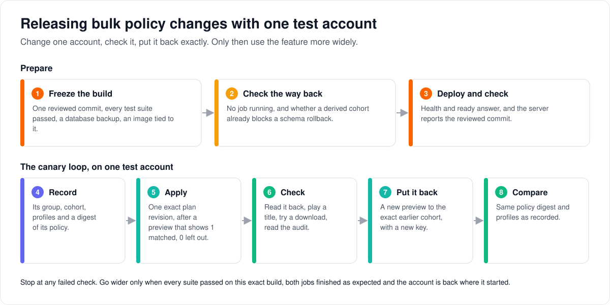

# Releasing bulk policy changes: the canary runbook

> **Provenance and status.** Bloem page, rewritten on 2026-11-01 and checked against
> `main` at `b6039036d`; its routes were checked again on 2026-11-11, after Silo retired
> its v1 API. Bulk policy changes are a Bloem addition, and this runbook is
> Bloem's own. It was written for the feature's first release in August 2026 and still
> applies to any release that changes it. The technical rules are in the
> [For developers](#for-developers) section.

This runbook releases the bulk policy feature
([how bulk policy changes work](bulk-policy-cohorts.md)) and proves it on a live server
with a single **canary**: one test account that gets a temporary plan change, is
checked, and is put back exactly as it was. It walks through preparing the release, the
canary itself, and the record that decides whether to go wider.

## The whole run at a glance



Before you start:

- **Someone must be allowed to do this.** Pushing, deploying, migrating and changing a
  live account need an authorized operator. Finishing a source review does not give
  that permission.
- **Keep secrets out of the record.** Replace every `<placeholder>` locally. Never paste
  credentials, API keys or the preview's tokens into the evidence record.
- Commands assume the repository root is the current working directory.

## 1. Freeze the build you reviewed

1. Write down `git rev-parse HEAD`: the **release commit**.
2. Make sure nothing is changed or uncommitted, and look at `git diff --check`.
3. Make sure the commit contains the default branch:

   ```sh
   git fetch origin main
   git merge-base --is-ancestor origin/main HEAD
   ```

4. Run the complete test suites (see [For developers](#tests-to-run)), then the
   feature's own tests. Passing the feature's tests does not replace the full run.
5. Back up PostgreSQL and check that the backup can be read.
6. Use an image tagged with that exact commit or its digest. Never `latest` for a
   canary: you must be able to say exactly what ran.

Stop if the branch cannot fast-forward the default branch, any test fails, the backup
is missing, or the image does not match the commit. A failure written down as "known"
is still a failure until it is fixed or its owner changes the requirement.

## 2. Check the way back

Before deploying:

1. Read both cohort migrations and run `make migrate-status` against the target server.
2. If you might need to undo the database change, make sure no policy job is `queued`
   or `running`.
3. Find out whether a derived or managed-default cohort already exists. One that does
   blocks undoing the cohort migration, on purpose.
4. Keep the backup until the canary and the observation period are over.

Bloem changes the database before it starts answering. Follow the logs, and do not
restart it during a migration. Starting the previous image again does not undo the
database.

## 3. Deploy and check the build

Deploy the image the normal way, then check that it is alive and ready:

```sh
curl -fsS <server-origin>/api/v1/health
curl -fsS <server-origin>/api/v1/ready
```

As a platform administrator, read the server's build information and make sure its
`revision` is the full release commit. Write down the image digest as a second check.
Do not change anything if health or readiness fails, the commit differs, or the database
is not in the migration state you expect.

Then open **Organization → People** and **Organization → Policy Cohorts** (or
**Platform → Bulk Account Policies** for accounts in the default organization) and
make sure they load without console or network errors.

## 4. Choose the canary

Choose one test account that is not an administrator and can safely get a temporary
plan change. Record only its account number and its organization's ID (or the word
`direct` for an account in the default organization). Never record its email or profile
names.

Before changing anything:

- make sure no other bulk job touches the account;
- find its exact current group or cohort, and a way to put it back;
- list which profiles follow the account and which have their own policy;
- choose one enabled plan revision whose effect you know;
- choose one title, and whether the change should let it play or not;
- choose one download quality that tests either an original download or a converted
  one, and note the title's `content_id` (and `file_id` if needed); and
- leave **Move custom profiles too** off, unless moving those profiles is what you are
  testing.

Read the account's current policy (the exact routes are in
[For developers](#the-reads-and-checks)) and save the answer locally. To fingerprint it
for the record:

```sh
jq -Sc '.policy' < before.json | shasum -a 256
```

This fingerprint only identifies what you saw. It does not replace the policy digest
Bloem itself reports.

## 5. Preview and apply

Pick only the canary account, choose **Put on a plan**, and choose the
exact plan and revision. The preview must show:

- 1 account matched and none left out;
- the same current group or cohort that you read;
- exactly the plan, revision and policy digest you chose;
- only field changes you expect;
- the profile counts you listed; and
- profiles with their own policy staying put, unless you chose otherwise.

Write down the counts, the expiry, the current and target, the target digest and the
field changes. Do not write down either token.

Confirm once. Write down the job number and follow it until it ends. It must show 1 of 1
done and no unexpected failure. The only acceptable skip is `already_applied`, and only
if you chose a target the account already had.

If the confirmation times out, follow the
[safe retry steps](bulk-policy-cohorts.md#monitoring-cancellation-and-retry). Do not make
a second idempotency key just because the first answer was lost.

## 6. Check what changed

Read the account again. It must show:

- the group, cohort and plan from the preview;
- a higher policy revision;
- exactly the target's complete policy;
- the profiles that follow the account, moved; and
- the profiles with their own policy, unchanged, unless you chose to move them.

Sign in as the test account, read one profile, and start playing the chosen title. The
result must match the new plan's playback, library, quality and conversion rules.
Playback says nothing about downloads, so check those separately with the same account
and profile:

1. Read the download capability. It must agree with the new policy and the server's own
   settings.
2. Ask for exactly one download of the chosen title at the chosen quality: `original`
   for the original-download rule, or a listed bitrate for the converted-download rule.
3. If it is allowed, Bloem accepts it; write down the download's number and qualities,
   then delete it. If it is refused, the refusal must have the expected reason, and no
   download may have been created.

Check the admin audit view for the job and the assignment: the right revisions, the
right counts, and no passwords, keys or raw infrastructure errors. The assignment's
policy fingerprint must describe the complete policy after the change, including the
audio-conversion rule.

Fingerprint the account's policy again with the same `jq` command.

## 7. Put it back

Make a new one-account selection and preview. Put the account back on its exact earlier
cohort. Use **Reset to the organization default** only if the account was on the managed
default before. Never approximate a custom or older state with a plan.

Confirm with a new idempotency key, follow the job to the end, and repeat every check
from step 6. The policy fingerprint and profile assignments must match what you recorded
at the start, apart from revision numbers and times that only go up. Delete any download
the check created.

If the account's earlier state cannot be restored with a reviewed command, stop before
the first change and choose another account.

## 8. Record the result and decide

Fill in this record without credentials or personal data:

| Evidence | Value |
| --- | --- |
| Reviewed/deployed full SHA | |
| Immutable image digest | |
| Complete required repository suite | pass/fail; no baseline waiver implied |
| Focused bulk/migration suites and manual browser checks | pass/fail |
| Complete effective-policy audit digest fix present | yes/no; audio-transcode regression result |
| Scoped API-key authoritative read fix present | yes/no; single/snapshot regression result |
| Scoped API-key canary (when API-key automation is used) | owner currently enabled platform admin; single/snapshot reads pass/fail |
| Build endpoint revision match | yes/no |
| Health and readiness timestamps | |
| Migration versions/status | |
| Scope (`organization UUID` or `direct`) | |
| Test Server account ID | |
| Before group/cohort/template and observed-policy digest | |
| Apply preview counts, target digest, and expiry | |
| Apply job ID and succeeded/skipped/failed counts | |
| Post-apply group/cohort/template and observed-policy digest | |
| Profile and playback checks | pass/fail + safe notes |
| Download capability and actual route check | quality; expected/actual status; safe download ID removed |
| Restore job ID and succeeded/skipped/failed counts | |
| Restored group/cohort/template and observed-policy digest | |
| Audit evidence checked | yes/no |
| Rollback eligibility/refusal condition | |
| Operator and observation-window end | |

Go beyond the one test account only when every suite and check passed on this exact
build, the build is healthy, both jobs ended with the expected counts, the download
checks matched the policy, the account is back where it started, and the audit record is
complete. Otherwise stop, leave no new job queued, and follow the way back you agreed
beforehand: roll forward or restore the backup.

## Who can change what

| Who | What they do in this runbook |
| --- | --- |
| Authorized operator | Push, deploy, migrate, and change the canary account. |
| Platform administrator | Read the build information, the canary's policy, and the audit; run direct-account bulk jobs. |
| Organization administrator | Run bulk jobs for their own organization's canary, under **Organization → People**. |
| The test account | Play a title and try a download to show the new policy works. |

## Words used in the code

| On this page | In the code and API |
| --- | --- |
| Release commit | the full SHA that `GET /api/v2/admin/system/build` reports as `revision` |
| Canary account | one Server account ID, in an organization or `direct` (the default organization) |
| Reading the account's policy | the authoritative entitlement reads (`internal/entitlements/account_policy.go`) |
| Policy fingerprint (yours) | `jq -Sc '.policy' \| shasum -a 256` of the read |
| Policy digest (Bloem's) | the preview's target `policy_digest`, and the audit's `effective_policy_digest` |
| Job | a policy job, `job_id`, with `progress_current` and `progress_total` |
| Move custom profiles too | `include_custom_profiles` |
| Way back | the Down sections of `20260822090000_entitlement_policy_cohorts` and `20260822100000_admin_people_policy_jobs` |

## For developers

- **API:** the [plans and preview API](../bloem/api/plans.md) lists the platform cohort,
  snapshot and bulk routes; the
  [organizations and administration API](../bloem/api/organizations.md) lists the
  organization people policy routes and the organization-scoped authoritative read.

### Where this runbook came from

The feature and this runbook are Bloem's; see
[how bulk policy changes work](bulk-policy-cohorts.md#where-it-came-from) for the
feature's history. The runbook was written on August 22, 2026, for the feature's first
release (`cf14f1635`, tightened in `dd29ed42e` and `5b7673be1`). The "Task" numbers
in the original refer to the implementation plan of that release. The two corrections
it requires are `c0cadc675` (the assignment audit hashes the complete effective policy)
and `1b74d98b9` (scoped API keys may use the authoritative reads). Both have been on
`main` since August 22, so every current build includes them.

At `b6039036d` (as before at `e852f92bf`), the routes, `make` target, response fields
and error codes it names were checked against the source and are current. The Playwright canary journey
(`web/e2e/bulk-policy-cohorts.spec.ts`, added in `4834e27a2`) was removed on
October 26, 2026 (`dcb93649d`), with the Playwright configuration, because no script,
workflow or Makefile ran it. Until a replacement exists, the browser checks in steps 3
and 5 are manual. This repository has no record of the canary being run in production.
Since October 2026, production deployments have been recorded as dated receipts in this
directory; the [October 27, 2026 receipt](2026-10-27-main-deployment.md) records
production applying the feature's latest migration,
`20261026170000_bloem_cohort_coherence_ignores_deleted_libraries`.

The compile, handler, access, and web-harness failures found during the Task 8 source
review were corrected before release preparation. That historical fix is not a standing
waiver: every release artifact must still pass the complete required repository suite
and the focused gates before deployment.

### Tests to run

- The complete repository release gates from
  [`CONTRIBUTING.md`](../../.github/CONTRIBUTING.md#validate-your-change); Bloem's local
  form of the gate is described in [Bloem CI](../bloem/ci.md).
- The focused bulk policy suites (`go test ./internal/adminpeople/...
  ./internal/entitlements/...` and the handler tests for `entitlement_bulk.go`,
  `entitlement_account_policy.go` and `bloem_admin_people.go` in
  `internal/api/handlers`) and the migration refusal tests.
- The post-Task 4 corrections' regressions against the exact artifact: `c0cadc675`
  hashes the complete authoritative effective policy in assignment audits (including the
  audio-transcode gate), and `1b74d98b9` lets `admin:entitlements:bulk` API keys use the
  authoritative single-account and snapshot read routes only while their owner remains
  an enabled platform administrator.

A failure documented as a known baseline is still a failed release gate until it is
fixed or the requirement is explicitly changed by its owner.

### Migration and rollback rules

The application applies pending migrations before opening its listener. A previous
image alone is not a database rollback. Rollback rules are fail-safe:

- `20260822100000_admin_people_policy_jobs` refuses down while a policy job is
  `queued` or `running` ("cannot roll back: people policy jobs are queued or running").
- `20260822090000_entitlement_policy_cohorts` refuses down while any cohort revision
  has a `derivation_kind` other than `exact_template`, that is a derived
  (`policy_patch`) or `managed_default` cohort the old schema cannot represent
  ("cannot roll back: derived entitlement policy cohorts exist").
- Never delete job/cohort rows or remove managed markers to force a down migration. If
  refusal is expected, roll forward or restore the reviewed backup under the incident
  plan.

### The reads and checks

- **Build:** `GET /api/v2/admin/system/build` with a platform-admin session; require `revision` to equal the full reviewed SHA.
- **Liveness and readiness:** `GET /api/v1/health` and `GET /api/v1/ready`, the retained
  operational probes.
- **Authoritative policy reads** before preview, after apply and after restore:

  ```text
  GET /api/bloem/v2/admin/platform/accounts/{account_id}/entitlement
  GET /api/bloem/v2/admin/platform/organizations/{organization_id}/accounts/{account_id}/entitlement
  ```

- **Preview requirements:** `matched = 1` and `excluded = 0`; current cohort/group
  agrees with the authoritative read; target template key/revision and policy digest
  are exact; inherited/custom profile counts match the inventory;
  `include_custom_profiles=false` unless custom-profile movement is under test.
- **Job requirements:** poll the policy-specific status route until terminal; require
  `progress_current = progress_total = 1`, no unexpected failed record, and only an
  expected `already_applied` skip.
- **After apply:** target group and cohort/template provenance match the preview; the
  account policy revision advanced; the complete effective policy matches the target;
  inherited profiles moved; custom profiles stayed unless movement was confirmed.
- **Downloads** (Silo's `/api/v2` download routes; the v1 ones this runbook used before
  2026-11-11 are retired):
  1. `GET /api/v2/capabilities/downloads`: `download_allowed`, `quality_presets` and
     `transcode_user_allowed` must agree with the authoritative effective policy and
     server-level feature state.
  2. Exactly one `POST /api/v2/downloads` for the recorded `content_id` (and
     `media_file_id` when needed) with the chosen `quality`: `original` (the default) for the
     original-download gate, or a listed bitrate preset (`20mbps`, `10mbps`, `5mbps`,
     `2mbps`, `1mbps`) for the transcoded-download gate.
  3. Allowed: require `202`, record the safe download ID from `items` with `quality`
     and `effective_quality`, then `DELETE /api/v2/downloads/{id}` and require `204`.
     Denied: require `403` (`permission_denied`), and no download row created.
- **Audit:** job and assignment events with the expected revisions, safe result counts,
  and no credentials or raw infrastructure errors. The assignment audit's
  `effective_policy_digest` must describe the complete post-assignment effective
  policy, including the audio-transcode gate, rather than only the durable cohort
  projection.
- **Restore:** a fresh one-account selection and preview, a new idempotency key, then
  the authoritative policy, profile, playback, download capability, actual download
  route and audit checks again. The restored policy digest and profile assignments must
  equal the captured before state, except for expected monotonic revision/timestamp
  changes.

Technical pages:

- [How bulk policy changes work](bulk-policy-cohorts.md): concepts, invariants,
  routes, errors and safe records.
- [How plans work](../architecture/bloem-plans.md).
- [Downloads API](../downloads-api.md).
- [Installing and running Bloem with Docker](../bloem/overlays/wiki/deployment/docker.md#backups-and-updates):
  backups, updates and migrations.

The picture is an SVG file under `docs/architecture/images/bulk-policy-cohorts-runbook/`,
drawn by `scripts/bloem/draw-pictures.py` from
`scripts/bloem/pictures/bulk_policy_cohorts_runbook.py`. Redraw it there, not by hand.
