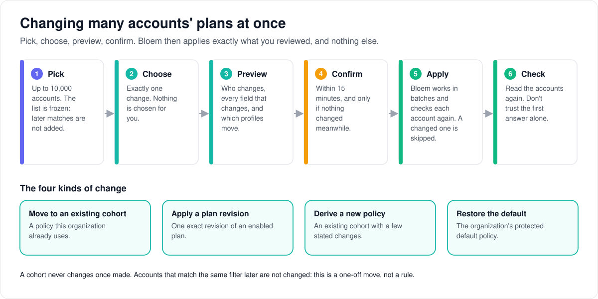
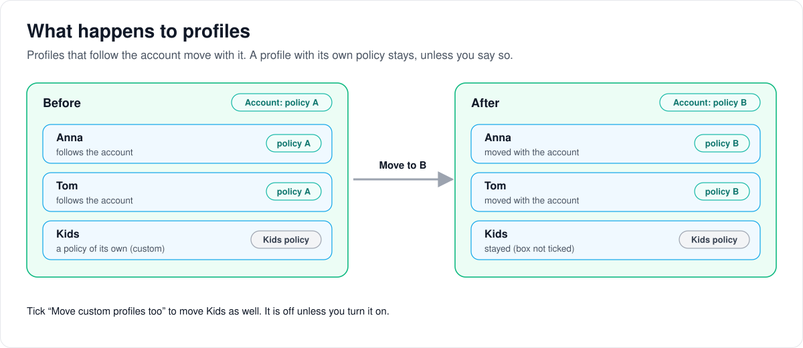

# How bulk policy changes work

> **Provenance and status.** Bloem page, rewritten on 2026-11-01 and checked against
> `main` at `b6039036d`. Bulk policy changes and policy cohorts are a Bloem addition:
> Silo has access groups but no plans, cohorts or bulk policy jobs. The technical rules
> are in the [For developers](#for-developers) section.

An administrator sometimes needs to put many existing accounts on a different
**plan** at once, for example to move every member of an organization to a new
revision of a plan. This page walks through how that works: what a cohort is, the
steps from choosing accounts to checking the result, what happens to each household's
profiles, and what to do when something goes wrong. Releasing and testing the feature
on a live server is in the [release and canary runbook](bulk-policy-cohorts-runbook.md).

## What a cohort is

A **plan** (see [how plans work](../architecture/bloem-plans.md)) decides what an
account gets: libraries, screens, video conversions, quality and downloads. A plan
changes by gaining **revisions**; the old ones stay as they were.

A **policy cohort**, or **cohort**, is one organization's frozen copy of a complete
policy that a group of its accounts shares. It is made in one of three ways:

- from **one exact revision of a plan**. Applying the same revision again in the same
  organization reuses the same cohort;
- by **deriving** it from an existing cohort with a few stated changes, such as one
  more screen;
- as the organization's **managed default**, its protected default policy.

A cohort never changes once it exists. To change what its accounts get, make a new
cohort and move them to it. Behind each cohort is a protected **access group**, and the
ordinary group settings cannot edit, delete or demote it.

A bulk change is a **one-off move**, not a rule. It changes the accounts you picked,
once. An account that later matches the same filter is not changed.

## Changing many accounts at once



1. **Pick the accounts.** An organization administrator uses the people filters; a
   platform administrator searches for accounts by name or email, or pastes a list of
   account numbers. Up to 10,000 accounts. The list is frozen at that moment.
2. **Choose exactly one change.** Nothing is chosen for you:
   - **Move to a cohort** that this organization already uses;
   - **Put on a plan**: one revision of an enabled plan;
   - **Change some settings**: an existing cohort plus stated changes;
   - **Reset to the organization default**: the organization's protected default. There is
     no "remove policy": every account always has one.
3. **Read the preview.** It shows how many accounts match and how many were left out,
   which cohorts they are on now, the target and its fingerprint (**policy digest**,
   shown as **Settings fingerprint** under **Details**), every field that changes,
   which accounts already have it, and which profiles move.
4. **Decide about profiles with their own policy** (below), with **Also change profiles
   with their own settings** next to the change. The default is to leave them alone.
5. **Confirm** within 15 minutes of picking the accounts. The confirmation is tied to
   exactly what you reviewed. If anything changed in between, make a new preview.
6. **Bloem applies it** in the background, in batches. It checks each account again
   first. An account that changed since the preview is **skipped** with a reason,
   rather than given a change nobody reviewed. Your own account is skipped if the
   change could take away the authority you need.
7. **Check the result** by reading the accounts again. The first answer only says the
   job started.

## What happens to profiles



A **profile** is one person on an account. Most profiles **follow the account**: they
are on the same access group as the account. Those move with it. A profile on a group
of its own, such as a kids profile with tighter limits, is **custom**, and stays where
it is unless you tick **Move custom profiles too**.

Bloem decides which profiles follow the account twice: when it makes the preview, and
again when it applies the change.

### Example

This example is made up. The Jansen account is on policy A with three profiles: Anna
and Tom follow the account, and Kids has a policy of its own. An organization
administrator moves the account to policy B and leaves **Move custom profiles too**
unticked. Afterwards Anna and Tom are on policy B, and Kids is still on its own policy.

## When something goes wrong

- **The request timed out, or the answer was lost.** If you got a job number, look the
  job up. If not, send exactly the same request again with the same **idempotency
  key** (the request's own unique name). Bloem recognises it and returns the original
  job instead of starting a second one.
- **"Idempotency conflict".** That key was already used for a different selection,
  change or route. Stop and check what you sent.
- **The selection or confirmation expired, or is stale.** Make and review a new preview,
  and use a new idempotency key.
- **Some accounts failed or were skipped.** Read the reasons. Don't retry
  automatically with a new list you made up: pick only the accounts you mean, preview
  again and confirm.
- **Cancelling.** A running job stops at the end of its current batch. A finished job
  cannot be cancelled.

## Who can change what

| Who | What they manage |
| --- | --- |
| Organization administrator | Bulk changes for active members of their own organization, under **Organization → People** (select people, then **Change plan or settings**). Reading the organization's cohorts under **Organization → Policy Cohorts**. |
| Platform administrator | Bulk changes for an explicit list of accounts in the default organization, under **Platform → Bulk Account Policies**, and through the platform API for any organization. |
| An automation with an API key | The platform routes, when the key belongs to an enabled platform administrator and is unscoped or carries `admin:entitlements:bulk`. |

## Words used in the code

| On this page | In the code and database |
| --- | --- |
| Plan, plan revision | an entitlement template revision (`internal/entitlements`, `template_store.go`) |
| Cohort | `entitlement_policy_cohorts` and its `entitlement_policy_cohort_revisions`, each backed by one access group with `access_groups.managed_cohort_id` |
| How a cohort was made | `derivation_kind`: `exact_template`, `policy_patch` or `managed_default` |
| Picking accounts | an immutable selection, `admin_people_selections` (`internal/adminpeople`) |
| The change | a policy command `kind`: `assign_entitlement_cohort`, `apply_entitlement_template`, `derive_entitlement_cohort`, `restore_default_entitlement` |
| Preview | `adminpeople.PolicyPreview`, with a selection token and a confirmation token |
| The background job | an `admin_jobs` row with its `admin_people_bulk_jobs` row, run by `adminpeople.Worker` |
| Follows the account | `inherits_account` |
| Move custom profiles too | `include_custom_profiles` |
| Reading the accounts again | the authoritative account policy reads (`internal/entitlements/account_policy.go`) |

## For developers

- **API:** the [plans and preview API](../bloem/api/plans.md) lists the platform
  cohort, snapshot and bulk routes; the
  [organizations and administration API](../bloem/api/organizations.md) lists the
  organization people policy routes. The longer reference is the
  [native `/api/bloem/v2` reference](../bloem-api-reference.md#platform-entitlement-cohorts-and-bulk-policy).

### Where it came from

Bulk policy cohorts are Bloem's. Silo has access groups (`internal/access`) but no
entitlement templates, cohorts or bulk policy jobs: the `internal/entitlements` and
`internal/adminpeople` packages, the `/api/bloem/v2` routes and the admin pages below
exist only in Bloem.

- **Added August 21–22, 2026.** The commits are `af226de60` (immutable cohorts),
  `da4d974b2` (authoritative account policy reads), `2b3641937` (previews),
  `fec535d55` (durable jobs), `37fbcef7d` (platform APIs) and `c49d44e97`
  (organization UI). The migrations are `20260822090000_entitlement_policy_cohorts`
  and `20260822100000_admin_people_policy_jobs`. This page and the
  [runbook](bulk-policy-cohorts-runbook.md) were added in `cf14f1635`.
- **Changed since then:**
  - `811fb4d29` (September 2) moved Bloem's native API to `/api/bloem/v2`.
  - `f1e6f1ab5` (October 13) records the acting administrator as the cohort creator.
  - `22e4a4b05` (October 14) refuses a derived cohort of the preview template.
  - `c60b7008e` (October 26) moved account policy back onto `users`, where Silo keeps
    it. Since then a membership only links an account to its one organization.
  - `b017bfe84` (October 26) removed Bloem's general Idempotency-Key replay. Policy
    jobs keep their own idempotency key.
  - `84624b9b3` (October 26, migration
    `20261026170000_bloem_cohort_coherence_ignores_deleted_libraries`) lets an
    administrator delete a library that a cohort group lists. Production applied that
    migration on October 27 ([receipt](2026-10-27-main-deployment.md)).
  - `bee8a7728` (October 27) removed the platform bulk routes' `429 rate_limited`
    answer, which nothing produced.
- **Current at `b6039036d`** (first checked this way at `e852f92bf`). The routes,
  operation names, the 10,000-account limit,
  the 15-minute expiry, the API key scope, the error codes and the admin page labels on
  this page were checked against the source. That is a source check, not a record of a
  production bulk job.

### Concepts and invariants

- A **template revision** is a reusable global policy definition. A bulk operation
  never edits it.
- A **policy cohort revision** is an immutable organization-scoped effective policy
  backed one-to-one by a protected access group. Exact applications of the same
  template revision converge on the same organization cohort; an existing archived
  exact cohort stays authoritative.
- A **derived cohort** is a complete policy produced by applying an explicit patch to an
  existing cohort. It has its own protected group and cannot change accounts outside the
  reviewed selection.
- The **managed default** is the organization's protected default group. Restoring
  default assigns it; there is no remove-policy operation.
- An **authoritative read** resolves current account and profile access groups, policy
  provenance, and complete effective policy from Server state. A caller's expected
  template or provisioning state is never treated as current truth.

Cohort-backed groups cannot be updated, deleted, made default, or demoted through the
generic access-group API (`access.ErrManagedGroup`,
`entitlements.ErrManagedCohortImmutable`). Cohort revisions cannot be updated or
deleted. Archive state affects discovery only (`ListCohorts` hides archived cohorts
unless asked) and never removes an applied policy.

### Interfaces

Organization administrators use:

- **Organization → People** (`/admin/organization/people`) to select people and open
  **Change plan or settings**;
- **Organization → Policy Cohorts** (`/admin/organization/policy-cohorts`) to inspect
  source revision, policy, lineage, member count, creator/time, and archive state; and
- the organization routes `GET /api/bloem/v2/admin/organization/entitlement-cohorts`
  and `…/entitlement-cohorts/{cohort_id}`, `POST …/organization/people/selections`, and
  the people policy routes under `/api/bloem/v2/admin/organization/people`
  (`policy-previews`, `policy-jobs`, `policy-jobs/{job_id}`,
  `policy-jobs/{job_id}/cancel`) for preview, enqueue, status, and cancel.

Platform administrators use **Platform → Bulk Account Policies**
(`/admin/platform/direct-accounts/bulk`) for an explicit list of directly managed
Server account IDs. The direct-account routes use the deployment's default
organization, resolved server-side. Equivalent organization routes take the
organization UUID in the path:

```text
GET  /api/bloem/v2/admin/platform/organizations/{organization_id}/entitlement-cohorts
GET  /api/bloem/v2/admin/platform/organizations/{organization_id}/entitlement-cohorts/{cohort_id}
POST /api/bloem/v2/admin/platform/organizations/{organization_id}/entitlement-bulk/policy-previews
POST /api/bloem/v2/admin/platform/organizations/{organization_id}/entitlement-bulk/policy-jobs
GET  /api/bloem/v2/admin/platform/organizations/{organization_id}/entitlement-bulk/policy-jobs/{job_id}
POST /api/bloem/v2/admin/platform/organizations/{organization_id}/entitlement-bulk/policy-jobs/{job_id}/cancel
POST /api/bloem/v2/admin/platform/accounts/entitlement-bulk/policy-previews
POST /api/bloem/v2/admin/platform/accounts/entitlement-bulk/policy-jobs
GET  /api/bloem/v2/admin/platform/accounts/entitlement-bulk/policy-jobs/{job_id}
POST /api/bloem/v2/admin/platform/accounts/entitlement-bulk/policy-jobs/{job_id}/cancel
```

Authoritative platform reads are:

```text
GET  /api/bloem/v2/admin/platform/accounts/{account_id}/entitlement
GET  /api/bloem/v2/admin/platform/organizations/{organization_id}/accounts/{account_id}/entitlement
POST /api/bloem/v2/admin/platform/accounts/entitlement-snapshots
POST /api/bloem/v2/admin/platform/organizations/{organization_id}/entitlement-snapshots
```

The bulk snapshot body is `{ "account_ids": [41, 42] }`, at most 10,000 IDs
(`entitlements.MaxAccountPolicySnapshotIDs`), strict JSON with a 1 MiB limit. All
results share one `observed_at` timestamp. Each successful item contains current
account group, cohort and source-template provenance, policy revision, complete resolved
policy, and every profile's effective policy plus `inherits_account`. Missing or foreign
accounts return a safe per-account `not_found`; policy provenance is reported as
`managed`, `custom`, or `legacy_unmanaged` without invention.

### Review and apply

1. Select accounts. Organization administrators may use the existing people filters;
   platform direct-account operations require an explicit bounded ID list of 1–10,000
   unique positive IDs (`maximumSelectionTargets`). The selection is immutable.
2. Choose exactly one operation. No cohort or template is selected by default.
3. Create a preview. Review matched/excluded counts, current cohort distribution,
   target key/revision and policy digest, every field difference, already-compliant
   accounts, and profile movement.
4. Decide whether custom profiles should move. The default is **off**.
5. Confirm before the displayed expiry. The selection token and the confirmation token
   expire together, 15 minutes after the selection's snapshot (`selectionTTL`).
   Confirmation is bound to the immutable selection, exact command, actor, organization
   policy revision, route scope, target revision, and custom-profile choice.
   Direct-account confirmations also bind a digest of the immutable account-ID target
   set; a token made on an organization route cannot be used on a direct-account route
   or the other way round.
6. Enqueue with one stable idempotency key and poll the returned `job_id` until
   `completed`, `failed`, or `cancelled`.
7. Re-read authoritative account policies and compare them with the reviewed target. Do
   not infer success only from the enqueue response.

Available operations are:

| Operation | Admin console label | Action on the wire | Effect |
| --- | --- | --- | --- |
| Assign cohort | Move to an existing cohort | `assign_entitlement_cohort` | Moves selected accounts to an existing active cohort revision. |
| Apply template | Apply an exact template revision | `apply_entitlement_template` | Reuses or creates the exact cohort for one enabled template revision. |
| Derive cohort | Derive a policy for this selection | `derive_entitlement_cohort` | Applies an explicit deterministic patch and creates/reuses a separate immutable derived cohort. A derived cohort of the preview template is refused. |
| Restore default | Restore the managed default | `restore_default_entitlement` | Moves selected accounts to the protected managed default; never to no policy. |

Patches use explicit `add`, `remove`, `replace`, `all`, `none`, or `unrestricted`
modes where applicable. They never toggle. Omitted fields stay unchanged, and invalid
policy dependencies or no-op derivations are rejected.

### Profile behavior

A profile is inherited when its access group equals the account's current access group
at preview and execution time. Inherited profiles move with the account. A profile on
another group is custom and remains unchanged unless the operator explicitly turns on
**Move custom profiles too** (`include_custom_profiles`).

Execution rechecks every account, membership, access group, policy revision, and profile
classification. A stale target is skipped with a stable reason instead of applying a
now-unreviewed change. The acting account is also skipped when the workflow could affect
its required administrative authority.

### Monitoring, cancellation, and retry

Jobs commit bounded batches (100 accounts by default) and resume after a process restart
without repeating completed account records. Each result exposes progress plus
successful, skipped, and failed counts; skipped and failed records carry only a Server
account ID and a stable safe reason (such as `already_applied`, `not_found`,
`authorization_state_changed` or `actor_authority_target`).

Cancellation is best-effort at a batch boundary. A terminal job cannot be cancelled.
When a request times out or its response is lost:

1. Query the job if a `job_id` was received.
2. If no job ID was received, resubmit the exact same payload with the same idempotency
   key.
3. Treat the returned original job as the outcome of an exact replay.
4. If the server returns `idempotency_conflict`, stop: the key was reused with a
   different selection, command, or route scope.
5. If confirmation or selection is stale/expired, create and review a new preview and
   use a new idempotency key.

Do not automate retries of per-account failures by inventing a new target set. Review
the safe reasons, create a fresh selection containing only intended targets, and
preview again.

### Errors

The platform routes answer `403 insufficient_platform_authority`, `404 not_found`,
`409 selection_expired`, `409 policy_confirmation_stale`, `409 idempotency_conflict`,
`409 job_not_cancellable`, `409 authorization_state_changed`, `422 validation_failed`
and `503 entitlements_unavailable`. The organization people routes answer the same
conflicts, `403 insufficient_organization_authority`, `422 validation_failed` and
`503 tenant_unavailable`; their `authorization_state_changed` carries
`current_revision` when the request named an account. Operational and storage errors
are never returned verbatim.

### Authorization and safe records

Organization routes require a current organization-admin context and can affect only
active memberships in that organization. Platform routes require a platform-admin
context, or an API key owned by an enabled platform administrator (the owner is checked
again on every request) that is unscoped or carries the exact `admin:entitlements:bulk`
scope (`auth.ScopeAdminEntitlementsBulk`). The scope narrows access; it does not itself
grant platform authority, and it reaches only the cohort reads, authoritative reads,
snapshots and bulk routes above. Cross-organization references collapse to safe
not-found responses.

Retain job IDs, organization UUIDs, Server account IDs, cohort/template identities,
policy digests, counts, timestamps, and stable reason codes. Do not retain bearer
credentials, API keys, selection tokens, confirmation tokens, email addresses, personal
search text, raw database errors, or upstream provider errors.

### Migration and rollback boundary

The migrations adopt existing exact-template groups without changing policy or
assignments. Existing custom groups remain custom, and existing people jobs continue
under their prior action contract.

Schema rollback refuses while a policy job is `queued` or `running`
(`20260822100000_admin_people_policy_jobs`). It also refuses when a derived or
managed-default cohort, one whose `derivation_kind` is not `exact_template`, exists and
so cannot be represented by the prior schema
(`20260822090000_entitlement_policy_cohorts`). Never bypass these checks or manually
clear cohort markers: doing so could turn an immutable managed policy into an editable
custom group. Follow the [release and canary runbook](bulk-policy-cohorts-runbook.md) for
preflight, rollback assessment, and bounded verification.

### Tests

The rules are pinned in `internal/adminpeople` (`policy_preview_test.go`,
`service_policy_test.go`, `worker_test.go`) and `internal/entitlements`
(`cohort_store_test.go`, `policy_patch_test.go`, `account_policy_test.go`,
`account_policy_digest_test.go`, `bloem_preview_template_test.go`,
`bloem_cohort_creator_test.go`, `bloem_cohort_library_delete_test.go`).

Technical pages:

- [Bulk policy cohorts release and canary runbook](bulk-policy-cohorts-runbook.md).
- [How plans work](../architecture/bloem-plans.md) and the
  [entitlement templates guide](../wiki/admin/entitlement-templates.md).
- [Entitlement template operations](entitlement-templates.md).
- [How organizations work](../architecture/bloem-organizations.md).

The pictures are SVG files under `docs/architecture/images/bulk-policy-cohorts/`, drawn
by `scripts/bloem/draw-pictures.py` from `scripts/bloem/pictures/bulk_policy_cohorts.py`.
Redraw them there, not by hand.
