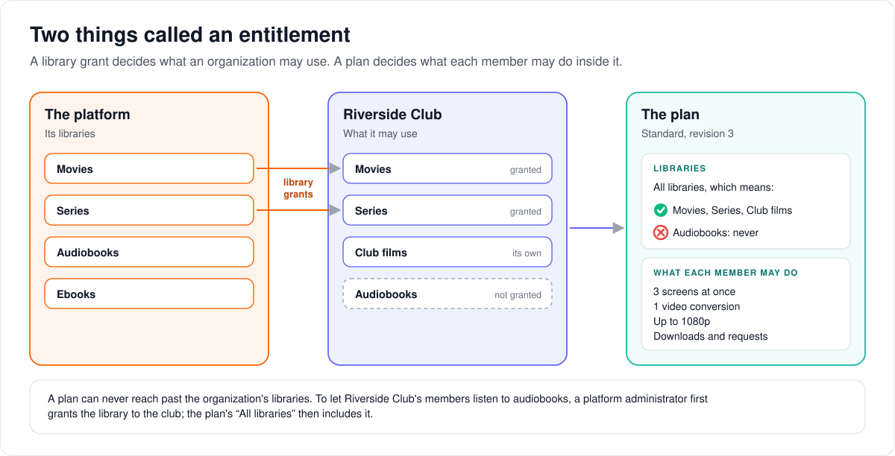
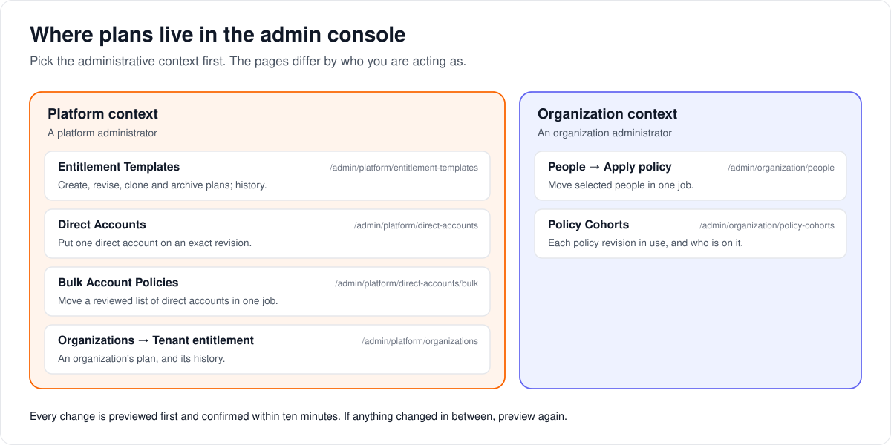

# Managing entitlement templates

> **Provenance and status.** Bloem page, rewritten on 2026-11-01 and checked against
> `main` at `b6039036d`. Entitlement templates (Bloem's plans) are a Bloem
> addition: Silo has access groups (`internal/access`) but no templates. This page
> is the procedure for a platform administrator; it is a source check, not a
> record of a production apply. The technical rules are in the
> [For developers](#for-developers) section.

An **entitlement template** is a plan: a named policy for what an account may do,
kept as a series of **revisions** that never change once saved. This page walks
through the two things Bloem calls an entitlement, the plans Bloem starts with,
where to find everything in the admin console, and how to create, change and
apply a plan safely, one account, one organization or many accounts at a time.
The plain explanation of plans is [how plans work](../architecture/bloem-plans.md).

## Two things called an entitlement



Bloem uses the word "entitlement" for two different controls:

- **A plan (policy entitlement template)** says what members may do: play, how
  many screens and video conversions, downloads, requests, permissions, picture
  quality, and which libraries.
- **A library grant (organization library entitlement)** lets an organization
  use a library that belongs to the platform. It is managed with the
  organization's libraries.

A plan can never reach past the libraries an organization has. Its library choice
is an extra limit inside what the organization owns or was granted. (Riverside
Club in the picture is a made-up organization.)

## The plans Bloem starts with

Every installation, new or upgraded, has these enabled revision-1 plans. All of
them start on **All libraries**, so they follow every library the account can
reach, now and later.

| Key | Plays | Screens | Profiles | Conversions | Downloads | Converted downloads | Quality | Requests |
| --- | --- | ---: | ---: | ---: | --- | --- | --- | --- |
| `browse-only` | No | 0 | 0 | 0 | No | No | — | No |
| `viewer` | Yes | 1 | 5 | 0 | Yes | No | 1080p | Yes |
| `standard` | Yes | 3 | 5 | 1 | Yes | Yes | 1080p | Yes |
| `premium` | Yes | 4 | 5 | 2 | Yes | Yes | 2160p | Yes |
| `reseller-member` | Yes | 3 | 5 | 1 | Yes | Yes | 1080p | Yes |
| `bloem-preview` | No | 0 | 0 | 0 | No | No | — | No |

These are starting points, not fixed products. Revise them, or clone one under a
new key, to match what you sell. Two are protected:

- **`browse-only`** can never be changed to play video, and cannot be archived.
- **`bloem-preview`** is the storefront preview's plan
  ([how browse-only access and the preview work](../architecture/bloem-browse-only-content-policy.md)).
  It grants no permissions at all, where the others grant every permission. Only
  its libraries can change. It cannot be archived or switched off, no group of
  accounts can be built from it, and no other plan can take its key.

## Where to find it



Choose the **Platform** administrative context, then:

- **Plans** (`/admin/platform/entitlement-templates`): the plans
  and their history.
- **Direct Accounts** (`/admin/platform/direct-accounts`): one direct account at a
  time.
- **Change Many Accounts** (`/admin/platform/direct-accounts/bulk`): a reviewed
  list of direct accounts.
- **Organizations**, then an organization, then **Plan**: the
  organization's plan.

An organization administrator works in the **Organization** context: **People**,
then **Change plan or settings**, and **Cohorts** for the history.

## Create, revise, clone and archive

1. Open **Plans** and select **New plan**.
2. Type a name; Bloem suggests a lowercase key from it, which you can change
   before saving. Choose whether the plan is offered, and set the policy.
3. Save. This makes revision 1.
4. To change a plan, create a **new revision**. Earlier revisions stay as they
   were and are listed under **Revisions**.
5. **Copy** when the new policy is a different product or purpose. The clone
   starts switched off, so you can review it before anyone uses it.
6. **Archive** only when nobody should choose the key any more. Accounts already
   on it keep their policy.

To roll back, pick an older revision under **Revisions** and select
**Go back to this**. Bloem never edits or deletes past revisions.

## Put an organization on a plan

1. Open **Platform → Organizations** and select the organization.
2. In **Plan**, pick an enabled plan and an exact revision.
3. Run the **preview** (dry run). Check the old and new plan and revision, the
   policy, which profiles move, the libraries, and the organization's seats and
   conversions.
4. **Confirm within ten minutes.** The confirmation belongs to you, this
   organization, this exact revision and the state you previewed.

Applying changes only Bloem's managed default group and the profiles on it.
Groups the organization made itself are left alone.

## Put one direct account on a plan

Open **Platform → Direct Accounts**, load the account by its number, and use the
same preview-then-confirm steps. Bloem creates or updates that account's own
managed group in the default organization. No other account or custom group
changes.

## Move many accounts at once

Don't repeat the one-account steps in a loop. A bulk move takes one fixed
selection, one reviewed preview and one job that finishes the whole change:

- An organization administrator selects people under **Organization → People**,
  chooses **Change plan or settings**, and can see the history under **Cohorts**.
- A platform administrator uses **Platform → Bulk Account Policies** for a list
  of direct account numbers.
- Moving people to an exact plan revision reuses that revision's group for the
  organization. Changing a few fields for a selection makes a separate group for
  them; it doesn't change the plan or anyone else.
- **Reset to the organization default** puts accounts back on the protected default.
  It never leaves an account without a policy.

The preview shows who is on what now, exactly where each account will come from,
each field that changes, who already matches, and which profiles will move or
stay. Its confirmation expires, and any real change to the selection, the
command, who you are, where you are working or the policies makes it invalid.

Details: [bulk policy cohorts](bulk-policy-cohorts.md) and the
[bulk policy release runbook](bulk-policy-cohorts-runbook.md).

## When something goes wrong

- **"Stale confirmation" or "target changed".** Don't send the old confirmation
  again. Reload, preview again, review, and confirm the new preview.
- **A built-in plan is missing after an upgrade.** Check that migration
  `20260821210000_enable_builtin_entitlement_templates` ran and that you are in
  the Platform context.
- **A bulk job's answer was lost.** Read the job first. Send the exact same
  command with the same key again only if no job came back. A different
  selection, command or scope needs a new key and a new preview.
- **Keeping records.** The per-account reason codes for skipped or failed
  accounts are safe to keep in an operations record. Confirmation and selection
  tokens are not.

## Example: four screens on Standard

This example is made up.

An installation wants Standard to allow four screens. The platform administrator:

1. Opens **Standard** and creates revision 2 with four screens. Revision 1 stays.
2. Opens **Change Many Accounts**, pastes the list of direct accounts on
   Standard revision 1, chooses **Put on a plan**, then **Standard** and revision 2.
3. Reads the preview: 120 accounts change from three screens to four, and 4
   accounts are already on revision 2.
4. Confirms within 15 minutes of pasting the list (a bulk move's confirmation
   expires with its selection), and follows the job until it finishes.

A week later the change proves too generous. The administrator saves revision 1's
values as revision 3 and moves the same accounts to it.

## Who can change what

| Who | What they manage |
| --- | --- |
| Platform administrator | Creating, revising, cloning and archiving plans. Applying them to organizations and to direct accounts, alone or in bulk. Reading an organization's plan history. |
| Organization administrator | Moving their own organization's people between revisions and cohorts, with the same preview and confirmation. |
| The storefront (Bloem Garden) | Listing plans and putting one account on a plan, with a platform administrator's API key; also creating accounts and reseller organizations on a plan. |

## Words used in the code

| On this page | In the code and database |
| --- | --- |
| Plan | entitlement template (`internal/entitlements`) |
| Revision | `entitlement_template_revisions` |
| Library grant | an organization library entitlement (`organization_entitlements`), with its own `security_revision` |
| Managed default group | the access group a template is materialized on (`access_groups.managed_template_key`) |
| All libraries | `library_ids: null` |
| Preview, confirm | dry-run and apply, with a `confirmation_token` and an `idempotency_key` |
| Group for a selection | organization policy cohort (derived cohort) |
| Bulk move | bulk policy job |

## For developers

- **API:** [plans and preview](../bloem/api/plans.md) (templates, per-account and
  bulk policy) and [organizations and administration](../bloem/api/organizations.md)
  (organization applies and audit, account create and update, reseller
  organizations). The older
  [native `/api/bloem/v1` reference](../bloem-api-reference.md#entitlement-template-administration)
  also lists the routes and wire shapes.

### Policy fields

| Field | Meaning |
| --- | --- |
| Libraries | **All libraries** stores `library_ids: null` and dynamically includes libraries made available later. Selecting individual libraries stores their positive numeric IDs as an allowlist. |
| Playback allowed | Master gate for starting playback. Turning it off also requires streams, transcodes, and both download controls to stay off. |
| Maximum streams | Concurrent playback ceiling. |
| Maximum profiles | Profile ceiling materialized on the managed group. For managed templates, `0` means primary-profile-only rather than unlimited. |
| Transcode allowed / maximum transcodes | Whether transcoding may be used and its concurrent ceiling. |
| Original downloads | Allows downloading the original media file. |
| Transcoded downloads | Separately allows preparing/downloading a converted copy; it does not imply original-download access. |
| Maximum playback quality | Quality ceiling such as `1080p` or `2160p`. |
| Requests allowed | Whether members may submit media requests. |
| Allowed permissions | `null` permits every access-group permission; an explicit array is an allowlist. |

Enforcement is server-side. Playback and compatibility entry points fail
closed when playback is disabled, download routes check the relevant download
gate, profile creation observes the managed profile ceiling, and policy changes
invalidate the affected authorization state.

### Keys, revisions and protection

- A key is lowercase `a-z`, digits and hyphens, starts with a letter or digit,
  and is at most 128 characters (`^[a-z0-9][a-z0-9-]{0,127}$`,
  `templateKeyPattern` in `internal/entitlements/template_store.go`).
- Creation produces revision 1; every change is a new immutable revision.
  Rollback creates a new latest revision from an older one. A clone starts
  disabled. Archiving does not silently remove applied policy from existing
  targets.
- The built-ins come from `20260821170000_entitlement_templates` and
  `20260821210000_enable_builtin_entitlement_templates` (2026-08-21);
  `bloem-preview` comes from `20261014120000_bloem_preview_template`
  (2026-10-14).
- `browse-only`: a revision under that key cannot enable playback, and it cannot
  be archived.
- `bloem-preview`: an explicit empty permission set; cannot be archived or
  disabled; a revision may change only its libraries; no derived cohort can be
  made from it. Its key is reserved: creating a template with it is refused, and
  the migration refuses to run if an existing template already uses it.

### Applying

- Dry-run, then apply with the returned `confirmation_token` and a stable
  `idempotency_key`. The signed confirmation lasts ten minutes
  (`entitlementConfirmationTTL` in `internal/api/handlers/entitlement_templates.go`)
  and is bound to the actor, target, exact template revision and previewed state.
- Repeating the same idempotency key returns the stored result; reusing it for
  another template or revision is rejected. Entitlement applies keep this key of
  their own; Bloem's general Idempotency-Key replay was removed in `b017bfe84`.
- An organization apply updates only Bloem's managed default group and its
  assigned profiles; custom groups are preserved. A direct-account apply creates
  or updates the account's managed template group inside the default
  organization; other accounts and custom groups are not changed.
- The canonical direct-account routes are
  `/api/bloem/v1/admin/platform/accounts/{account_id}/entitlement` (with
  `/dry-run` and `/apply`). The equivalent
  `/api/bloem/v1/admin/platform/users/{user_id}/entitlement` routes remain as
  compatibility aliases.
- Organization routes:
  `/api/bloem/v1/admin/platform/organizations/{id}/entitlement` (with
  `/dry-run`, `/apply` and `/audit`).

### Bulk jobs

Applying an exact template revision reuses the corresponding organization
cohort. A selection-specific patch creates a distinct derived cohort; it does not
revise the source template or change unselected accounts. "Restore the managed
default" (command `restore_default_entitlement`) assigns the protected managed
default. It never removes an account's policy or
leaves the account without an enforceable access group.

The bulk preview reports current cohort distribution, exact target provenance,
field-level differences, already-compliant accounts, inherited profiles that
will move, and custom profiles that will stay or move. The signed confirmation
expires and is invalidated by any material selection, command, actor, route
scope, or policy-state change.

Poll a bulk job's policy-specific status route to a terminal state. Retry a
transport failure by reading the job first, then resubmitting the exact same
command with the same idempotency key only when no job was returned. A
different selection, command, or operation scope requires a new key and a new
preview. Per-account skipped/failed reason codes are safe to keep in an
operations record; confirmation and selection tokens are not.

### Audit

Template creation, revision, rollback-as-new-revision, clone, archive, and
successful application produce durable audit events. Organization entitlement
history is available from its detail panel and from:

```text
GET /api/bloem/v1/admin/platform/organizations/{id}/entitlement/audit
```

### API clients

API automation uses a platform-scoped admin-context token, performs a dry-run,
and submits the returned `confirmation_token` plus a stable `idempotency_key` to
apply. An API key owned by an enabled platform administrator, unscoped or
carrying `admin:entitlements:accounts`, may also list the template catalog and
dry-run and apply a template to one account, as a storefront does. Those routes
are `GET` and `POST` on `/api/bloem/v1/admin/platform/entitlement-templates`, and
`POST /api/bloem/v1/admin/platform/accounts/{account_id}/entitlement/dry-run`
and `/apply`; this arrived in `f4abe0645` (2026-10-13). The create route shares
the catalog path, but its handler still requires an admin session. A refused key
gets 403 `insufficient_platform_authority`.
Revising, cloning and archiving templates, and the organization dry-run and
apply routes, also need an admin session.

An enabled administrator's unscoped API key can also put an account on an exact
plan revision while creating or updating it
(`POST /api/bloem/v1/admin/platform/accounts` and
`PUT /api/bloem/v1/admin/platform/accounts/{account_id}` with
`entitlement_template_key` and `entitlement_template_revision`; 422
`entitlement_template_unavailable` when that revision cannot be applied), and
put a new reseller organization on a plan
(`POST /api/bloem/v1/admin/platform/tenants`). The storefront uses these
native routes and calls none of Silo's `/api/v1`
([leaving Silo's `/api/v1`](../architecture/bloem-leaving-silo-v1.md)).

### History

Templates were added on 2026-08-21: `3ec1650d7` (under Bloem's earlier working
name Vondel, renamed in `b25394bc8`), `917696305` and `3d4339757` (server-wide
enforcement). This page was added in `dbe8323d7`. `811fb4d29` (2026-09-02) moved
the routes to `/api/bloem/v1`. `f4abe0645` (2026-10-13) let a storefront API key
list templates and preview and apply one to a single account. `25062b4df` and
`21fae6837` (2026-10-14 and 15) seeded the protected `bloem-preview` template,
and `22e4a4b05` refuses loosening it. `c60b7008e` (2026-10-26) moved account
policy back onto `users`, where Silo keeps it.

Related pages:

- [How plans work](../architecture/bloem-plans.md).
- [Entitlement templates guide](../wiki/admin/entitlement-templates.md): the short
  admin guide.
- [Bulk policy cohorts](bulk-policy-cohorts.md) and the
  [release runbook](bulk-policy-cohorts-runbook.md).
- [How organizations work](../architecture/bloem-organizations.md) and
  [resource tenancy foundation](../architecture/resource-tenancy-foundation.md):
  library grants.

The pictures are SVG files under `docs/architecture/images/entitlement-templates/`,
drawn by `scripts/bloem/draw-pictures.py`. Redraw them there, not by hand.
