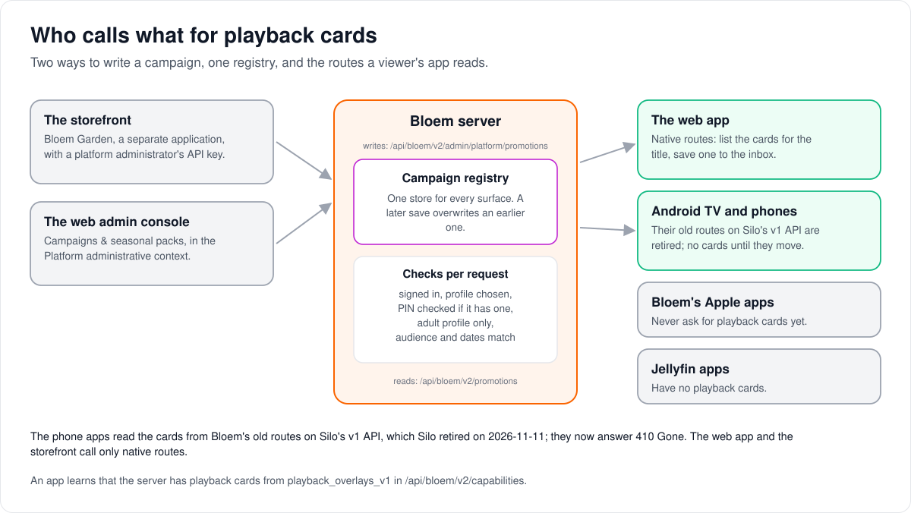

# Playback cards: who calls which route

> **Provenance and status.** Bloem page, rewritten on 2026-11-01 and checked against
> `main` at `b6039036d`. Silo has no campaign or playback-card API; this is a Bloem
> addition. It is a short map of the routes. The plain explanation is
> [how playback cards work](architecture/playback-overlays.md), and the wire contract
> is in the documents linked under [For developers](#for-developers).

A **playback card** is a campaign message that floats over a video for a few seconds.
This page shows who writes campaigns, where they are stored, and which routes each
app reads to show a card.

## Who calls what

- **Two ways to write a campaign.** The storefront (Bloem Garden), a separate
  application, and the web admin console's **Campaigns & seasonal packs** page both
  write into the same **campaign registry** on the Bloem server. A later save
  overwrites an earlier one.
- **The web app** reads Bloem's own routes to list the cards for the title it plays
  and to save one to the inbox.
- **Bloem's Android apps** still read the older routes on Silo's `/api/v1` for the
  same cards, until they move. Bloem's Apple apps never ask for playback cards yet.
- **Announcements** are separate: a platform administrator publishes them from
  **Settings → Integrations → Announcements**, with no campaign rights and no storefront
  ([how announcements work](architecture/admin-announcements.md)).

## Words used in the code

| On this page | In the code and routes |
| --- | --- |
| Campaign registry | the promotions registry (`internal/promotions`) |
| Writing a campaign | `/api/bloem/v1/admin/platform/promotions` (`GET`/`POST /`, `PUT`/`DELETE /{id}`) |
| Reading cards | `GET /api/bloem/v1/promotions?surface=in_playback&content_id=…` |
| Saving to the inbox | `POST /api/bloem/v1/promotions/{id}/save?content_id=…` |
| "Does this server have playback cards?" | `playback_overlays_v1` in `/api/bloem/v1/capabilities` |

## For developers

- **API:** [messages and promotions](bloem/api/messages.md) holds every route above with
  its fields and error codes. The old routes are on
  [Bloem's routes on Silo's `/api/v1`](bloem/api/v1-routes.md#campaigns).
- **Lifetime and delivery rules:** [how playback cards work](architecture/playback-overlays.md)
  holds capability detection, placement fields, client lifetime rules and the
  save-to-inbox contract. Client rendering on the native apps is tracked there, not
  here.

### Authoring routes

- `/api/bloem/v1/admin/platform/promotions` (`GET`/`POST /`, `PUT`/`DELETE /{id}`) is
  mounted by `mountBloemPlatformStorefront` in `internal/api/router_bloem_storefront.go`.
  It takes a Platform administrative context or an enabled administrator's unscoped API
  key, and `RequireBloemPlatformAdmin` rechecks the account on every request.
  Organization authority is refused (`403 insufficient_platform_authority`). The
  registry has no revision locking: a later save overwrites an earlier one.
- The web console's page is `web/src/pages/admin-platform/EngagementPage.tsx`; the
  storefront moved to these routes on 2026-10-31
  ([leaving Silo's `/api/v1`](architecture/bloem-leaving-silo-v1.md)).
- The legacy acting-admin CRUD, `/api/v1/admin/promotions` (`GET`/`POST /`,
  `PUT`/`DELETE /{id}`), is still mounted by `mountBloemLegacyAdminV1` in
  `internal/api/router_bloem_wiring.go`. The current storefront and web app no longer
  call it; it stays for one release, for an older storefront release, then goes.

### Viewer routes

- `GET /api/bloem/v1/promotions`, `POST /api/bloem/v1/promotions/{id}/save` and
  `PUT /api/bloem/v1/promotions/{id}/dismissals/{surface}` are mounted by
  `mountBloemPromotionsViewer` (`internal/api/bloem_promotions_viewer.go`) and advertised
  as `promotions_viewer_v1`. They need a signed-in account, its organization, a
  selected and, where locked, PIN-verified profile.
- The phone apps use `GET /api/v1/promotions` and
  `POST /api/v1/promotions/{id}/save` (`mountBloemPromotionsV1`,
  `internal/api/router_bloem_wiring.go`); both need a selected profile and stay mounted
  until the apps move.

### Artwork

Campaign artwork uploads go through the ambience asset service, which stores them in
Silo's catalog **Assets** blob store (local disk or S3) and falls back to the public S3
client only when no Assets store is configured (`cmd/silo/bloem_main.go`). With no
store at all, uploads return `503` and an HTTPS artwork URL can still be authored.
Uploaded files are served from `/api/bloem/v1/ambience/assets/{ref}`. This page
said until 2026-10-27 that uploads required public S3; that described the wiring
before `f293cce0d` (2026-09-23). See
[campaign and seasonal asset storage](architecture/bloem-campaign-asset-storage.md)
and the [native authoring contract](bloem-api-reference.md#platform-campaign-and-seasonal-authoring).

### History

This page was added with timed playback overlays in `eaa0b3a6b` (2026-09-06), revised
for the embedded web authoring in `53534d9f0` (2026-09-18), re-checked on 2026-10-27,
and rewritten on 2026-11-01 after the storefront and the web app left Silo's
`/api/v1`.

### Related pages

- [How playback cards work](architecture/playback-overlays.md).
- [How messages and promotions work](architecture/bloem-messages-and-promotions.md).

The picture is drawn by `scripts/bloem/pictures/playback_overlays.py` through
`scripts/bloem/draw-pictures.py`. Redraw it there, not by hand.
