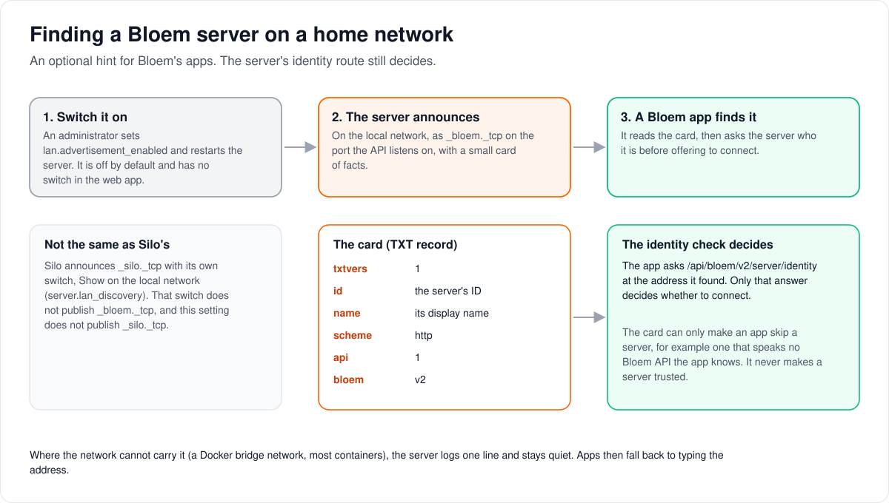

# How Bloem announces itself on a home network (`_bloem._tcp`)

> **Provenance and status.** Bloem page, rewritten on 2026-11-01 and checked against
> `main` at `b6039036d`. The `_bloem._tcp` announcement is a Bloem addition, separate
> from Silo's own `_silo._tcp`. It is implemented on the server, off by default, with
> no switch in the web app. This page explains it in plain language; the record the
> apps read and every technical rule are in the [For developers](#for-developers)
> section.

On a home network, Bloem can announce itself so that Bloem's own apps find the server
without anyone typing its address. This page walks through how to switch it on, what
the server announces, how an app uses it, and how it differs from Silo's announcement.

## How an app finds the server

1. **An administrator switches it on.** The setting `lan.advertisement_enabled` is off
   by default, needs a restart, and has no switch in the web app.
2. **The server announces itself** on the local network, as the service
   `_bloem._tcp`, on the port its API listens on. With it goes a small **card of
   facts** (a DNS-SD TXT record): the server's ID, its name, whether it speaks `http`
   or `https`, and which API versions it offers.
3. **A Bloem app on the same network sees the card.** Before offering the server, it
   asks the server's **identity route**, `/api/bloem/v2/server/identity`, who it is.
   Only that answer decides whether the app connects.

The card is a hint, not a key. Anyone on the network could send one, so it can only
make an app skip a server, for example one that speaks no Bloem API the app knows. It
never makes a server trusted.

## When it stays quiet

The announcement needs the host's local network directly. A server inside a Docker
bridge network or most containers cannot reach it, so the server notes it once and
stays quiet: no retries and no repeated log lines. Apps then fall back to typing the
address, as they always could.

## Not the same as Silo's

Silo has its own announcement, `_silo._tcp`, switched on under **Configure → Server →
General → Show on the local network**. That switch does not publish `_bloem._tcp`, and
Bloem's setting does not publish `_silo._tcp`. Bloem's apps look for `_bloem._tcp`.

## Who can change what

| Who | What they manage |
| --- | --- |
| Platform administrator | Switching the announcement on or off (`lan.advertisement_enabled`, with a restart). Silo's separate **Show on the local network** switch. |
| Viewer | Choosing a server their app found, or typing an address. |

## Words used in the code

| On this page | In the code |
| --- | --- |
| The announcement | `internal/lanadvert` (`lanadvert.Start`), service type `_bloem._tcp` (`lanadvert.ServiceType`) |
| The setting | `lan.advertisement_enabled` (`internal/config/bloem_admin_settings.go`, `cfg.LAN.AdvertisementEnabled`) |
| Starting it | `bloemStartListeners` (`cmd/silo/bloem_main.go`) |
| Card of facts | the TXT record (`txtRecord`) |
| Identity route | `GET /api/bloem/v2/server/identity` (`internal/api/handlers/server_identity.go`) |
| Silo's announcement | `_silo._tcp`, `internal/landiscovery`, setting `server.lan_discovery` |

## For developers

- **API:** the identity route is on the [apps and clients](../bloem/api/apps.md) API
  page. Silo's own discovery is described in
  [server discovery](../architecture/server-discovery.md).

### History

Written on 2026-09-02 (`8993d1b3b`) after the native API moved to `/api/bloem/v2`,
when aligning the clients showed that they browsed for a service no server published.
`8173499df` (2026-09-02) added `internal/lanadvert`, which publishes `_bloem._tcp`
through `github.com/brutella/dnssd`. Silo added `_silo._tcp` later, in `fdedf5a27`
(#1846, 2026-10-03; `internal/landiscovery`). Statements below about the client apps
describe their repositories as reviewed on 2026-09-02; they are not checked here.

### What the server does

- `bloemStartListeners` (`cmd/silo/bloem_main.go`) starts the advertiser only when
  `lan.advertisement_enabled` is true (default `false`, restart required:
  `restartRequiredKeys` in `internal/config/bloem_config.go`) and the public port is
  serving. The returned advertiser must be stopped first at shutdown, while its
  responder loop can still deliver the goodbye packets.
- The record's `id` comes from the same deployment identity the identity endpoint
  answers from (`serveridentity`, reading raw settings, so a `SECRET_KEY` rotation
  cannot change who the server is). `name` is the branding server name. `scheme` is
  `http`: the public listener is plain HTTP, and TLS terminates at an operator's
  reverse proxy, whose origin clients reach by manual entry.
- The TXT record takes `api` from `handlers.ServerAPIMajorVersions()` and `bloem` from
  `handlers.NativeAPISurfaces()` (`internal/api/handlers/server_identity.go`), never from
  literals, so the record and the identity document cannot drift.
- `lanadvert.Start` never blocks and never fails loudly. A missing identity resolver or
  name source, a listen address without a TCP port, an unresolvable server ID, no
  multicast-capable interface, or a registration error each produce exactly one log
  line and an inert advertiser. There is no retry loop by design. The mDNS instance
  label is cosmetic and the library renames it on a conflict; the TXT `name` key always
  carries the true server name, and the TXT `id` key is what clients key state on.
- Silo's **Configure → Server → General → Show on the local network** switch
  (`server.lan_discovery`) controls `_silo._tcp` only.

### The TXT contract the clients implement

Service type `_bloem._tcp`, on the port the API is served from.

| Key | Value | How clients read it |
|---|---|---|
| `txtvers` | `1` | Gates whether the rest is interpretable. A value a client does not recognise discards the whole record rather than trusting it partially. Absent is read as `1`. |
| `id` | advertised server identifier | Feeds candidate construction; must match `server_id` from the identity probe, which is authoritative. |
| `name` | display name | Cosmetic; clamped and sanitised client-side. |
| `scheme` | `http` or `https` | Validated through the client's origin rules. Cleartext to a non-loopback host is refused. |
| `api` | comma-separated Silo-compatible majors, i.e. `1` | Silo-compatible majors ONLY. It cannot answer "does this speak the native API" — upstream Silo serves its own major 2 — so a record carrying only `api` never causes a client to withhold a candidate. |
| `bloem` | comma-separated native surface versions, i.e. `v1` | The record-level counterpart of the identity document's `bloem_api`. A parseable list naming no surface the client speaks is the one reason a client withholds an attempt early. |

The advertisement is an unauthenticated hint. It can only ever push a candidate toward
"not worth attempting"; it never grants trust. `GET /api/bloem/v2/server/identity`
remains the authority on whether a connection is made.

`bloem` is a key added on 2026-09-02: no client shipped before then reads it, and every
client treats an absent key as "cannot determine", so adding it is backward compatible.

### The clients

`bloem-android`, `bloem-android-skyline` and `bloem-apple` all browse `_bloem._tcp` and
parse the TXT record, as reviewed on 2026-09-02. Clients degrade to manual origin
entry, which is why the missing server side went unnoticed until then. No upstream
`silo-server`, `bloem-ops` or `bloem-edge` build publishes `_bloem._tcp`.

### The original requirements, and where they stand

1. **A zeroconf dependency** that answers conflicting-name and interface-change cases,
   not just an announcement at boot. Met: `github.com/brutella/dnssd`, whose responder
   probes (RFC 6762 §8), announces and renames on conflict.
2. **A deployment story.** mDNS needs the host's L2 broadcast domain.
   `docker-compose.livetv.yml` uses `network_mode: host`, so at least one supported
   deployment can do it; LXC deployments and bridge-networked compose cannot without
   configuration. The advertiser must be opt-in and degrade silently where multicast
   is unavailable rather than logging on a timer. Met, as above.
3. **A settings surface**, consistent with how Live TV tuner discovery is exposed
   ([Live TV tuner discovery](../livetv-tuner-discovery.md)), including an off switch,
   because operators on shared or hostile networks will not want the server announcing
   itself. Partly met: the setting exists and is off by default, but it has no control
   in the web admin.
4. **The identity values wired from one source.** `api` from `serverAPIMajorVersions`
   and `bloem` from `nativeAPISurfaces` (`internal/api/handlers/server_identity.go`),
   never typed as literals. Met.

### Prior art in this repository

Live TV tuner discovery already broadcasts and receives on the LAN over UDP 65001
([Live TV tuner discovery](../livetv-tuner-discovery.md)), so LAN behaviour is not new
ground here, but it is outbound probing, not service registration, and shares no
machinery with this.

### Related pages

- [How apps connect](../architecture/bloem-apps.md): the plain overview.
- [Server discovery](../architecture/server-discovery.md): Silo's `_silo._tcp`.

The picture is an SVG file under `docs/architecture/images/lan-service-advertisement/`,
drawn by `scripts/bloem/pictures/lan_service_advertisement.py` through
`scripts/bloem/draw-pictures.py`. Redraw it there, not by hand.
