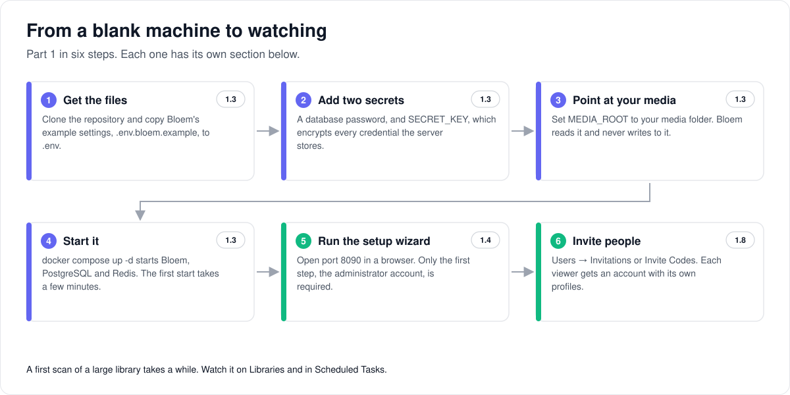
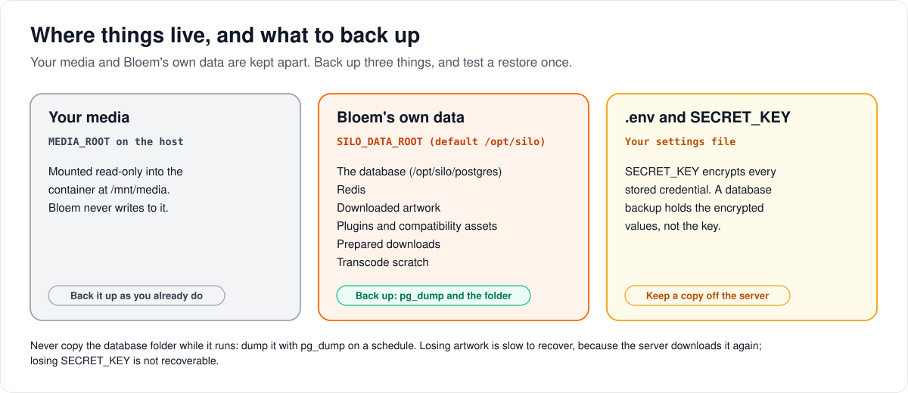
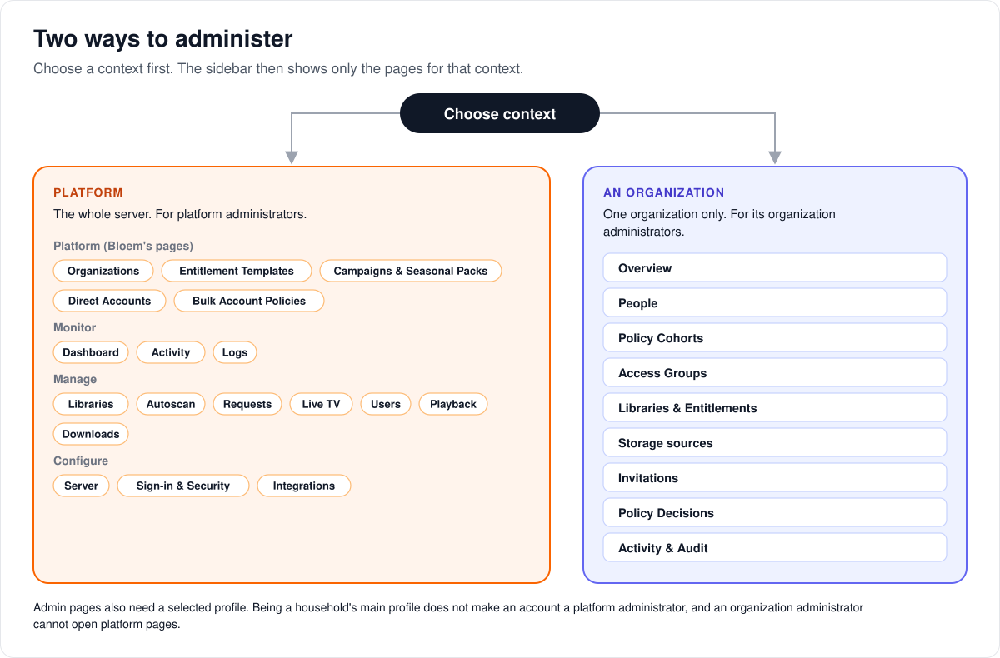
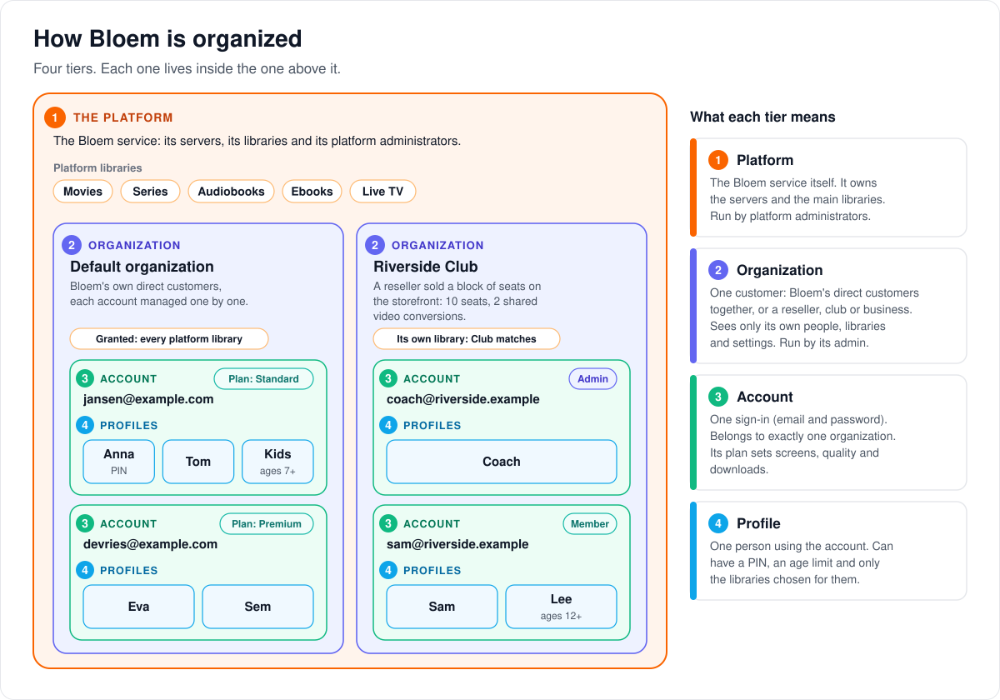
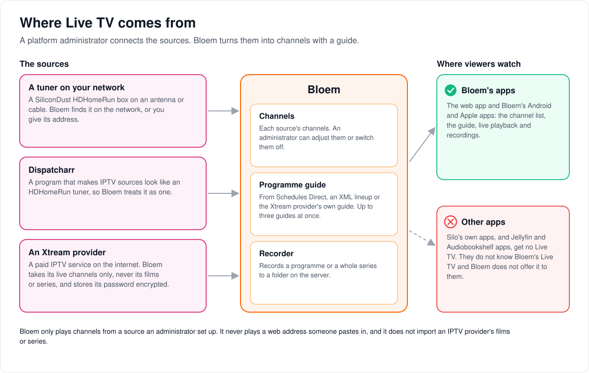
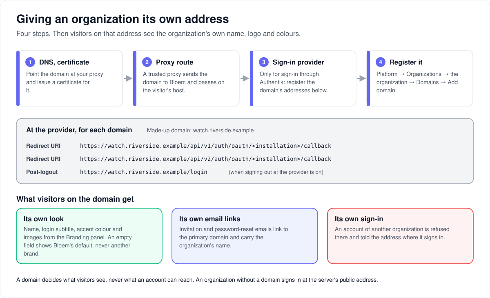

# Bloem Server admin guide

> **Provenance and status.** Bloem page, rewritten on 2026-11-01 and checked against
> `main` at `b6039036d`; the search and embedding parts were updated on 2026-11-10 against
> `7acd2c7e0`. It is the task guide for the person who runs a Bloem server.
> Most of what it describes is Silo's; organizations and their domains, plans, Live TV,
> campaigns, previews and storage sources are Bloem additions. The technical rules,
> file names and commit references are in the [For developers](#for-developers) section.

This guide takes you from a blank machine to a household watching its own library, and
then keeps the server healthy. Part 1 gets a server running; you can read it in an
afternoon. Part 2 goes through the admin console one area at a time; use it to look things
up. Part 3 covers backups, updates and what to check when something breaks. If a word is
new, the [glossary](#glossary) explains it. If you watch rather than run the server, read
the [user guide](user-guide.md) instead.

## Where Bloem comes from

Bloem Server is a public **tracking fork** of [Silo Server](https://github.com/Silo-Server/silo-server).
Bloem follows Silo's main line, merges it often, and keeps its own changes small and declared,
so Silo's improvements keep arriving. [FORK.md](../../FORK.md) states the rules, and the
[integration changelog](../bloem/CHANGELOG.md) records each merge.

**Almost everything in this guide is Silo's:** the web app, the setup wizard, libraries and
scanning, metadata, playback and transcoding, profiles and households, access groups, movie and
series requests, notifications, plugins, the settings pages, AI Services, recommendations,
autoscan, server nodes, and the Jellyfin- and Audiobookshelf-compatible servers. Where Silo
documents a feature, its own pages here are the reference, for example
[real-time monitoring](../architecture/realtime-monitoring.md),
[requests](../architecture/media-requests.md), [notifications](../architecture/notifications.md)
and [AI providers](../architecture/ai-provider-authentication.md). Silo's manual for people who
run a server lives in another repository,
[`Silo-Server/siloserver.org`](https://github.com/Silo-Server/siloserver.org).

Because the web app is Silo's, parts of it still say "Silo". The setup wizard ends on "Silo is
ready", and settings are labelled **Silo public URL** or **Silo passwords**. That text is
Silo's, not a mistake.

### What Bloem adds

Each of these is covered below:

- **Organizations and administrative contexts.** Several groups of accounts on one server, each
  managed separately by its own administrators ([2.6](#26-plans-organizations-and-policy)).
- **Organization domains and branding.** An organization can have its own web addresses, name,
  logo and colours ([2.18](#218-organization-domains-and-branding)).
- **Plans and policy cohorts.** Reusable, versioned access rules
  ([Entitlement templates guide](admin/entitlement-templates.md)).
- **Live TV.** Tuners, a programme guide and recording, adapted from Prairie Server, plus Xtream
  providers ([2.10](#210-live-tv)).
- **Campaigns, seasonal packs and announcements** ([2.16](#216-campaigns-and-seasonal-packs)).
- **Browse-only previews** for people thinking of subscribing ([2.6](#browse-only-previews)).
- **Audiobook and ebook requests**, beside Silo's movie and series requests ([2.9](#29-requests)).
- **Storage sources.** Libraries that read from S3 or Bookwarehouse buckets as well as local
  folders ([2.2](#22-libraries)).
- **Separate sign-in for a profile** in the Bloem apps ([user guide](user-guide.md#2-profiles)).
- **A native API** for Bloem's own apps, `/api/bloem/v1` ([reference](../bloem-api-reference.md)).

### What Bloem removed

Some earlier Bloem features are gone, and this guide no longer describes them: the music
catalog, Pastime managed tracking (see [Pastime removal](../architecture/bloem-pastime-removal.md))
and Bloem's companion enrollment for compatibility apps. Silo's own Jellyfin and Audiobookshelf
servers came back in its place. Silo, for its part, removed the administrator's colour, font and
custom-CSS controls and made Cinema Dark the only theme. The dates and commits are in
[For developers](#where-bloem-comes-from-1).

### What changed most recently

Bloem's own changes on November 10, 2026:

- **Search can drop the most common words first.** On **Server → Search**, **When a search has
  several words** has a new choice, **Drop the most common words until something matches**. A
  search that describes a story finds the right title far more often with it
  ([2.7](#27-settings)).
- **Task labels for `gemini-embedding-2`.** With that embedding model, Bloem labels titles and
  searches the way Google recommends, which finds the right title more often
  ([2.17](#217-ai-services-and-recommendation-embeddings)).

On November 1, 2026, Bloem merged Silo through `63ef34b23`. For the person running the server:

- **Audit records** now cover sign-ins, sessions, profiles and API keys.
- **Download bandwidth budgets** are shared across servers.
- **The container can start without root**, through Silo's `silo` entrypoint.
- **Fixes** to subtitles and AI errors, collections, autoscan, seasonal rows and password reset.
- **Transcode and proxy nodes** must now say their own address (`NODE_URL`) or they refuse to
  start ([2.14](#214-nodes-and-distributed-deployments)).

Bloem's own changes on November 1:

- **Organization domains and branding** ([2.18](#218-organization-domains-and-branding)).
- **Old sign-ins sign in again.** When an organization signs an account out, a sign-in from
  before that point is ended, and the app asks the person to sign in again. Before, the web app
  showed a broken home page.
- **The web app and the storefront no longer call Silo's `/api/v1`.** Announcements now need the
  Platform context ([2.16](#216-campaigns-and-seasonal-packs)).

Earlier merges on October 31 brought these from Silo:

- **Password changes** can sign out the account's other devices.
- **Sign-ins last longer:** the access token now lasts 8 hours by default instead of 1.
- **API usage:** each sign-in session has an hourly request quota, and the dashboard has an
  API clients card. Egress on the dashboard is split by proxy node.
- **Home rows** load 20 cards at a time.
- **Audiobook runtimes** are worked out from the audio files themselves.
- **Docker:** `docker-compose.yml` is Silo's all-in-one stack and does not start Bloem. Bloem
  runs on `docker-compose.advanced.yml`, which `.env.bloem.example` selects. Silo removed its
  separate GPU overlay files ([1.6](#16-hardware-transcoding-optional-recommended)).

Bloem's own changes since October 29: library preview free play; per-library figures and a
new-arrivals list for storefronts; an upgrade prompt when a plan's screen limit is reached;
guided S3 setup with all-bucket sources; and AI subtitles for Chinese and Japanese without
stray spaces. The [changelog](../bloem/CHANGELOG.md) has each one.

---

## Part 1 — Getting a server running



### 1.1 What Bloem Server is

Bloem Server is a **media server**. It takes the video, audiobook, ebook and comic files you
already own, works out what each one is, fetches artwork and descriptions, and streams them to
phones, tablets, televisions and web browsers. It runs on a computer you control: a home server,
a spare PC or a rented virtual machine. People connect with a web browser, with an app built for
Bloem's or Silo's API, or with a Jellyfin- or Audiobookshelf-compatible app.

Three things it does shape how you set it up:

- **It plays media the way each device wants it.** When a device can play a file as it is, Bloem
  sends it unchanged: **direct play**. When it cannot, Bloem converts it on the fly:
  **transcoding**. Transcoding is the one job that needs real processing power, which is why the
  GPU section below exists.
- **It has households.** One login can have several **profiles**, one per family member, each
  with its own watch history, recommendations and parental limits.
- **It serves native apps.** Use the built-in web app, or a native app whose API contract
  matches the server.

Because Bloem tracks Silo, a few technical names keep Silo's spelling so that Silo's changes keep
merging cleanly: environment variables such as `SILO_DATA_ROOT` and `SILO_IMAGE`, the Docker
service called `silo`, and the default database user `silo`. When this guide shows one of them,
it is not a mistake.

### 1.2 What you need before you start

- **A machine to run it on.** Linux is the well-trodden path. Any 64-bit machine works for a
  small household. Hardware transcoding ([1.6](#16-hardware-transcoding-optional-recommended))
  needs an Intel, AMD or NVIDIA GPU the machine can see.
- **Docker.** Docker Engine on Linux, or Docker Desktop on Mac or Windows, with Docker Compose
  2.24 or newer. This guide installs Bloem with Docker. Building from source is possible but not
  covered here.
- **Your media, organized.** A folder tree Bloem can read, laid out as
  [Supported Media Folder Structures and Naming](../architecture/media-naming.md) (Silo's page)
  describes. The most common reason films do not show up is a folder layout the scanner cannot
  make sense of, so read that page before you scan.
- **Somewhere to keep the server's own data:** its database and the artwork it downloads. This
  is separate from your media, and it must be on storage that survives container restarts.
- **Git and OpenSSL** on the machine, for the commands below.
- **Access to a Bloem image.** See "Choose the image" in [1.3](#13-install) before you start.

You do *not* need a domain name or a public IP address to start. Everything below works on a
home network first. Making the server reachable from outside comes later, and is optional.

### 1.3 Install

Copy these commands one block at a time. Each block is explained underneath.

```sh
git clone https://github.com/bloem-studios/bloem-server.git
cd bloem-server
cp .env.bloem.example .env
chmod 600 .env
```

This downloads the deployment files and creates your settings file, `.env`, from Bloem's
example. Use `.env.bloem.example`, not `.env.example`: `.env.example` is Silo's file, unchanged,
and its `SILO_IMAGE` line selects Silo's image instead of Bloem's. The `chmod` makes the file
readable only by you, because it is about to hold secrets.

```sh
printf '\nPOSTGRES_PASSWORD=%s\nSECRET_KEY=%s\n' \
  "$(openssl rand -hex 24)" "$(openssl rand -base64 48)" >> .env
```

This adds two random secrets to `.env`: a database password, and `SECRET_KEY`. `SECRET_KEY` is
the master key that encrypts every credential the server stores, such as metadata provider keys
and storage credentials. The server refuses to start without it.

> **Back up `SECRET_KEY` now, somewhere that is not the server.** If you lose it, every stored
> credential becomes unrecoverable, and a database backup will not save you: the backup holds
> the encrypted values, not the key. A password manager entry is fine.

Now open `.env` in a text editor and set the path to your media:

```dotenv
MEDIA_ROOT=/path/to/your/media
```

Use an absolute path, one that starts with `/`. This folder is mounted read-only into the
container at `/mnt/media`, so Bloem sees your files without copying them.

**Keep the Compose file.** `.env.bloem.example` sets `COMPOSE_FILE=docker-compose.advanced.yml`.
Leave it. The repository's default `docker-compose.yml` is Silo's all-in-one stack and would
start Silo, not Bloem.

**Choose the image.** `.env.bloem.example` sets
`SILO_IMAGE=ghcr.io/bloem-studios/bloem-server:latest`. Bloem's CI publishes each tested `main`
commit under its full commit SHA and moves `latest` to the newest one, so `latest` changes
whenever `main` does. To know which revision you run, and to roll back to it, set `SILO_IMAGE`
to a full-SHA tag instead, or build the image yourself, as
[Container image selection](../bloem/overlays/wiki/deployment/docker.md#container-image-selection)
describes. That page also notes that pulling the image may need a GitHub account with access to
the package.

```sh
docker compose up -d
```

This downloads the Bloem image, PostgreSQL and Redis, and starts them. The first start takes a
few minutes. When it settles, open **http://localhost:8090** in a browser, or
`http://<the server's IP address>:8090` from another machine on the same network.

### 1.4 First run: the setup wizard

The first time you open the address, the server walks you through Silo's setup wizard. Only the
first step is required. You can skip every later step and come back to it from the step list,
until you leave the wizard on its last screen.

1. **Account.** Create the first account, the administrator who can do everything, and its
   first profile. Pick a strong password: this login can change every other login.
2. **Server.** Name the server (shown on the sign-in page and in the apps) and set the
   **Public URL**: the address people open in a browser, also used for links in emails and
   notifications. On a home network it is the address you just used. If the server sits behind a
   reverse proxy, list the proxy under **Trusted proxies**.
3. **Playback.** Video transcoding on or off, hardware acceleration (*Auto* picks the best device
   the server can see), 4K transcoding and HDR tone mapping.
4. **Storage.** Optional S3 storage for artwork and uploads. Leave it unset to keep them on local
   disk.
5. **Libraries.** Add your media. A **library** is one kind of media in one or more folders. Its
   type is one of Movies, Series, Mixed, Audiobooks, Ebooks, Manga or Podcasts. Because
   `MEDIA_ROOT` is mounted into the container, the folder you pick is the path inside the
   container, under `/mnt/media`. The folder browser shows you the mounted tree.
6. **Subtitles.** Accounts for subtitle sources such as OpenSubtitles.
7. **Connect apps.** Whether to answer Jellyfin-compatible apps, and the address they should use.
8. **Features.** Skip markers (TheIntroDB and Silo's marker service, or detection on this
   server), mobile push notifications, and whether people may download.

After the wizard, the server starts **scanning**: it reads your folders, identifies each item and
fetches its details and artwork from the metadata providers. A first scan of a large library
takes a while. You can watch it on **Libraries** and in **Scheduled Tasks**.

### 1.5 Where things live on disk



Two places matter. Mixing them up is the most common way to lose data.

| What | Where | Can I lose it? |
|---|---|---|
| **Your media** | `MEDIA_ROOT` on the host, mounted read-only into the container | No. Bloem never writes to it. |
| **Bloem's own data**: database, Redis, downloaded artwork, plugins, compatibility assets, prepared downloads, transcode scratch | Folders under `SILO_DATA_ROOT` (default `/opt/silo`), including `/opt/silo/postgres` for the database | Yes, if you delete them. The database is what you back up. |

The full layout, including which folders can go on fast storage and which can be thrown away,
is in [Deploy Bloem with Docker → Storage and state](../bloem/overlays/wiki/deployment/docker.md#storage-and-state).

### 1.6 Hardware transcoding (optional, recommended)

Without a GPU, transcoding uses the CPU. A modern CPU manages one or two converted streams at
once; beyond that, playback stutters. A GPU handles many at once.

1. Give the container the GPU with a small override file of your own, for example
   `compose.gpu.yml`. The
   [Docker guide](../bloem/overlays/wiki/deployment/docker.md#hardware-acceleration) has the file
   for each kind of GPU.
2. Add it to `.env`: `COMPOSE_FILE=docker-compose.advanced.yml:compose.gpu.yml`.
3. Prepare the host:
   - **Intel or AMD (VA-API or Quick Sync):** install the GPU driver, and check that `/dev/dri`
     is present.
   - **NVIDIA (NVENC):** install the NVIDIA driver and the NVIDIA Container Toolkit.
4. Open **Playback → Settings** in the admin sidebar and set **Hardware acceleration** to *Auto*.
   The other choices are Intel Quick Sync, VA-API, NVIDIA NVENC, VideoToolbox and Software.

Details for each vendor are in
[Hardware acceleration](../bloem/overlays/wiki/deployment/docker.md#hardware-acceleration).

### 1.7 Reaching it from outside your network (optional)

Bloem listens on port 8090 without encryption. That is fine inside a home network and not fine
on the internet. To watch away from home:

1. Put a reverse proxy with HTTPS in front of it (Caddy, nginx or Traefik) and point a domain
   name at the proxy.
2. Under **Server → General**, set **Silo public URL** to the `https://` address, so links and
   apps use it. This is **the server's public address**.
3. Add the proxy's address to **Trusted proxies**, so the server sees each viewer's real address.

Never expose PostgreSQL or Redis. To give an organization addresses of its own, see
[2.18](#218-organization-domains-and-branding).

### 1.8 Invite the household

Every viewer needs an **account**, and every account can have profiles. Open **Users** in the
admin sidebar. The page has three tabs:

- **Users** lists the accounts. **Create User** makes one directly, with a username and password.
- **Invitations** sends an invitation to an email address, or makes a link you deliver yourself.
  Email needs a mail server (**Integrations → Email**). The invited person picks a password. No
  account exists until they accept, so a mistyped address cannot claim a name. You can replace or
  revoke a link before it is used.
- **Invite Codes** suit the case where you do not want to type each address. A code can be used a
  set number of times; people enter it on the sign-up page. Public sign-ups and self-service
  password reset are switched on or off under **Sign-in & Security → Sign-in**.

**Profiles** are created by the account holder (on the profile picker, or under
**Settings → Profiles**) or by you on their user page. A profile can have a PIN, so a child
cannot switch to a parent's profile.

**Inviting people into an organization** works differently:

1. Choose that organization's administrative context and open **Invitations**.
2. Create the invitation. The page shows a link once, for you to deliver. It sends no email.
3. Copy the link before you close the result. It is cleared when you close it, switch context or
   sign out.

Regenerating a link makes the previous one stop working, and revoking prevents acceptance.
Review the confirmation before either. After a connection error, reload the list before you
decide anything.

You are now running a media server. The rest of this guide is the reference.

---

## Part 2 — The admin interface, area by area



Everything below opens from **Admin** in the sidebar when your account may administer. Bloem
first asks for an **administrative context**, with the **Choose context** control in the
navigation:

- **Platform** is the whole server. Its sidebar has Silo's three groups, **Monitor**, **Manage**
  and **Configure**, plus Bloem's **Platform** group (Organizations, Entitlement Templates,
  Campaigns & Seasonal Packs, Direct Accounts, Bulk Account Policies) and **Live TV** under
  Manage.
- **An organization** shows only that organization's pages: Overview, People, Policy Cohorts,
  Access Groups, Libraries & Entitlements, Storage sources, Invitations, Policy Decisions and
  Activity & Audit.

The pages you see follow your authority. Being a household's main profile does not make the
account a **platform administrator**, and an **organization administrator** cannot open platform
pages. Admin pages also need a selected profile; the account's settings and sign-in sessions do
not.

### 2.1 Dashboard

**Monitor → Dashboard** is the landing page: live sessions, content health and server activity,
including the API clients card. **Monitor → Activity** shows each stream now playing: who, what,
which app, and whether it plays directly or is being converted. When something is wrong, it
usually shows here first.

### 2.2 Libraries

**Manage → Libraries** has one row per library. From here you:

- **Add a library:** name, type and folders. A library can span several folders.
- **Scan Library:** rescan a whole library. You rarely need this by hand; see Autoscan below.
  **Verify Mounts** and **Check mount** test that the folders are reachable.
- **Refresh Metadata:** fetch details and artwork again without rescanning files. Use it after
  installing a new metadata plugin or fixing a badly matched item.
- **Resolve unmatched and ignored items:** files the scanner could not match to any provider,
  which you can resolve or ignore.
- **Set who can see it.** Access groups ([2.5](#25-access-groups)) and plans
  ([2.6](#26-plans-organizations-and-policy)) decide who sees what.

The Libraries group also holds **Collections** and **Home Sections** ([2.8](#28-collections-and-sections)),
**Subtitle Files** (downloaded subtitle records and tools) and **Settings**.

**How Bloem decides what a file is.** The scanner reads folder and file names first, which is
why naming matters, then asks the metadata providers to confirm. If it guesses wrong, open the
item, choose **Match Item** from its menu, and pick the right match. **Edit Metadata** changes
single fields. Local `.nfo` sidecar files count too:
[Local NFO Metadata](../architecture/local-nfo-metadata.md) (Silo's page) lists the fields and
how they merge with what the providers say.

**Libraries with local and remote folders** (Bloem). A library can combine folders on disk with
locations in several **storage sources**:

1. In the folder picker, open a configured S3 or Bookwarehouse source.
2. Browse into nested folders and add the roots you need.
3. Review the whole selection before saving.

Removing one selected root keeps the others, and reopening the picker keeps what you chose. A
library location keeps its source identity when its selected roots change.

Native storage serves ebook, movie and audiobook workflows only when the matching scanner and
delivery services are ready. Enter credentials through the protected source controls (for an
organization, its **Storage sources** page), never by pasting provider URLs into media paths.
Installing the provider, configuring the source, admitting it to a library and actually playing
from it are four separate checks. An unavailable source can be kept for recovery without
publishing media nobody has verified. See [How storage sources work](../architecture/bloem-storage-sources.md)
and [native storage](../architecture/bloem-native-storage.md).

### 2.3 Autoscan

Silo's Linux **real-time library monitoring** watches local folders. It scans the changed file or
folder and reports each folder's monitoring status. This is separate from external autoscan
connections. Network shares are not watched this way: use scheduled scans, a manual scan or an
external autoscan source. See [real-time monitoring](../architecture/realtime-monitoring.md)
(Silo's page).

**Manage → Autoscan** has three pages:

- **Activity:** changes received, and the scans they started.
- **Sources:** the folders, webhooks and servers Autoscan watches. **Run now** polls every polling
  source at once, and each source opens an edit dialog.
- **Settings:** polling defaults and connections.

A dropped webhook delivery does not update the last delivery time. A scan that overlaps another
waits for it, rather than silently skipping the work.

### 2.4 Users and Devices

**Manage → Users** has **Users**, **Access Groups**, **Devices** and **History Import**.

**Users** lists every account with its role and access group. A user's page has the tabs
Overview, Access, Sign-in, Activity, Downloads and Preferences. From there you can disable the
account, change its access and limits, and help with passwords. For an account with a local
password you can email or share a single-use reset link, or set a temporary password that must be
replaced at the next sign-in. The **server owner** is an account role of its own, separate from
owning an organization; only the server owner can change another administrator's account. See
[password resets](../architecture/password-resets.md) (Silo's page).

**Profile limits are inherited.** When an account's profile limit is unset, it takes the access
group's limit; unset does not mean unlimited. A value set on an ordinary account wins. A plan
managed by Bloem keeps the ceiling it assigned. Check the effective policy before changing how
many profiles a household may have.

**Devices** lists every device that has connected with a stable device ID, with its per-profile
setting overrides, which you can reset. To cut off a lost or sold device, the account holder
signs it out under **Settings → Signed-in sessions**. You can also disable the account or reset
its password.

**History Import** copies watch history from Emby, Plex or Jellyfin into Bloem.

### 2.5 Access groups

An **access group** is a named set of permissions and defaults that you attach to accounts:
libraries, downloads, streams, requests, and permissions such as *Watch Live TV*, *Marker
Editing* or *Metadata Curation*. Make one group per kind of person ("Family", "Guests") rather
than setting permissions account by account.

- Deleting a group moves its members to the default group in the same organization. Nobody is
  ever left without a policy.
- Group policy also covers bitrate limits for local and remote streams, and request approval and
  quotas, with account overrides and server defaults. See
  [request policy](../architecture/media-requests.md).

Access groups are Silo's; Bloem keeps each one inside an organization.

<a id="26-entitlement-templates-organisations-and-policy"></a>

### 2.6 Plans, organizations and policy

This is the part that scales past one household, and it is Bloem's. If you run Bloem for one
family you can skip it: the defaults are sensible. For the picture of how the platform,
organizations, accounts and profiles fit together, read
[How organizations work](../architecture/bloem-organizations.md).



An **organization** is a group of accounts managed together, such as a reseller's customers or a
second family you host. Each account belongs to exactly one organization. Every server has one
**default organization**, which holds the accounts you manage directly. An organization has its
own administrators, who manage their own people but not yours. Platform administrators manage
organizations under **Platform → Organizations**, and put directly managed accounts on plans under
**Direct Accounts**.

A **plan** (the admin console calls it an **entitlement template**) is a reusable, versioned set
of access rules: which libraries, whether playback and transcoding are allowed, how many streams
at once, how many profiles, whether downloads are allowed, the maximum quality, and which
access-group permissions. Bloem ships *Browse-only*, *Viewer*, *Standard*, *Premium* and
*Reseller Member* as starting points, plus the protected *Preview* plan used by browse-only
previews. Every change to a plan creates a new **revision**. Old revisions are never rewritten, so
an account given revision 3 keeps revision 3 until you deliberately move it. See
[How plans work](../architecture/bloem-plans.md).

To change what accounts get, safely:

1. Create or pick a plan.
2. Create a new revision for each change.
3. On the organization or account page, choose the exact revision.
4. Choose **Preview** and read what will change.
5. **Confirm** within ten minutes.

The full guide is [Entitlement Templates](admin/entitlement-templates.md).

A **policy cohort** moves a reviewed set of existing accounts between exact plan revisions, with a
preview of what will change first. It is **Cohorts** in an organization, and **Bulk Account
Policies** for directly managed accounts.

In an organization's **Libraries** page, tell owned libraries apart from grants.
Shared libraries can be paused (**Pause**), restored (**Restore**) or withdrawn (**Give
back**) after confirming; giving a library back cannot be undone from this page. If someone changed a grant since you loaded it, reload and review it
before acting. **Activity** shows redacted lifecycle and entitlement events for the
organization, 50 at a time; load more on purpose. It records the events those ledgers contain,
not a promise that every action appears. **Access Checks** is a separate diagnostic page.

An organization can also be served on its own addresses, under its own name and logo:
see [2.18](#218-organization-domains-and-branding).

#### Browse-only previews

The protected **Preview** plan lets a prospect browse chosen libraries, descriptions, series,
seasons and episodes. Playback, reading, downloads and personal changes are refused. Unlike an
ordinary plan with playback switched off, the protected preview also limits credentials and
catalog responses.

For a public web preview, set up the library preview in the storefront (Bloem Garden, Bloem's
companion application, outside this repository) with a separate preview address. Keep the normal
subscriber address separate. The storefront hands out short-lived launch links, and the server
exchanges each one once for a time-limited guest session. Setting up the server side uses the
scoped preview administration API. Publishing a source alone does not set up addresses or switch
the preview on. See [How plans work](../architecture/bloem-plans.md)
and the [security contract](../architecture/bloem-browse-only-content-policy.md).

### 2.7 Settings

Silo's settings pages sit in the admin sidebar under the topic they belong to; there is no single
"Settings" menu. The ones you will actually touch:

| Sidebar location | Page | What is on it |
|---|---|---|
| Configure → Server | **General** | Server name and login subtitle, **Silo public URL**, **Show on the local network** (Silo's LAN advertisement), local network address, trusted proxies, database connections, Redis. |
| Configure → Server | **Appearance** | Logos and icons, favicon, login background, accent colour, server-wide poster-badge defaults and title-art default. There are no theme, font or custom-CSS controls. |
| Configure → Server | **Storage** | Where artwork and uploads are stored: local disk or S3 ([S3 storage setup](../bloem/overlays/s3-storage-setup.md)). |
| Configure → Server | **Search** | Built-in PostgreSQL search or Meilisearch ([Optional Meilisearch](../bloem/overlays/wiki/deployment/docker.md#optional-meilisearch)). Values set through `SILO_SEARCH_PROVIDER` and related variables lock these fields. With Meilisearch, set **When a search has several words** to **Drop the most common words until something matches**, and keep the **Query timeout** above the slowest searches (Bloem's production uses 3,000 ms): [How search finds titles by words and by meaning](../architecture/bloem-search-and-embeddings.md). |
| Configure → Server | **Network Access** | Overlay-network providers such as Tailscale. |
| Configure → Sign-in & Security | **Sign-in** | Silo passwords, public sign-ups, self-service password reset, single sign-on (with the **Redirect URI** and **Post-logout redirect URI** to register at the provider), network sign-in. |
| Configure → Sign-in & Security | **Security** | Which local servers the server may contact, rate limiting, API key tiers. |
| Configure → Sign-in & Security | **API Keys**, **Policy** | Admin API keys and their tiers. Policy (OPA documents, simulations and decision logs) appears only when the policy editor is available. |
| Manage → Libraries → Settings | **Library & Metadata** | Version listing, scanner and matcher workers, maturity limits, ratings, subtitle sync. |
| Manage → Autoscan → Settings | **Autoscan** | Polling defaults and connections. |
| Manage → Playback → Settings | **Playback** | Watch thresholds, transcoding and hardware acceleration, preview images, skip markers. |
| Manage → Downloads → Settings | **Downloads** | Whether viewers can download for offline use, per-user and server-wide limits, prepared copies. **Prepared Files** lists the copies. |
| Manage → Requests → Settings | **Requests** | Request limits and approval, Sonarr and Radarr servers, routing rules. The Discover tab's rows are on **Requests → Discover Page**. |
| Configure → Integrations | **Providers** | Watch-provider plugins such as Simkl, subtitle provider accounts, the MDBList key, skip-marker providers. |
| Configure → Integrations | **Email** | The mail server for invitations, password resets and notification emails. |
| Configure → Integrations | **Notifications** | Delivery channels, server channels, and how new content becomes notifications ([2.15](#215-notifications-and-webhooks)). |
| Configure → Integrations | **AI Services** | AI providers and the model each AI job uses ([2.17](#217-ai-services-and-recommendation-embeddings)). |
| Configure → Integrations | **Compatibility** | Jellyfin and Audiobookshelf app compatibility ([2.12](#212-native-and-compatibility-clients)). |
| Configure → Integrations | **Announcements** | Bloem's page for publishing messages to viewers ([2.16](#216-campaigns-and-seasonal-packs)). |
| Monitor → Logs → Settings | **Logging** | Log level, quiet prefixes, log and permission-check retention. |

The server name, login subtitle and Appearance values are also the default organization's brand.
Other organizations set theirs in their own **Branding** panel ([2.18](#218-organization-domains-and-branding)).

Metadata provider keys such as TMDB and TVDB belong to their plugins ([2.11](#211-plugins)).
Every setting has a short explanation beside it. Pages hold your edits until you save with the
bar at the bottom of the page. A setting marked *Restart* needs a server restart to take effect.

### 2.8 Collections and sections

**Libraries → Collections** holds curated groups of items, such as "Christmas films" or "The
Marvel films in order". Build one by hand, with rules (a **smart collection**: "everything rated
above 8 from the 1990s"), or from a **collection template** that syncs a list from TMDB or MDBList
and keeps it current: [Collection Templates](../architecture/collection-templates.md) (Silo's
page).

**Libraries → Home Sections** decides the rows on Home and on library pages, such as Continue
watching, Recently added, a collection or a recommendation row, and their order. Viewers can hide
rows they do not want; you decide what is on offer.

### 2.9 Requests

Viewers can ask for titles the library does not have:

1. Allow request access through the account or group policy.
2. Set up integrations, routes, approval rules and quotas on **Requests → Settings**.
3. Watch the queue and its delivery state on **Requests → Queue**.
4. Set the rows of the viewers' Discover tab on **Requests → Discover Page**. With no layout
   saved, the default rows show.

Viewers can follow an existing request and choose seasons where the title allows it; followers
get the relevant updates. Bloem stamps each request with the acting organization and limits its
administration to it. See [How requests work](../architecture/bloem-requests.md) and Silo's
[request architecture](../architecture/media-requests.md) for routing, retries, fulfilment and
group limits.

Bloem adds **Audiobooks** and **Ebooks** tabs beside **Movies & series**, on both the queue and the
viewer's Requests page, when the server supports them. Each has its own connection setup on the
queue page and is off until configured. Only people in the default organization can ask for
ebooks. See [audiobook requests](../architecture/bloem-audiobook-requests.md)
and [ebook requests](../architecture/bloem-ebook-request-foundation.md).

### 2.10 Live TV

Live TV is Bloem's; Silo lists it as a non-goal. Bloem can tune, record and show a programme guide
from a tuner on your network or from an authenticated Xtream live provider. The tuner and
recording code is an attributed adaptation of Prairie Server (see
[FORK.md](../../FORK.md#prairie-server-live-tv)), and Xtream providers are Bloem's own addition.
For the picture of how it fits together, read [How Live TV works](../architecture/bloem-live-tv.md).



To open it:

1. Sign in as an administrator.
2. Select your account's main profile and enter its PIN if asked.
3. Choose the **Platform** context.
4. Open **Manage → Live TV**. Its tabs are Tuners, Channels, Guide, Recordings and
   Conversion.

What each part does:

- **Tuners.** Bloem talks to SiliconDust **HDHomeRun** tuners and to **Dispatcharr**, which makes
  IPTV sources look like an HDHomeRun. *Search my network* finds tuners by broadcasting on your
  network. *Add tuner* asks one address directly, such as `http://192.0.2.50` or a
  Dispatcharr base such as `http://dispatcharr.local:9191`. Bloem checks each candidate before you
  can add it.
- **Xtream providers.** In **Tuners → Xtream live TV provider**, enter a base URL without
  credentials, the provider's username and password, and an optional display name. Prefer HTTPS:
  HTTP sends the provider's credentials without encryption. The provider must offer direct MPEG-TS
  without redirects. Only live channels are imported, never films or series.
- **Guide sources (EPG).** Programme listings from Schedules Direct, an XML sync (Gracenote)
  lineup, or an Xtream provider's XMLTV guide. For Xtream, select the saved provider in **Xtream
  XMLTV guide**, choose **Add Xtream guide**, then use the source's **Sync** button. Never paste an
  authenticated guide URL or another password. Each provider has one Xtream guide, and at most
  three guide sources can be switched on across all types.
- **Recordings (DVR)** and **Transcoding** for live streams, which cannot be prepared in advance
  the way a file can.

**Before adding an Xtream provider:** this server build must advertise support, and the server's
existing `SECRET_KEY` must be available to encrypt the credentials. Upgrade every API and worker
node first, and keep that key apart from the database backup. Each provider has a **connection
budget**: one stream at a time by default, at most 64, and never more than a positive limit the
provider sets. Watching and recording share it, across every server. Use of the same provider
account outside Bloem does not count against it.

**After setup:**

- Credentials clear from the form when you submit and are never shown again.
- If setup or adding a guide has an uncertain result, use **Reload providers** or **Reload guide
  sources** and review what was saved before trying again. Reopening the form is not permission to
  retry.
- A rescan keeps channel identities and your overrides. Missing channels become disabled.
  Returning channels stay disabled until you review them. An empty rescan keeps the old lineup.

**Removing a provider** needs confirmation, and is refused while streams are running. It deletes
the provider's credentials, guide setup, channels and related recording entries, but not recorded
files. You cannot edit credentials, the base URL or the budget: removing and re-creating the
provider is the only way, and it deletes those entries. See
[Xtream setup and limits](../architecture/xtream-live-tv.md).

> **Docker and LAN discovery.** Bloem's Compose stack runs on a bridge network, which usually
> cannot send discovery broadcasts to your LAN, so *Search my network* finds nothing. Either type a
> reachable, permitted tuner address and use *Add tuner*, or on Linux start with the Live TV
> override: `COMPOSE_FILE=docker-compose.advanced.yml:docker-compose.livetv.yml` in `.env`. It puts
> Bloem on the host network, where it listens on port 8080 instead of 8090, and combines with the
> GPU override. On Docker Desktop (Mac or Windows), host networking does not reach your real LAN;
> type the tuner address and use *Add tuner*.

Never expose unauthenticated HDHomeRun or Dispatcharr endpoints to the internet. Xtream's outbound
HTTP(S) requests do not need the LAN discovery override. Use the supported LAN layout for tuners:
the normal address and connection checks refuse loopback destinations. Full detail:
[Live TV tuner discovery](../livetv-tuner-discovery.md).

**Viewers and recordings.** Viewers whose access group grants *Watch Live TV* can schedule from the
guide or by channel and time, and create recurring **recording rules** from the Live TV page.

- Removing a rule does not cancel recordings it already scheduled, and deletes no files.
- There is no rule editor and no enforced retention control.
- If reading back after a recording change fails, actions stay blocked until **Reload recordings**
  succeeds. Review the result before submitting a fresh draft.
- **Completed recordings are not added to the catalog by themselves.** When a recording has no
  library link, make its folder part of a library and scan it. Completion alone does not make it
  playable from the catalog.

### 2.11 Plugins

Metadata providers (TMDB, TVDB and others), subtitle sources, skip-marker providers, request
routing, watch sync and storage providers are **plugins**. **Integrations → Plugins** lists what is
installed. It lets you switch each one on or off and configure it, checks for updates, and
installs new ones from the **Catalog** tab, from an added repository or from an uploaded plugin
file. Most metadata providers need an API key, entered on the plugin's own page and stored
encrypted.

An installed plugin is trusted code. It runs as the server's own user, with the server's network
and file access, and is not sandboxed. Install only plugins you trust. See
[plugin trust](../architecture/plugin-trust.md) (Silo's page).

### 2.12 Native and compatibility clients

The web app and the native apps share the main server address. Use a native app release whose
server contracts match; [client contracts](../architecture/bloem-sdk-compatibility.md) explains the
difference between generated types and a tested app release. For the picture of which app uses
which entrance, read [How apps connect](../architecture/bloem-apps.md).

Silo's two compatibility servers each listen on their own port, never on the main one. Set them up
under **Integrations → Compatibility**:

- **Jellyfin-compatible apps** (Infuse, Findroid, Swiftfin and others) use the Jellyfin port,
  `JF_PORT`, default `8096`, while **Allow Jellyfin apps to connect** is on. Set **Address Jellyfin
  apps should use** to an address those apps can reach.
- **Audiobookshelf apps** use `ABS_PORT`, default `13378`, while **Allow Audiobookshelf apps to
  connect** is on.

Both are on by default, and changing either switch needs a restart. Viewers sign in with
`account#profile` as the username; for a profile with a PIN, they add `#PIN` to the password. Each
session sees only its own organization's libraries. The viewer's **Settings → Connect Apps** page
shows exactly what to type.

### 2.13 Playback history, logs, diagnostics, tasks and maintenance

- **Playback → History** lists finished playback attempts across users and profiles, with the
  **Method** each used (direct or converted). It is the quickest way to see whether your devices
  play files as they are. **Playback → Skip Markers** shows intro, recap and credits markers, and
  **Playback → Nodes** is in [2.14](#214-nodes-and-distributed-deployments).
- **Audio at playback start.** When a viewer starts something without choosing an audio track,
  the server starts from their language preference. If that track would have to be converted for
  the device, the server plays another main track in the same language that the device takes
  unconverted, with at least as many channels. It never substitutes commentary or
  audio-description tracks. A track the viewer saved for a series still plays as saved.
- **Profiles own their playback.** A profile can report progress for, and stop, only its own
  playback, even on a shared account. Another profile's request is refused.
- **Monitor → Logs** has **Server Log** (application, audit and FFmpeg output, filterable),
  **Client Diagnostics** (crash reports and debug bundles that apps upload from their own
  Diagnostics setting, each downloadable as a bundle) and **Settings** for logging. Signed stream
  and download tokens are masked in the server log. When you ask for help, attach a filtered
  extract of the server log, and check it for personal data first.
- **Configure → Server → Scheduled Tasks** lists every background job (scans, metadata refreshes,
  cleanups) with its schedule, progress and history. If a scan seems stuck, look here first.
- **Configure → Server → Maintenance** holds catalog import and export (catalog seeds) and the
  history of those runs.

There is no separate Stats page; the old `/admin/stats` address opens the Dashboard.

### 2.14 Nodes and distributed deployments

One machine running everything is the **integrated** mode, which is what you have after Part 1.
Bloem can also split into roles:

| Mode | What it does |
|---|---|
| `integrated` | Everything on one machine (the default). |
| `api` | The primary, control role in a custom distributed layout. |
| `transcode` | A worker that transcodes and prepares downloads, sharing the same database. |
| `proxy` | A node that delivers streams and source downloads. |

You would do this to put transcoding on the machine with the GPU while the database lives
somewhere quieter. A `transcode` or `proxy` node must be given its own address in `NODE_URL`,
which matches it to its entry on the main server; without it, the node refuses to start.

**Playback → Nodes** shows each worker, its GPU, its scratch disk and its load, and holds the
routing choices for direct play, remux and transcoding.
[Node observability](../architecture/observability.md#node-resource-sampling) explains resource
sampling and metrics. The Compose examples for each role are in
[Server roles and distributed deployments](../bloem/overlays/wiki/deployment/docker.md#server-roles-and-distributed-deployments).

### 2.15 Notifications and webhooks

**Integrations → Notifications** decides how the server delivers notifications and how new
content becomes one. The delivery channels are in-app, web push, the Silo push relay for the Apple
and Android apps, email (which needs a mail server under **Integrations → Email**) and
**Discord**. Viewers can also add **personal webhooks**, within the limits you set here. **Server
channels** announce new content to a place you choose. Generic webhooks are signed with HMAC so
the receiver can check them, and a receiver that keeps failing is switched off rather than retried
forever. See [notifications](../architecture/notifications.md) (Silo's page).

### 2.16 Campaigns and seasonal packs

For the picture of where viewers see each kind of message, read
[How messages and promotions work](../architecture/bloem-messages-and-promotions.md).

**Campaigns and seasonal packs:**

1. Choose the **Platform** context and open **Campaigns & Seasonal Packs**.
2. Create, review, publish, edit or delete a campaign or seasonal pack.
3. Choose the audience, placements and dates. Use yearly repeat only when the server offers it.

The storefront is not needed for this. Organization administrators cannot publish here.

These lists have no revision locking: a later save can overwrite an earlier one. Reload before
editing, review publication, and confirm deletion. After a failed or uncertain save, look at the
current list before deciding what to do next.

Artwork uploads take PNG, JPEG, WebP or GIF up to 8 MiB. They are stored in the server's artwork
store, on local disk or S3 as set under **Server → Storage**. With no store set up at all, uploads
are refused, and you can still give an HTTPS artwork address. See
[campaign asset storage](../architecture/bloem-campaign-asset-storage.md) and
[S3 setup](../bloem/overlays/s3-storage-setup.md).

What viewers get: Home promotions are off by default and hidden for children. Viewers can dismiss
cards, and can always continue straight past a card shown before playback. Seasonal effects
respect reduced motion, an off switch on each device and expiry dates, and stop during playback.
Home, when signed in, shows public packs plus those for the viewer's organization; the sign-in
page shows public packs only. See [web coverage](../architecture/bloem-web-feature-coverage.md) for the
verified workflows and what still needs browser and media testing.

**Integrations → Announcements** is the simpler, separate tool for publishing a message to
viewers' notifications and withdrawing it later. It needs the **Platform** context; in any other
context it asks you to select it.

### 2.17 AI Services and recommendation embeddings

AI features are optional and Silo's. **Integrations → AI Services** has three parts:

- **Providers.** Connect each AI provider once: OpenAI, Gemini, OpenRouter, Groq, Ollama, a
  Whisper server, or any OpenAI-compatible endpoint, each with its base URL and API key. A stored
  key is sent only to the address saved with it, and a provider that a job still uses cannot be
  removed. A ChatGPT plan can be signed in instead, for the text model only.
- **Models.** Each job picks a provider and a model from that list: the **Text model** (subtitle
  and description translation), **Speech-to-text** (subtitles made from audio) and **Embeddings**.
  Speech-to-text no longer falls back to the text provider.
- **Features.** Translate subtitles, create subtitles from audio, translate descriptions, and the
  limits for each. A feature stays off until its model is set up.

On the first start after upgrading, the server turns the older single AI address and key, and the
separate speech address and key, into providers, and binds each job to the one it used.

**Embeddings** power recommendations and semantic search. The AI Services page shows the current
choice but does not change it. Choose the provider and model on **Integrations →
Recommendations**, beside the embedding lock and the **Reset embeddings** action. The lock follows
the model, so the same model through another provider needs no reset. See
[AI providers](../architecture/ai-provider-authentication.md) and
[recommendations](../architecture/recommendations.md) (Silo's pages).

**Changing the embedding model** means embedding the whole catalog again: choose the new model,
restart, then press **Reset embeddings**. On a catalog of 1.7 million titles that takes about a
day with Gemini. Meaning-based search for each kind of title comes back once 85% of that kind
has new vectors; until then search matches words only. With `gemini-embedding-2`, Bloem puts a
short task label in front of each title and each search, as Google recommends; other models get
the plain text. [How search finds titles by words and by
meaning](../architecture/bloem-search-and-embeddings.md) explains both.

### 2.18 Organization domains and branding

An organization can be served on **domains** of its own, with its own name, logo and colours. Its
emails then link to its own address, and its sign-in page looks like its own service. This is
Bloem's addition. For the rules behind it, read
[Organization domains and branding](../architecture/bloem-organization-domains.md).



**What a domain does:**

- **Visitors see the organization's brand.** Its name, login subtitle, colours and images, from
  its **Branding** panel.
- **Emails link to its primary domain.** Invitation and password-reset emails link there and carry
  the organization's name. One domain is the **primary domain**.
- **Sign-in stays with the right organization.** An account of another organization that signs in
  on the domain is refused and told where it signs in, for example "This account signs in at
  https://watch.riverside.example." An organization without a domain signs in at the server's
  public address.
- **A domain decides what visitors see, never what an account can reach.** An account's
  organization comes from the account, whatever address it arrives on.

In production on 2026-11-01, the default organization is the only one, and the server's public
address is registered as its primary domain.

**Adding a domain, step by step:**

1. **DNS and a certificate.** Point the domain at your proxy and issue a certificate for it.
2. **A route at the proxy.** Send the domain to Bloem through a trusted proxy (one listed under
   **Trusted proxies**) that passes on the visitor's host.
3. **The sign-in provider, if people sign in through Authentik.** A sign-in or sign-out through
   the provider stays on the domain it started on, so the provider must know each domain's
   addresses. The **Sign-in** settings page shows only those for the server's public address. For
   each extra domain, register:
   - two redirect URIs:
     `https://<domain>/api/v1/auth/oauth/<installation>/callback` and
     `https://<domain>/api/v2/auth/oauth/<installation>/callback`;
   - and, when signing out at the provider is on (under **Advanced** on the Sign-in page),
     `https://<domain>/login` as a post-logout redirect URI.
4. **Register the domain.** In the Platform context, open **Platform → Organizations**, open the
   organization, and use the **Domains** panel: type the domain under **Domain** and choose **Add
   domain**. Tick **Make it the primary domain** to make it primary. The storefront can register
   domains too, with its API key.

**The Domains panel** lists each domain, marks the **Primary** one, and says whether it was added
there or came from the storefront. **Make primary** moves the primary to another domain, and
**Remove** (with a second **Remove** to confirm) unregisters one. An organization's first domain
becomes its primary. Removing the primary makes the oldest remaining domain primary. A domain is
a lower-case name with at least one dot, such as `watch.example.com`, with no `https://`, port or
path, and it can belong to only one organization.

**The Branding panel**, on the same page, sets what visitors on the organization's domains see:

- **Server name**, **Sign-in page subtitle**, **Accent colour** and **Default theme**, saved with **Save
  branding**;
- four images: **Wordmark**, **Mark**, **Favicon** and **Sign-in background**, each uploaded or
  removed on its own.

An empty field shows Bloem's built-in default on the organization's domains, never another
organization's brand. For the default organization, the panel only says that it uses the server's
branding: set that under **Configure → Server → General** and **Appearance**
([2.7](#27-settings)).

**Good to know:**

- Changes show at once on the server you made them on, and on other servers within about
  30 seconds.
- Signing in on an address that is not registered, such as an IP address or a LAN name, is never
  refused because of its domain, so an administrator can always reach the server.
- Phone and TV apps keep using the server's public address: the **Sign in a TV** page (`/activate`)
  and the address apps are given stay there. Sign-in through a provider from a native app also
  keeps the public address.
- A provider sign-in refused on another organization's domain shows the provider flow's general
  failure, not the "signs in at" message.
- An invitation a platform administrator sends into another organization links to the default
  organization's address.
- The Jellyfin address and the email sender are the same for every organization.
- A database shared with Silo ([Silo backend switching](../architecture/silo-backend-switching.md))
  stops being switchable once a second organization exists.

---

## Part 3 — Keeping it healthy

### 3.1 Backups

Back up three things, and test restoring them once:

1. **The PostgreSQL database.** Dump it with `pg_dump` from the host on a schedule; the
   [Docker guide](../bloem/overlays/wiki/deployment/docker.md#backups-and-updates) has the exact
   command. Do not copy the database folder while it is running. The database is your watch
   history, users, settings: everything.
2. **`SILO_DATA_ROOT`**: artwork, plugins and prepared downloads. Losing artwork is recoverable,
   because the server downloads it again, but slow.
3. **`.env`, above all `SECRET_KEY`**, kept apart from the database, as [1.3](#13-install)
   explains.

Your media is not part of this backup; back it up however you already do.

### 3.2 Updating

1. Record the image you run (`docker compose images silo`) and take a database backup.
2. Read the [integration changelog](../bloem/CHANGELOG.md). If it mentions a migration, test the
   update on a copy first.
3. Set `SILO_IMAGE` in `.env` to the new full-SHA tag, and update only the application service:

   ```sh
   cd bloem-server
   git pull --ff-only
   docker compose pull silo
   docker compose up -d --no-deps silo
   docker compose logs -f silo
   ```

4. Follow the logs and let startup finish. Bloem migrates its own database on start, before it
   accepts connections.
5. Check both `/api/v1/health` and `/api/v1/ready` afterwards.

Keep the same Compose project and override files for the update. For an image you built yourself,
load it and select its exact tag before `up`; do not try to pull a tag that was never published.

Some migrations need every application, worker and scanner process stopped first, on every node,
so do not do a rolling upgrade across them. The native storage onboarding migration is one. The
[October 7 record](../operations/2026-10-07-native-storage-deployment.md) documents one such
rollout, and [Backups and updates](../bloem/overlays/wiki/deployment/docker.md#backups-and-updates)
lists the preparation for each release.

### 3.3 When something is wrong

| Symptom | First thing to check |
|---|---|
| Films are missing after a scan | Folder and file naming: [the naming guide](../architecture/media-naming.md). Then **Libraries** for unmatched items, and **Scheduled Tasks** for a scan error. |
| An item has the wrong artwork or title | Open it, choose **Match Item**, and pick the right match. |
| Playback stutters or buffers | **Playback → History**: is it converting? If so, does the machine have a GPU, and is hardware acceleration set to *Auto*? |
| Hardware transcoding does not start | Check that the GPU override file is in use, and that the host driver (and, for NVIDIA, the container toolkit) is installed: [Hardware acceleration](../bloem/overlays/wiki/deployment/docker.md#hardware-acceleration). |
| A transcode or proxy node will not start | Set `NODE_URL` to the node's own address ([2.14](#214-nodes-and-distributed-deployments)). |
| A Jellyfin or Audiobookshelf app cannot connect | Check that the app uses the compatibility port (`8096` or `13378`), not 8090; that the switch under **Integrations → Compatibility** is on and the server was restarted; and that the username is `account#profile`. |
| Nobody can log in | Check that **Silo public URL** under **Server → General** matches what people type, including `http` or `https`. |
| Someone is told "This account signs in at …" | They are on another organization's address. Send them to the address the message names ([2.18](#218-organization-domains-and-branding)). |
| Sign-in through Authentik fails on an organization's domain | Register that domain's two callbacks, and its `/login` if signing out at the provider is on ([2.18](#218-organization-domains-and-branding)). |
| A viewer is suddenly sent back to the sign-in page | Their organization ended a sign-in from before it changed their access or signed them out. They sign in again. |
| The web app is slow to search | Switch on Meilisearch under **Server → Search**: [Optional Meilisearch](../bloem/overlays/wiki/deployment/docker.md#optional-meilisearch). |
| The log warns "postgres restart required" on every start | The server could not read `pg_file_settings`, or PostgreSQL's configuration files have errors, so it lists every restart-only setting it tuned; the warning then does not prove a restart is needed. Otherwise it names only settings PostgreSQL has yet to apply, so restart PostgreSQL and Bloem once. See [the restart warning](../bloem/overlays/wiki/deployment/docker.md#the-restart-required-warning). With a PostgreSQL you manage yourself, set `POSTGRES_TUNE=off`. |
| The pulled image is old or missing features | Before October 27, 2026, `latest` was a September 24 build that Bloem's CI did not move. Pull again, or pin `SILO_IMAGE` to a full-SHA tag ([image selection](../bloem/overlays/wiki/deployment/docker.md#container-image-selection)). |

When you ask for help, give the image tag you run, the steps that fail, and a filtered extract of
**Monitor → Logs → Server Log** around the failure.

---

## Example: giving a reseller its own address

This example is made up. On 2026-11-01, production had no reseller organizations.

Riverside Club, a football club, resells Bloem to its members as a reseller organization. It wants
its members to see "Riverside TV" at `watch.riverside.example`, not the server's own name.

1. The club's DNS points `watch.riverside.example` at the proxy, which gets a certificate for it
   and routes it to Bloem.
2. The server signs people in through Authentik, so the platform administrator registers
   `https://watch.riverside.example/api/v1/auth/oauth/<installation>/callback`,
   `https://watch.riverside.example/api/v2/auth/oauth/<installation>/callback` and
   `https://watch.riverside.example/login` at the provider.
3. In **Platform → Organizations → Riverside Club**, the administrator adds the domain. It is the
   club's first, so it becomes primary.
4. In the **Branding** panel, the administrator sets **Server name** to "Riverside TV", an accent
   colour and the club's wordmark.

Now the coach's invitations link to `watch.riverside.example`, and the sign-in page there says
Riverside TV. The server's public address is registered to the default organization, as in
production, so when Sam, a club member, signs in there, Sam is told "This account signs in at
https://watch.riverside.example." A viewer from the default organization who signs in on the
club's address is told to sign in at the server's public address. Nobody can watch anything more,
or less, because of the address they used.

## Who can change what

| Who | What they manage |
| --- | --- |
| Platform administrator | The whole server in the Platform context: libraries, settings, plugins, nodes, Live TV, organizations with their domains and branding, plans, campaigns, seasonal packs and announcements. |
| The server owner | Other administrators' accounts: only the server owner can change them. |
| Organization administrator | Their own organization only: people, policy cohorts, access groups, libraries and grants already made to it, storage sources, invitations, policy decisions and activity. Not its domains or branding. |
| The storefront (Bloem Garden) | Reseller organizations, accounts on plans, domains and branding, campaigns and preview links, using a platform administrator's API key. A domain it adds is marked as from the storefront. |
| A household's main profile | The household's profiles, PINs, Kids limits and profile sign-in credentials, the account password and its signed-in sessions. |

## Words used in the code

| In this guide | In the code and settings |
| --- | --- |
| Administrative context | the Platform or organization admin context ([multitenant administration](../architecture/multitenant-administration.md)); the sidebar comes from `buildAdminNavSections` in `web/src/lib/adminNavigation.ts` |
| Organization | `organizations`, a "tenant" in `internal/tenancy` and in the `/api/bloem/v1/admin/platform/tenants` routes |
| Default organization | the organization with `is_default` |
| Plan | an entitlement template (`internal/entitlements`) |
| The server's public address | `server.public_url`, labelled **Silo public URL** |
| Organization domain | a `bloem_organization_domains` row (`internal/orgdomains`) |
| Organization branding | `bloem_organization_branding` rows, one per `branding.*` key |
| Settings file and master key | `.env` from `.env.bloem.example`; `SECRET_KEY` |
| Bloem's own data folder | `SILO_DATA_ROOT` |
| Live TV permission | `watch_live_tv` |
| Compatibility ports | `JF_PORT`, `ABS_PORT` |
| Server roles | `MODE`: `integrated`, `api`, `transcode`, `proxy` |

## Glossary

- **Access group:** a named set of permissions attached to accounts.
- **Administrative context:** whether you administer the whole server (Platform) or one organization.
- **Autoscan:** watching folders and scanning only what changed.
- **Direct play:** sending a file to a device unchanged, because the device can play it as it is.
- **Domain:** a web address registered to an organization, which shows its brand.
- **Entitlement template:** the admin console's name for a plan.
- **Household / profile:** one account, several people; each profile has its own history and limits.
- **Library:** one kind of media in one or more folders.
- **Metadata:** the title, description, artwork, cast and ratings Bloem fetches for each item.
- **Metadata provider:** an outside service (TMDB, TVDB…) that supplies metadata, usually through a plugin with an API key.
- **NFO:** a small text file next to a media file, carrying metadata Bloem will honour.
- **Node:** a separate machine running one of Bloem's roles.
- **Organization:** a group of accounts with its own administrators.
- **Plan:** a reusable, versioned set of access rules applied to accounts or organizations.
- **Primary domain:** the organization's domain that its emails link to.
- **Revision:** one version of a plan that never changes.
- **Silo:** the upstream project Bloem tracks; see [Where Bloem comes from](#where-bloem-comes-from).
- **The server's public address:** the address set as **Silo public URL**.
- **Tracking fork:** a fork that keeps merging its upstream instead of drifting away from it.
- **Transcoding:** converting media on the fly so a device can play it.

## For developers

- **API:** [organizations and administration](../bloem/api/organizations.md) (administrative
  contexts, organization administration, the platform's organizations, and their domains and
  branding under `/api/bloem/v1/admin/platform/tenants/{id}/domains` and `/branding`);
  [plans and preview](../bloem/api/plans.md); [Live TV](../bloem/api/live-tv.md);
  [storage](../bloem/api/storage.md); [requests](../bloem/api/requests.md);
  [messages](../bloem/api/messages.md) (campaigns, seasonal packs, announcements);
  [apps](../bloem/api/apps.md). The topic index is [Bloem native API by topic](../bloem/api/README.md),
  and the generated reference is [`docs/bloem-api-reference.md`](../bloem-api-reference.md)
  (see [native storage administration](../bloem-api-reference.md#native-storage-administration)
  and [preview guest sessions](../bloem-api-reference.md#preview-guest-sessions)).

### Review basis

- This rewrite was checked on 2026-11-01 against Bloem `main` at `b6039036d`, which contains Silo
  through `63ef34b23`: the web routes, navigation and page labels in `web/src/`, the Compose files
  and the server code named below. The previous review was on 2026-10-27 at `e852f92bf` (Silo
  through `3e2d306b2`).
- It is a source review. It is not a record of a browser, device or playback test, and it does
  not describe any particular deployment. The guide was first written in `15f7ada52`
  (2026-09-05).

### Where Bloem comes from

- Removed by Bloem: the music catalog (`f9e1447f3`, 2026-10-26); Pastime managed tracking
  (2026-10-13); Bloem's companion enrollment for compatibility apps (`b8ddec9bf`, 2026-10-13).
  Silo's own Jellyfin and Audiobookshelf servers came back on 2026-10-18 in `2393c41ee`.
- Removed by Silo: the administrator's colour, font and custom-CSS controls (`3173b22a1`, #2413,
  2026-10-13); Cinema Dark became the only theme (`39a554717`, #1534).
- November 1 merge: `f14332386` merges Silo `main` through `63ef34b23` (57 Silo commits, no
  migrations). Silo now refuses `MODE=transcode` or `MODE=proxy` without `NODE_URL`
  (`internal/config/bootstrap.go`).
- October 31 merges: Silo through `07c05cad6`, then `288f58200`, then `fbe0e89ca` and
  `32a2f63e1`. Password changes can sign out other devices (Silo #2925); the access-token default
  is `8h` (Silo #3250, `auth.access_token_expiry`); hourly request quota per sign-in session and
  the dashboard API clients card (Silo #3075); egress split by proxy node (Silo #3256); home rows
  load 20 cards (Silo #3276); audiobook runtimes from files (Silo migration
  `20261028150609_audiobook_runtime_from_files`); signed stream and download tokens masked in the
  server log (Silo #3137).
- Old sign-ins: an account-login session created before its profile's organization revoked the
  account is ended, and the viewer-access gate answers `401` with reason `session_invalid`
  (`session_expired` on `/api/v2`), so the client signs in again instead of getting `404` "Profile
  not found". See `internal/api/bloem_org_session_revocation.go`,
  `internal/api/middleware/bloem_viewer_session.go`, migration
  `20260923160000_bloem_org_session_revocations` and the
  [security foundation](../architecture/bloem-security-foundation.md).
- Leaving Silo's `/api/v1`: the web app and the storefront call none of Silo's `/api/v1`. The web
  app's signed-out seasonal layer reads `GET /api/bloem/v1/ambience/public`. Announcements use
  `/api/bloem/v1/admin/platform/announcements` and need the platform context. See
  [leaving Silo's `/api/v1`](../architecture/bloem-leaving-silo-v1.md).

### Install, disk and Docker

- Docker Compose 2.24 or newer. `.env.bloem.example`, not Silo's `.env.example`, whose
  `SILO_IMAGE` selects Silo's image. `chmod 600 .env`.
- Secrets: `POSTGRES_PASSWORD` (`openssl rand -hex 24`) and `SECRET_KEY`
  (`openssl rand -base64 48`). The server refuses to start without `SECRET_KEY`.
- `MEDIA_ROOT` is an absolute host path, mounted read-only at `/mnt/media`.
- `COMPOSE_FILE=docker-compose.advanced.yml` (Silo's multi-container file, which takes
  `SILO_IMAGE`); `docker-compose.yml` is Silo's all-in-one stack and ignores `SILO_IMAGE`.
- `SILO_IMAGE=ghcr.io/bloem-studios/bloem-server:latest`. `.github/workflows/bloem-image.yml`
  publishes each tested `main` commit as `ghcr.io/bloem-studios/bloem-server:<full SHA>` and,
  since October 27, 2026, moves `latest` to it unless `main` has moved on.
- The container listens on `8080`; Compose publishes `${PORT:-8090}:8080`, `${JF_PORT:-8096}` and
  `${ABS_PORT:-13378}`. Silo made `ABS_PORT` configurable from the environment on 2026-10-26.
- `SILO_DATA_ROOT` defaults to `/opt/silo`; the database is in `/opt/silo/postgres`.
- GPU: an override file of the operator's own, for example `compose.gpu.yml`, with
  `COMPOSE_FILE=docker-compose.advanced.yml:compose.gpu.yml`. VA-API and Quick Sync need `/dev/dri`;
  NVENC needs the NVIDIA Container Toolkit. Hardware acceleration choices: Auto, Intel Quick Sync,
  VA-API, NVIDIA NVENC, VideoToolbox, Software.
- Live TV discovery: `COMPOSE_FILE=docker-compose.advanced.yml:docker-compose.livetv.yml` uses
  `network_mode: host`, where Bloem listens on host port `8080` and published ports are ignored.
- Each settings page is at `/admin/settings/<page>`. `SILO_SEARCH_PROVIDER` and related variables
  lock the Search fields. `POSTGRES_TUNE=off` for a PostgreSQL you manage yourself.
- Updating: `docker compose images silo`; check `/api/v1/health` and `/api/v1/ready` afterwards
  (`/api/v1/ready` fails once shutdown begins). The native storage onboarding migration
  `20261006145307_bloem_native_storage_onboarding` needs every application, worker and scanner
  process stopped on every node.

### Administration, organizations and plans

- Admin pages need a selected profile; account settings and sign-in sessions do not. A household's
  `is_primary` profile is not the server-wide `admin` role. The server owner role is distinct from
  organization ownership; only the server owner can change another administrator's account.
- Organization invitations show the link once and send no email; regenerating invalidates the
  previous link, revoking prevents acceptance, and the link is cleared on close, context switch or
  sign-out. Outside an organization, the Users page uses Silo's `/api/v2` invitations screen.
- An unset account `max_profiles` inherits the access group's limit, not an unlimited allowance;
  an explicit account value wins for ordinary accounts; managed Bloem entitlements keep their
  assigned ceiling.
- Deleting an access group moves its members to the default group in the same organization.
- Plans: built-in *Browse-only*, *Viewer*, *Standard*, *Premium*, *Reseller Member* and the
  protected *Preview*. Revisions are immutable; confirmation is bound to the preview and expires
  after ten minutes for one account or organization (`entitlementConfirmationTTL`), or 15 minutes
  after the selection for a policy cohort (`selectionTTL` in `internal/adminpeople/service.go`).
- Grants: **Pause**, **Restore** or **Give back** after confirmation; giving back cannot be undone
  from the page; a stale grant must be reloaded first. **Activity** pages are 50 events, redacted.
- Browse-only previews: the storefront issues short-lived launch tickets; the server exchanges each
  once for a bounded guest session on a separate preview host. Server setup uses the scoped preview
  administration API. Source publication alone does not configure hosts or enable the preview.
- Requests carry the acting organization, and their administration is bounded by it.
- Compatibility: Bloem wraps the Jellyfin and Audiobookshelf servers' access checks with its
  organization scope; see [protocol compatibility](../architecture/bloem-compatibility-removal.md)
  for the tenant wiring and persistence boundary. Sign-in is `account#profile`, with `#PIN` after
  the password (`internal/jellycompat/login.go`, `internal/audiobooks/abs/login.go`).
- Playback: a profile can report progress for and stop only its own playback; another profile's
  request is refused with `403` (Silo `e852571bb`). The automatic audio choice is Silo
  `e7605afe2`, merged 2026-10-27 (`internal/playback/audio_select_v3.go`).
- AI Services was reorganised by Silo on 2026-10-26 (`c27acf246`, #3106), merged by Bloem on
  2026-10-27; embeddings moved to **Integrations → Recommendations** (Silo `39913c51d`, #3107).

### Organization domains and branding

- Code: `internal/orgdomains`; platform routes in
  `internal/api/handlers/bloem_organization_domains.go`; the sign-in check in
  `internal/auth/bloem_sign_in_domain.go` and `internal/api/handlers/bloem_sign_in_domain.go`;
  migration `20261101055208_bloem_organization_domains`; capability `organization_domains_v1` in
  `/api/bloem/v1/capabilities`. Web: `web/src/pages/admin-platform/OrganizationDomainsPanel.tsx`
  and `OrganizationBrandingPanel.tsx` on `OrganizationDetailPage.tsx`.
- Routes under `/api/bloem/v1/admin/platform/tenants/{id}`: `GET`/`POST …/domains`,
  `PUT …/domains/{host}/primary`, `DELETE …/domains/{host}`; `GET`/`PUT …/branding`, and
  `PUT`/`DELETE …/branding/assets/{kind}` with `kind` one of `wordmark`, `mark`, `favicon`,
  `login_bg`. They take a Platform administrative context or an enabled administrator's unscoped
  API key. An API key records a domain's source as `garden`, anything else as `platform`.
- Errors: `409 domain_taken`; `422 invalid_host` (lower case, at least one dot, no scheme, port or
  path); `409 default_organization` from the branding routes; `422 validation` (`server_name` at
  most 80 characters, `login_subtitle` at most 200, no control characters, `accent_color` a colour
  such as `#336699`, `default_theme` a theme name such as `dark`); `413 too_large`;
  `503 unavailable` when asset storage is not configured.
- A domain decides presentation, never access: an account belongs to one organization
  (`organization_memberships_one_per_account`), and the tenant middleware takes it from the account
  or session. A request host is compared lower case with its port removed, and is
  `X-Forwarded-Host` only from a trusted proxy, else `Host`.
- The default organization uses the server's branding and public URL. Another organization's unset
  branding value is Bloem's built-in default on its domains, not the server's.
- Emails: the invitation and password-reset services answer `server.public_url` as
  `<scheme>://<primary domain>`.
- Sign-in on another organization's domain is refused before a session exists:
  `409 wrong_organization_domain`, `This account signs in at https://<primary domain>.`, falling back
  to the server public URL when the account's organization has no primary domain; `/api/v2`
  renders it as `conflict`. It is 409 because v2 renders a 403 at sign-in as `permission_denied`,
  which the sign-in page reports as a disabled account. Accounts of an organization without a domain
  are let in on the server public URL's host even when it is registered to the default
  organization. Not refused: unregistered hosts, and impersonation sessions.
- OAuth (Authentik): a web sign-in stays on the domain it started on (`Directory.OAuthBaseURL`,
  `auth.OAuthHandler.SetRequestBaseURL`); a provider sign-out started there returns to that
  domain's `/login`. `internal/auth/oauth_handler.go` is a declared seam for this. Register
  `https://<domain>/api/v1/auth/oauth/<installation>/callback`,
  `https://<domain>/api/v2/auth/oauth/<installation>/callback` and, with provider sign-out,
  `https://<domain>/login`. Silo's installation page and the `/api/v2/auth/provider-logout`
  description name only the public URL's.
- The directory refreshes after 30 seconds (`DirectoryTTL`), serving the old map meanwhile; a
  write on the same node shows at once.
- Limits: native app sign-in through a provider keeps the public URL; a provider sign-in refused on
  another organization's domain gets the OAuth handler's generic failure; `/activate` and
  `/api/v2/system/identity` stay on the public URL, and device-code sign-in is not domain-checked;
  an invitation a platform administrator sends into another organization links to the default
  domain; the Jellyfin address and email sender are server-wide; a second organization ends Silo
  switching.
- Tests: `internal/orgdomains/*_test.go`, `internal/api/handlers/bloem_organization_domains_test.go`,
  `internal/api/handlers/bloem_sign_in_domain_test.go`, `internal/auth/bloem_sign_in_domain_test.go`,
  `internal/apiv2/bloem_login_domain_test.go` and
  `web/src/pages/admin-platform/OrganizationDomainsPanel.test.tsx`.

### Live TV, campaigns and the rest of Part 2

- Live TV adapts Prairie Server (`ef2d38171`, 2026-08-13; see
  [FORK.md](../../FORK.md#prairie-server-live-tv)); Xtream consumption is Bloem's (2026-09-19).
  Xtream needs a build that advertises support and the existing `SECRET_KEY`; the connection budget
  defaults to 1, at most 64, capped by a positive provider limit, shared by watching and recording
  across replicas, and not counting the account's use outside Bloem. At most three enabled guide
  sources across types, one Xtream guide per provider. Removal is refused while physical streams
  are active and deletes credentials, guide configuration, channels and related DVR entries, not
  recorded files. Loopback destinations are rejected by the normal URL and connection checks. See
  the [September 19 deployment record](../operations/2026-09-19-xtream-deployment.md).
- Campaign artwork: PNG, JPEG, WebP or GIF up to 8 MiB (`internal/ambience/assets.go`); refused
  with no artwork store configured. The campaign and seasonal registries have no revision locking.
- Real-time monitoring uses inotify on Linux local folders; network shares are not watched.
- Generic notification webhooks are HMAC-signed; a receiver that keeps failing is disabled.
- `/admin/stats` redirects to the Dashboard.

Technical pages:

- [How organizations work](../architecture/bloem-organizations.md),
  [Organization domains and branding](../architecture/bloem-organization-domains.md) and
  [Multitenant administration](../architecture/multitenant-administration.md).
- [How plans work](../architecture/bloem-plans.md), the
  [Entitlement Templates guide](admin/entitlement-templates.md) and the
  [browse-only content policy](../architecture/bloem-browse-only-content-policy.md).
- [How Live TV works](../architecture/bloem-live-tv.md), [Xtream live providers](../architecture/xtream-live-tv.md)
  and [Live TV tuner discovery](../livetv-tuner-discovery.md).
- [How storage sources work](../architecture/bloem-storage-sources.md) and
  [native storage](../architecture/bloem-native-storage.md).
- [How apps connect](../architecture/bloem-apps.md) and
  [protocol compatibility](../architecture/bloem-compatibility-removal.md).
- [Docker deployment](../bloem/overlays/wiki/deployment/docker.md), the deployment reference this
  guide summarises.
- [FORK.md](../../FORK.md) and the [integration changelog](../bloem/CHANGELOG.md): what Bloem adds
  and when.

### Source references

- `docs/architecture/bloem-compatibility-removal.md`, `docs/architecture/invitations-onboarding.md`,
  `docs/architecture/notifications.md`, `docs/architecture/ai-provider-authentication.md`
- `docs/livetv-tuner-discovery.md`, `docs/bloem/overlays/s3-storage-setup.md`
- `web/src/lib/adminNavigation.ts`, `web/src/lib/bloemAdminNavigation.ts` and
  `web/src/lib/adminSettingsSearch.ts`: the admin sidebar and settings pages named above
- `web/src/pages/setup-wizard/`, `web/src/pages/Admin*.tsx`, `web/src/pages/admin-*/`, `web/src/bloem/`
- `web/src/pages/admin-settings/SignInProviderSlot.tsx`: the Redirect URI and Post-logout redirect URI
- `docker-compose.advanced.yml`, `docker-compose.livetv.yml`, `.env.bloem.example`

The pictures are SVG files under `docs/architecture/images/admin-guide/`, drawn by
`scripts/bloem/pictures/admin_guide.py` through `scripts/bloem/draw-pictures.py`. Redraw them
there, not by hand.
