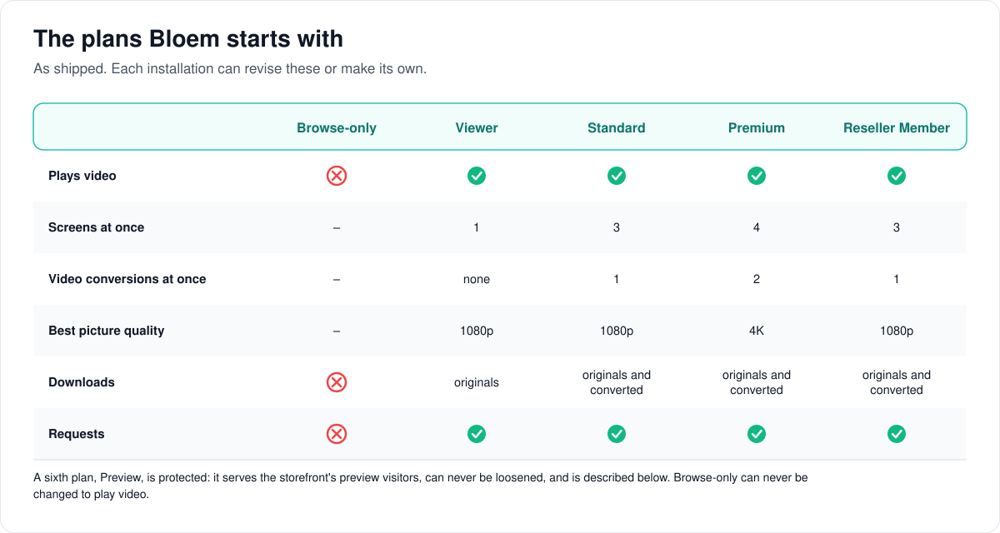
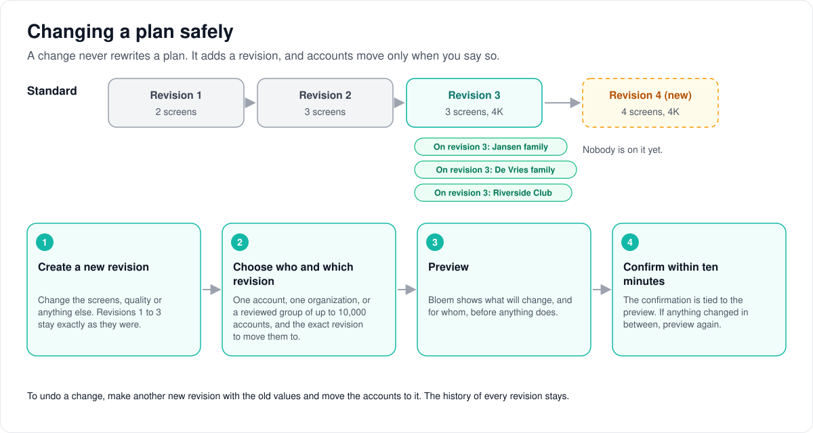

# Entitlement templates

> **Provenance and status.** Bloem page, rewritten on 2026-11-01 and checked against
> `main` at `b6039036d`. Entitlement templates (plans) are a Bloem addition; Silo's
> own access control is the per-account policy and access groups described in the
> [admin guide](../admin-guide.md#25-access-groups). This is the short guide for a
> platform administrator. The technical rules are in the
> [For developers](#for-developers) section.

An **entitlement template** is a plan: access policy you define once and apply,
as one exact revision, to an organization or to a direct account. This page walks
through what a plan controls, the plans Bloem starts with, and the safe way to
change one. The full procedure is
[managing entitlement templates](../../operations/entitlement-templates.md), and
the plain explanation is [how plans work](../../architecture/bloem-plans.md).

## What a plan controls

Choose the **Platform** administrative context, then open **Entitlement
Templates** in the Platform section of the admin sidebar
(`/admin/platform/entitlement-templates`). Every plan sets:

- all libraries, or a chosen set of libraries;
- whether playback and video conversion (transcoding) are allowed;
- how many screens, profiles and conversions at once;
- downloads of the original file and of a converted copy, each on its own;
- the best picture quality;
- whether members can make media requests; and
- which access-group permissions members get.

**All libraries** follows every library the organization or account can reach,
now and later. A chosen set is an allowlist. Either way, a plan can only permit a
library the organization already owns or holds a live grant for; a plan never
grants a platform library by itself.

## The plans Bloem starts with

Bloem includes **Browse-only**, **Viewer**, **Standard**, **Premium** and
**Reseller Member** (keys `browse-only`, `viewer`, `standard`, `premium`,
`reseller-member`). Revise them or clone them to fit what you offer.
Browse-only can never be revised to allow playback.

A sixth plan, **Preview** (key `bloem-preview`), backs the storefront's
browse-only previews. It is protected: it cannot be switched off or loosened, and
no other plan can take its key. See
[browse-only previews](../admin-guide.md#browse-only-previews) and
[how browse-only access and the preview work](../../architecture/bloem-browse-only-content-policy.md).

## The safe way to change a plan

1. Create or select a plan.
2. Check its policy and whether it is enabled.
3. Create a **new revision** for every change. Old revisions are never rewritten.
4. On the organization's page (**Plan**) or the **Direct Accounts**
   page, select the exact revision and run the preview.
5. Review the changes, then confirm within ten minutes. The confirmation belongs
   to what you previewed; if anything changed, preview again.

To roll back, create a new revision from an older one. Groups an organization
made itself are kept when you apply a plan to the organization.

To move a reviewed set of existing accounts between exact revisions, use policy
cohorts and bulk jobs: **Change Many Accounts** for direct accounts, **Policy
Cohorts** in an organization context. See
[bulk policy cohorts](../../operations/bulk-policy-cohorts.md).

## Who can change what

| Who | What they manage |
| --- | --- |
| Platform administrator | Creating, revising, cloning and archiving plans; applying them to organizations and direct accounts. |
| Organization administrator | Moving their organization's people between revisions, under **People → Apply policy**. |
| The storefront (Bloem Garden) | Listing plans and putting one account on a plan, with a platform administrator's API key. |

## Words used in the code

| On this page | In the code and database |
| --- | --- |
| Plan | entitlement template (`internal/entitlements`) |
| Revision | `entitlement_template_revisions` |
| All libraries | `library_ids: null` |
| Live grant | an organization library entitlement |
| Policy cohort, bulk job | entitlement cohorts and bulk policy jobs |

## For developers

- **API:** [plans and preview](../../bloem/api/plans.md) and the older
  [native API reference](../../bloem-api-reference.md#entitlement-template-administration).
- Operations, troubleshooting and API automation:
  [managing entitlement templates](../../operations/entitlement-templates.md).

Source references:

- `internal/entitlements/template_store.go`
- `internal/api/handlers/entitlement_templates.go`
- `internal/api/router_bloem.go`
- `migrations/sql/20260821170000_entitlement_templates.sql`,
  `migrations/sql/20261014120000_bloem_preview_template.sql`
- `web/src/pages/admin-platform/EntitlementTemplatesPage.tsx`,
  `web/src/pages/admin-platform/EntitlementTemplateEditor.tsx`

History: Bloem added templates in `3ec1650d7` (2026-08-21, migration
`20260821170000_entitlement_templates.sql`) so a platform administrator could give
many organizations and accounts the same policy without editing each one, and
this page in `dbe8323d7` the same day. The protected **Preview** template
followed in `25062b4df` (2026-10-14).
