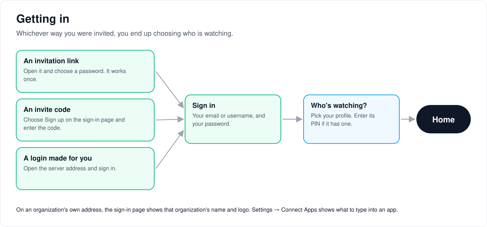
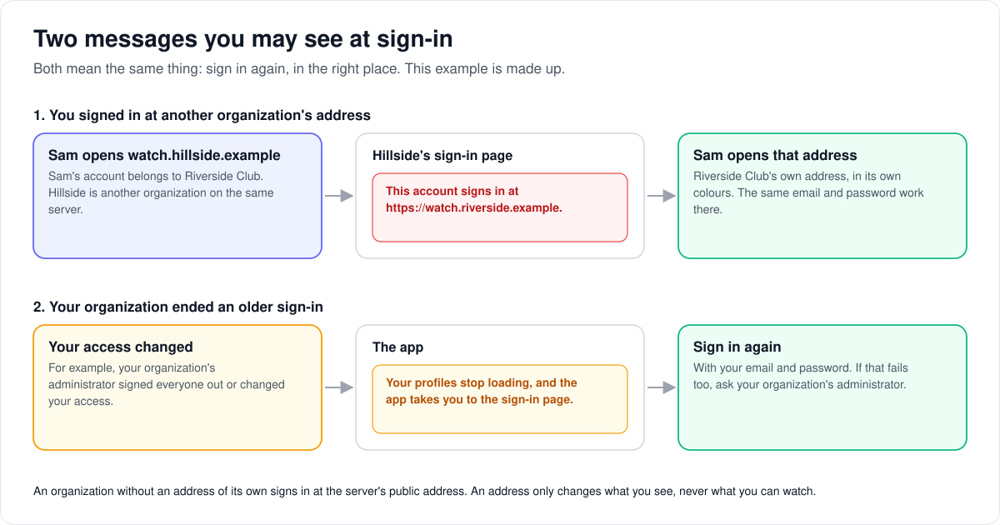
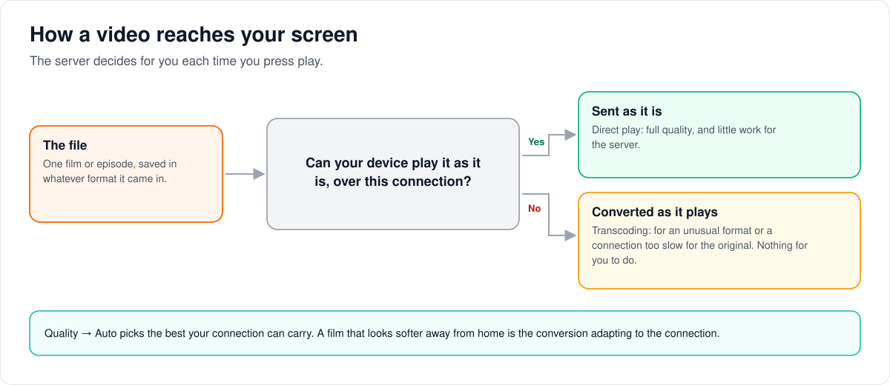
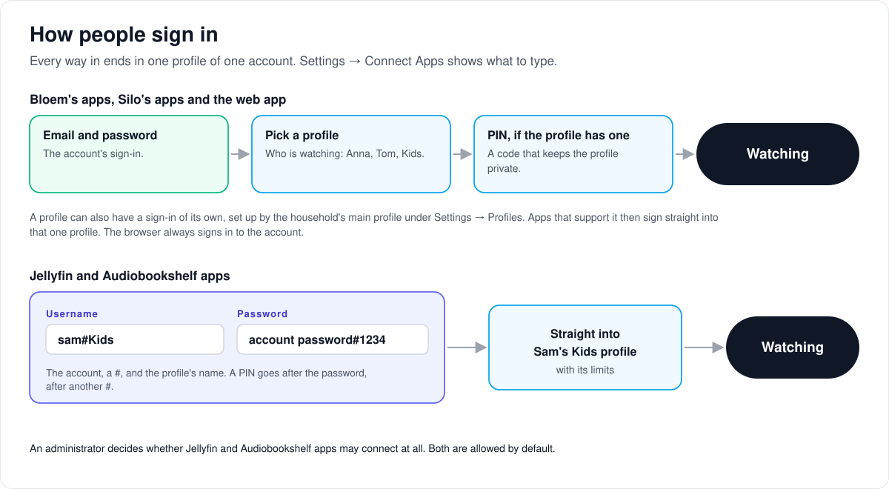

# Bloem user guide

> **Provenance and status.** Bloem page, rewritten on 2026-11-01 and checked against
> `main` at `b6039036d`. It is the guide for people who watch, listen and read on a Bloem
> server. The web app is Silo's, so parts of it say "Silo". Bloem adds Live TV, audiobook and
> ebook requests, browse-only previews, promotional cards and seasonal artwork, separate
> sign-ins for household profiles, and organizations' own addresses. The technical details are
> in the [For developers](#for-developers) section.

Somebody you know runs a Bloem server, a private streaming service for a library they look
after, and has given you a way in. This guide walks through getting in, profiles, finding
things, watching, listening and reading, downloads, requests, notifications, settings and apps.
It covers the web app, which works in any browser, and says where the phone, tablet and TV apps
come in. Those apps are separate projects, so their details depend on the app you use. You do
not need to know how the server works. If a word is new, the [glossary](#glossary) explains it.

---

## 1. Getting in

### Browsing a preview

The person running the server may give you a **Browse the library** link. Open it in your
browser to explore descriptions, series, seasons, episodes and collections. When you try to
watch, listen or read, the preview shows subscription options. Downloads and personal actions
are not available in a preview. Previews are a Bloem addition, and the wording of these buttons
can be changed by the person running the server.

A guest preview ends after a limited time. Use **Keep browsing** to go back to the launch page,
or follow its subscription link. If you already subscribe, your own login is kept separately.
Preview controls in native apps are not part of this web flow.

### Your invitation

You will have received one of these:

- **An invitation link, emailed or handed to you.** Open it and choose a password. The link works
  only once and can be replaced or revoked, so if it has gone stale, ask the person who sent it
  for a new one.
- **An invite code and a server address.** Open the address in a browser, choose **Sign up** on
  the sign-in page, enter the code, and pick a username and password.
- **A username and password someone set up for you.** Open the server address and sign in.

### The server address

Bloem is not a public website: every server has its own address. It looks like
`http://192.0.2.20:8090` on a home network, or `https://films.example.com` when the server has
a domain. You need it for the apps as well as the browser, so keep it somewhere.

Your account belongs to one **organization**, the group of accounts it is managed with. Most
servers have only one. An organization can have **its own address**, with its own name, logo and
colours on the sign-in page. When it has one, your invitation and password-reset emails usually
link to it, so use the address in your emails. An address only changes what you see, never what
you can watch.

### Signing in at another organization's address

If you sign in on an address that belongs to a different organization, Bloem refuses and tells
you where your account signs in:

> This account signs in at https://watch.riverside.example.

That address is made up; you will see your own. Open the address it names and sign in there with
the same email and password. If your organization has no address of its own, the message names
the server's public address.

### When you are asked to sign in again

Sometimes the app takes you back to the sign-in page by itself. That happens when your
organization ends your sign-in, for example after its administrator signed everyone out or
changed your access. Your old sign-in stops working everywhere it was used.

1. Sign in again with your email and password.
2. Choose your profile.
3. If signing in fails too, ask your organization's administrator.

### Signing in from a TV or phone

Apps ask for the server address first, then your login. Some TV apps show a code or a QR code
instead of a password box:

1. Open the address the TV shows on a phone or computer where you are already signed in. It is
   the server's **Sign in a TV** page (`/activate`), on the server's public address even when your
   organization has its own.
2. Approve the code.
3. The TV finishes signing in.

The web sign-in page offers the reverse too: **Use your phone instead** shows a code you approve
on a device that is already signed in.

### Passwords

Change your password under **Settings → Account**. Tick **Sign out of other devices** to end
every other sign-in at the same time, for example after losing a phone. Other browsers and apps
must then sign in again with the new password. The device you are using stays signed in, and API
keys keep working.

- **A temporary password** from your administrator must be replaced when you are asked, before
  you continue into the library.
- **A forgotten password:** use **Forgot password?** on the sign-in page when the server offers
  it, or ask an administrator for a reset link. A reset link works once; use the newest one you
  received.
- **An account managed by an outside sign-in service** (an identity provider) uses that service's
  password recovery instead.

---

## 2. Profiles

One login can have several **profiles**, one per person in the household. Each profile keeps its
own *Continue watching*, history, recommendations and settings. Someone else's half-watched
series does not appear in your row, and your taste does not shape their suggestions. Playback
belongs to the profile that started it: another profile on the same login cannot move or stop it.

- **Choosing a profile** happens right after you sign in, on **Who's watching?**. Pick yours.
- **Creating one:** **Add profile** on that screen, or **New profile** under
  **Settings → Profiles**. Adding a profile may ask for the main profile's PIN.
- **A PIN** stops other people opening your profile. Set one in **Settings → Profiles**.
- **A Kids profile** can be limited by a maximum content rating, a maximum advisory age, a maximum
  playback quality and a set of libraries. The administrator or the household's main profile sets
  these, and anything above the limit does not appear.
- **Switching** is **Switch Profile** in the sidebar menu under your profile picture.

**Settings → Profiles**, **Settings → Account** and **Settings → Signed-in sessions** are for the
household's **main profile** (or an administrator). Other profiles do not see them.

**Separate sign-in for a profile** (a Bloem addition), under **Settings → Profiles**, let a permitted
household manager set, change or switch off a separate sign-in for one profile, for apps that
support it:

1. Select and unlock the main profile.
2. Set, rotate or disable the profile's sign-in.
3. Confirm with the account's current password.

If someone else's change landed first, reload and review it: your older action is refused and
leaves the newer credentials and sessions as they are. Rotating or disabling a profile's sign-in
signs that profile out of the apps that used it. Accounts that sign in only through an outside
sign-in service cannot confirm here.

The browser always signs in to the **account**. Profile credentials do not let a profile sign in
to the browser directly, and do not pair a shared device with one profile. Signing in a TV is a
separate flow.

---

## 3. Finding things

### Home

Home is rows: *Continue Watching* at the top, then whatever the server offers, such as Next Up,
recently added, a themed collection or things recommended for you. Add, hide and reorder rows under
**Settings → Home Screen**.

**Home promotions: Off/On** controls optional campaign cards for your profile in this browser. It
starts off and is not available for children. If your browser blocks storage, the choice lasts
only in the current tab. Cards you can dismiss have their own dismiss control. A card shown before
playback always offers **Continue to content** straight away, and does not restart a player you
already opened.

Seasonal snow and artwork can appear on Home or on the sign-in page. They respect reduced motion,
stop while video plays, and have a switch on each device, **Seasonal effects: On/Off**. Home, when
you are signed in, shows public packs and packs for your organization; the sign-in page shows
public packs only. Promotions and seasonal artwork are Bloem additions.

### Libraries

Each **library** is one kind of thing: Movies, Series, a Mixed library of both, Audiobooks, Ebooks,
Manga or Podcasts. The sidebar lists the libraries you can see; open one to browse it. The
controls at the top sort and filter, and filters stack. **Settings → Libraries** chooses which
libraries appear in your menu, their order, and the languages for each.

### Search

**Search** in the sidebar finds titles and people. Where requests are on, results can also include
a **Not in your library** group: titles the server can look up but does not have, which you can
request. See [Asking for something new](#6-asking-for-something-new).

### Collections

**Collections** are sets someone put together: a director's films, a franchise in viewing order, a
seasonal list. Some update themselves from outside lists. You can make your own: open any item and
choose **Add to Collection**.

### Calendar

**Calendar** shows what is arriving and when: new episodes of series you follow or that are in the
library, and upcoming releases.

### People

Click any actor, director or writer to see everything of theirs the library holds.

### Your own lists

- **Watchlist:** things you mean to watch. Add from any item's page.
- **Favorites:** things you loved.
- **History:** everything you have watched. **Mark Watched** and **Mark Unwatched** on an item
  change it.

All three are per profile, and in the sidebar.

---

## 4. Watching

### Playing something

Open an item and press **Play**. A series plays from where you left off. A film you stopped part
way shows **Resume**; choosing it offers **Resume at** the saved time or **Play from Beginning**.

When a title exists in more than one version, such as a theatrical and an extended cut or two
languages, the item page lets you choose, and the player's quality menu shows the version playing.

The web app can shuffle libraries, series, seasons and collections, choosing from what your
profile can see. Native apps show shuffle only if they offer it.

### Controls

The web player has:

- **Play/pause, seek, skip back and forward.** Skips default to 10 seconds back and 30 seconds
  forward; change them under **Settings → Playback**.
- **Audio:** choose the language or the surround track. If you do not choose, the server starts
  from your preferred language. When that track would have to be converted for your device, it
  picks another main track in the same language that your device plays as it is, never a
  commentary or audio-description track. A track saved for a series still plays as saved.
- **Subtitles:** choose a track, turn them off, adjust timing, or **Sync to audio**. If the track
  you want is missing, **Add Subtitles…** searches online through the server's subtitle sources.
  Where the server has AI switched on, **Translate subtitles with AI** or **Generate subtitles with
  AI** makes one.
- **Quality:** normally *Auto*, which picks the best your connection can carry. Set it lower on a
  slow connection, or higher if the picture looks soft and your connection is good.
- **Chapters**, where the file has them.
- **Skip Intro** appears at the start of episodes when the server has found the intro.
- **Next episode** counts down at the end of one; press it or let it run.
- **Sleep timer** stops playback after a set time.

How a TV remote or phone maps to these depends on the app.

### Picture quality and "transcoding"

Bloem sends the file exactly as it is when your device can play it: **direct play**. When it
cannot, because of an unusual format or a connection too slow for the original, the server
converts it as it plays: **transcoding**. You do not have to do anything. If a film that looks
perfect at home looks worse away from home, that is the conversion adapting to the connection,
and *Quality → Auto* is doing its job.

### Listening: audiobooks

Audiobooks remember your place in each book and have their own speed control, sleep timer and
chapter navigation. Their skip intervals can differ from video's (**Settings → Playback**).
Audiobookshelf apps can connect too; see [section 9](#9-connecting-an-app).

### Reading: books and comics

Books (EPUB, PDF, MOBI/AZW3, FB2) and comics (CBZ, CBR) open in the reader, which keeps your place
in each book. Under its own settings the reader has font, font size, line height and margin, a
theme (Light, Sepia or Dark), paged or scrolled flow, right-to-left page turning, bookmarks,
highlights, text search and read-aloud.

Reading EPUB and PDF books straight from a storage provider is experimental. It needs a source
that is switched on and allowed. Switching that source off or uninstalling it stops access but
keeps the library and your reading progress. These books cannot be downloaded or converted for
offline use; being able to read one online does not mean you can download it.

### Watching together

**Watch Party** (in the sidebar) lets several people on different devices watch the same thing at
the same time, in sync.

1. Create one there with **Create Watch Party**, or choose **Start a Watch Party** from the
   **More** menu on a movie's or episode's page.
2. The host either picks what plays or lets everyone vote.
3. Share the invite link or the eight-letter room code. Others join under **Join a party**.

Play, pause and seek apply to everyone. The room ends two minutes after the host drops off.
Whether a phone or TV app can join depends on the app.

### Live TV and recordings

**Live TV** is a Bloem addition. It appears when your profile has permission. Channels come from a
tuner on the network or from an Xtream live provider that the administrator set up. You use your
Bloem account and profile, never the provider's password. Films and series from Xtream providers
are not imported. Watching and recording share the provider's connections, so a new stream can be
refused while they are all in use.

The Live TV page has **Guide**, **Channels**, **My recordings** and **Recording rules**:

- **Watch:** open a channel from the guide.
- **Record once:** schedule a programme from the guide, or a channel and time with **Schedule by
  channel and time**. **My recordings** shows each one's status and lets you cancel it.
- **Record regularly:** a **recording rule** matches titles that contain some text, or one series
  chosen from the guide (**Match guide series**), optionally on one channel or only new episodes.
  Removing a rule asks you to confirm and leaves its recordings in place. You cannot edit rules,
  and old recordings are not deleted for you.

If a recording action has an uncertain result, use **Reload recordings** and wait for it to
succeed before doing anything else. Check the list before making a fresh request: reloading does
not send the earlier action again. A finished recording without a library link needs an
administrator to scan its recording folder before it plays from the catalog. Whether your device
can play it still depends on the server, the tuner and your browser.

---

## 5. Downloads

Offline downloads are a feature of the phone and tablet apps, not the web app. The administrator
decides whether your account may download, and whether converted, smaller copies are allowed. How
an app presents downloads depends on the app.

Downloads are per device; they do not appear on your other devices. Season and series downloads
can wait in a queue when many are being prepared, rather than failing straight away. A download
queued for the whole account is still checked against what your profile may see before it is
sent. Books read straight from a storage provider cannot be downloaded this way.

---

## 6. Asking for something new

Where the administrator has turned it on, you can **request** things the library does not have.
Open **Requests** in the sidebar:

- **Discover** lists titles to browse and request, in rows the administrator chooses.
- **Yours** shows your requests grouped as *Needs attention*, *On the way*, *In your library* and
  *Cancelled*.

You can also search and pick a title from the *Not in your library* results. For a series, choose
the seasons you want. If someone already asked for a title, follow their request instead of
sending a duplicate; you are told when it arrives. What you can request, approval and limits
depend on your account and group. **Settings → Requests** can make adding a title to your
watchlist request it too.

Bloem adds **Audiobooks** and **Ebooks** tabs beside **Movies & series** when the server supports
them. An audiobook request takes a title and, if you like, an author, ISBN or ASIN. An ebook
request takes the ISBN of the edition you want; ebook requests are open only to accounts in the
server's default organization.

---

## 7. Notifications

**Notifications** in the sidebar (the bell) collects what the server tells you: a new episode of
something you follow, an approved request, an announcement from the administrator.
**Settings → Notifications** decides which new-episode alerts you want, and whether they also
arrive as browser notifications, email, Discord messages or webhooks, as far as the server offers
them. Phone push notifications are set up in the app.

---

## 8. Settings worth knowing about

**Settings** in the web app has these pages, grouped as in its menu:

| Group | Page | What you can change |
|---|---|---|
| Playback | **Playback** | Preferred quality, maximum bitrate, skipping intros, recaps and credits, auto-play next episode, seek intervals. |
| Playback | **Language & Subtitles** | Spoken and metadata languages, subtitle language and behaviour, forced subtitles, and how subtitles look. |
| Playback | **Your Devices** | Overrides for one device (quality, HDR, audio and subtitle preferences, sleep timer), and which profile this browser opens. |
| Appearance | **Navigation & Cards** | Poster size, badges on posters, shortcuts, and your menu. Every card shows its title and details. |
| Appearance | **Title Pages** | Title art, theme music, spoiler blurring, advisory age. |
| Appearance | **Accessibility** | Text size, text weight, contrast, date and time formats. |
| Home & Discovery | **Home Screen** | Which rows appear and in what order. |
| Home & Discovery | **Libraries** | Which libraries you see, their order, languages for each. |
| Home & Discovery | **Personalize** | Re-tune the taste profile behind your recommendations. |
| Home & Discovery | **Requests** | Whether adding to your watchlist also requests a title (only when requests are on). |
| Connections | **Connect Apps** | Exactly what to type into an app's sign-in screen (see below). |
| Connections | **Watch Providers** | Sync history, ratings and watchlists with services such as Simkl. |
| Connections | **Webhook Sync** | Take watch progress from Plex, Emby or Jellyfin as it happens. |
| Connections | **History Import** | Copy watch history, watchlist and favorites from Emby, Plex or Jellyfin once. |
| Account | **Notifications** | Which alerts you get, and where. |
| Account | **Profiles** | Names, PINs, Kids limits, profile sign-in credentials (main profile only). |
| Account | **Account** | Password and sign-in providers shared by the household (main profile only). |
| Account | **Signed-in sessions** | Where the account is signed in; sign out a browser or app, or everywhere (main profile only). |

There is no theme choice: the web app has one theme, and the server's administrator sets its
accent colour. On an organization's own address, the organization's colours apply.

Settings kept on the server follow their account, profile or device. The browser's Home
promotions choice and the seasonal off switch stay on that device and do not follow you elsewhere.

---

## 9. Connecting an app

Use the web app, or an app your administrator supports. **Settings → Connect Apps** shows exactly
what to type for the kind of app you have:

- **Silo app or website:** apps built for Bloem's or Silo's own API. Enter the same server address
  you use in the browser, sign in with your account, then choose a profile in the app's profile
  picker. Use device pairing when the app offers it.
- **Jellyfin-compatible app** (such as Infuse, Findroid or Swiftfin): these connect to a separate
  address and port your administrator gives you, usually the server address with port `8096`. Sign
  in with `account#profile` as the username (for example `sam#Kids`) and your account password. If
  the profile has a PIN, add `#` and the PIN to the end of the password.
- **Audiobookshelf apps** connect the same way on their own port, usually `13378`.

The compatibility ports work only while the administrator has them switched on. If an app says
your username or password is wrong, the Connect Apps page lists the usual causes. For the picture
of which app uses which entrance, see [How apps connect](../architecture/bloem-apps.md).

---

## 10. When something is not working

| What you see | What to try |
|---|---|
| "Cannot connect" in an app | Check the address, including `http` or `https` and the port, and that you are on a network that can reach the server. Try it in a browser first. |
| "This account signs in at …" | You are on another organization's address. Open the address in the message and sign in there. |
| You are suddenly back on the sign-in page | Your organization ended your sign-in. Sign in again; if that fails, ask its administrator. |
| A Jellyfin app rejects your password | Check that the username is `account#profile` and, for a profile with a PIN, that the password ends in `#PIN`. See **Settings → Connect Apps**. |
| A film stutters | In the player, set *Quality* lower. If it is fine at home and poor elsewhere, that is your connection. |
| Subtitles are out of sync | Try **Sync to audio** or the timing control, or a different track from **Add Subtitles…**. |
| Something you know is there is missing | It may be in a library your profile cannot see, or not scanned yet. Ask the administrator. |
| Wrong artwork or title | Tell the administrator; they can rematch it. |
| Your place in a series was lost | Check you are on the right profile: watch history is per profile. |
| You forgot your PIN | The household's main profile, or an administrator, can change it in **Settings → Profiles**. |

---

## Who can change what

| Who | What they manage |
| --- | --- |
| You, on your profile | Your Home rows, settings, lists, requests and notification choices. With the Live TV permission, your recordings and recording rules. |
| The household's main profile | The household's profiles, PINs, Kids limits and profile sign-in credentials; the account password and its signed-in sessions. |
| Your organization's administrator | Your account, its access and limits, invitations, and signing people out. |
| The server's administrator | The libraries, what the server offers (requests, downloads, Live TV, compatibility apps), and each organization's address and look. |

## Words used in the code

| In this guide | In the code and the API |
| --- | --- |
| Account | a `users` row |
| Profile, main profile | a `user_profiles` row; the main profile has `is_primary` |
| Organization | `organizations` (a tenant); each account has one membership |
| Organization's own address | a domain in `bloem_organization_domains` (`internal/orgdomains`) |
| "This account signs in at …" | `409 wrong_organization_domain` (`conflict` on `/api/v2`) |
| Asked to sign in again | `401` with reason `session_invalid` (`session_expired` on `/api/v2`) |
| Sign in a TV | `/activate` |
| Profile sign-in credentials | `/api/bloem/v1/profile-credentials/{id}` |
| Live TV permission | `watch_live_tv` |
| Seasonal artwork on the sign-in page | `GET /api/bloem/v1/ambience/public` |
| Compatibility sign-in | `account#profile`, with `#PIN` after the password |

## Glossary

- **Direct play:** the file is sent to your device unchanged.
- **Library:** one kind of media: movies, series, audiobooks, ebooks, manga, podcasts.
- **Main profile:** the household's main profile, which manages the others (the web app also says
  primary profile).
- **Organization:** the group of accounts yours is managed with. It can have its own address.
- **Profile:** one person within a login, with their own history and settings.
- **Request:** asking the administrator for something the library does not have.
- **Server address:** the web address of the Bloem server you use.
- **Silo:** the open-source media server Bloem is built on.
- **Transcoding:** the server converting a file as it plays so your device can show it.
- **Watch Party:** several people watching the same thing in sync from different devices.

## For developers

- **API:** [apps](../bloem/api/apps.md) (profile sign-in credentials and what Bloem's apps read),
  [messages](../bloem/api/messages.md) (campaign cards and seasonal packs, including
  `GET /api/bloem/v1/ambience/public`), [Live TV](../bloem/api/live-tv.md),
  [requests](../bloem/api/requests.md) and [organizations](../bloem/api/organizations.md)
  (organization domains).

### Review basis

- This rewrite was checked on 2026-11-01 against the web app's source and the server code at Bloem
  `main` `b6039036d` (Silo through `63ef34b23`). The previous check was on 2026-10-27 at
  `e852f92bf` (Silo through `3e2d306b2`). It is a source review, not a device test.
- Bloem is built on [Silo Server](https://github.com/Silo-Server/silo-server) and follows it
  closely. Silo's labels stay, for example "Silo app or website" on the Connect Apps page.

### Sign-in and sessions

- Sign-in on another organization's domain is refused before a session exists with
  `409 wrong_organization_domain` and the message `This account signs in at https://<primary domain>.`
  The address falls back to the server public URL when the account's organization has no primary
  domain. `/api/v2` renders it as `conflict`, and the sign-in page shows the detail. Unregistered
  hosts and impersonation sessions are not refused. A domain decides presentation, never access.
  See [organization domains and branding](../architecture/bloem-organization-domains.md).
- The device sign-in page (`/activate`) and the server address apps are told
  (`/api/v2/system/identity`) stay on the server public URL. A device-code sign-in is created by
  the device login service, so the domain check does not see it.
- An account-login session created before its profile's organization revoked the account is
  ended; the viewer-access gate answers `401` with reason `session_invalid` (`session_expired` on
  `/api/v2`), the refresh is refused, and the web app returns to sign-in. It used to answer
  `404` "Profile not found". See `internal/api/bloem_org_session_revocation.go`,
  `internal/api/middleware/bloem_viewer_session.go` and the
  [security foundation](../architecture/bloem-security-foundation.md).
- **Sign out of other devices** ends the account's other sign-ins; the current device stays signed
  in and API keys keep working. Reset links are single-use.

### Profiles and playback

- Profile sign-in credentials: confirmed with the account's current local password; SSO-only
  confirmation is not supported. A stale action is refused and leaves the newer credentials and
  sessions intact. Rotation or disable signs out that profile's direct sessions. The browser
  requires account sign-in: credentials do not enable direct-profile browser login or
  shared-device profile pairing, and TV account activation is separate.
- A profile can report progress for and stop only its own playback.
- The automatic audio choice arrived from Silo on 2026-10-27 (`internal/playback/audio_select_v3.go`).
- Watch Party rooms end two minutes after the host disconnects (`internal/watchtogether`).
- Provider-backed native EPUB/PDF reading is experimental and requires an enabled, authorized
  source. Disabling or uninstalling the source prevents access while keeping library and
  reading-progress identities. Native offline downloads and conversion are not supported; an
  online reader capability is not an offline-download guarantee.
- Downloads: season and series requests may queue beyond the concurrent preparation limit; an
  account-wide download is checked against the profile's access before it is served; local-media
  download paths do not support native provider-backed ebook locations.
- Live TV: Xtream VOD and series are not imported; watching and recording share the provider's
  configured connection budget. Reloading recordings does not resend the previous write. A
  completed recording without a library link needs its folder scanned into a library.
- Signed-out seasonal packs come from `GET /api/bloem/v1/ambience/public`; the web app calls none
  of Silo's `/api/v1` ([leaving Silo's `/api/v1`](../architecture/bloem-leaving-silo-v1.md)).
- Compatibility apps sign in with `account#profile` and `#PIN` after the password, on ports `8096`
  (Jellyfin) and `13378` (Audiobookshelf) by default.

Technical pages:

- [How apps connect](../architecture/bloem-apps.md) and
  [protocol compatibility](../architecture/bloem-compatibility-removal.md): the Jellyfin and
  Audiobookshelf compatibility servers.
- [Organization domains and branding](../architecture/bloem-organization-domains.md).
- [How Live TV works](../architecture/bloem-live-tv.md).
- [How requests work](../architecture/bloem-requests.md).
- [How messages and promotions work](../architecture/bloem-messages-and-promotions.md).
- `docs/architecture/invitations-onboarding.md`: invitations and sign-up.
- The [admin guide](admin-guide.md), for the person running the server.

### Source references

- `web/src/lib/userSettingsNav.ts`: the settings pages and their labels
- `web/src/components/AppSidebar.tsx`, `web/src/App.tsx`, `web/src/bloem/routes.tsx`: navigation and routes
- `web/src/pages/`: Home (`BloemHome.tsx`), LibraryPage, Collections, Calendar, PersonDetail,
  Requests (`web/src/bloem/BloemRequests.tsx`), Notifications, `watchtogether/`, EbookReader,
  LiveTV, ActivateDevice, Login and the `settings/` pages named above
- `web/src/player/components/`: the player controls
- `web/src/components/seasonal/SeasonalLayer.tsx`: seasonal effects and the public packs
- `internal/playback/audio_select_v3.go`: the automatic audio choice
- `internal/jellycompat/login.go`, `internal/audiobooks/abs/login.go`: `account#profile` sign-in
- `internal/api/handlers/bloem_sign_in_domain.go`: the "signs in at" refusal

The pictures are SVG files under `docs/architecture/images/user-guide/`, drawn by
`scripts/bloem/pictures/user_guide.py` through `scripts/bloem/draw-pictures.py`. The app sign-in
picture is drawn by `scripts/bloem/pictures/apps.py`. Redraw them there, not by hand.
