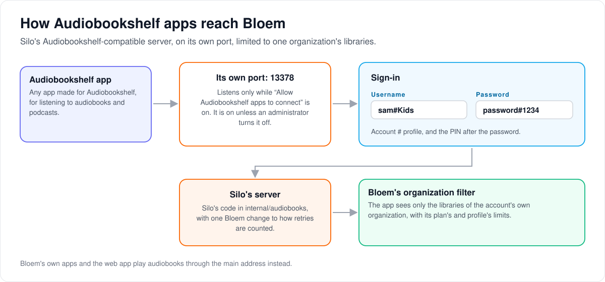

# How audiobooks and podcasts work in Bloem

> **Provenance and status.** Bloem page, rewritten on 2026-11-01 and checked against
> `main` at `b6039036d`, which contains Silo through `63ef34b23`. This package is Silo's:
> every Go source file here also exists in Silo's `main`. Bloem adds one small change, its
> own tests, this README, and the organization limit described below. The technical rules
> are in the [For developers](#for-developers) section.

This page explains what the `internal/audiobooks` package does, how Audiobookshelf apps
reach it, and the little that Bloem changes. Silo labels audiobooks, ebooks and
Audiobookshelf compatibility as **beta**: they work, but are outside Silo's 1.0 support
promise.

## What the package does

`internal/audiobooks` is Silo's audiobook and podcast service:

- **Scanning and details.** It recognises audiobooks in a library and looks up their
  details, such as author, narrator and cover, and remembers which lookups failed so it
  can try again later.
- **Podcasts.** It follows podcast feeds.
- **Smart collections and recommendations** for listeners.
- **An Audiobookshelf-compatible server**, so apps made for Audiobookshelf can sign in
  and listen.

Bloem's own apps and the web app do not use the Audiobookshelf server. They play
audiobooks through the main address, as described in
[how audiobooks play in Bloem's apps](../../docs/architecture/bloem-native-audio-playback.md).

## How Audiobookshelf apps reach Bloem

1. **Its own port.** Audiobookshelf apps connect to port `13378`, never to the main web
   address. The port listens only while **Allow Audiobookshelf apps to connect** is on,
   under **Configure → Integrations → Compatibility**. It is on unless an administrator
   turns it off, and changing it needs a restart.
2. **Signing in.** The app's username is the account, a `#`, and the profile's name, such
   as `sam#Kids`. If the profile has a PIN, it goes after the password, after another
   `#`.
3. **One organization only.** Silo's server answers, but Bloem limits it to the libraries
   of the account's own **organization**, with the account's plan and the profile's
   limits. An app never sees another organization's books.

## What Bloem changes

- **The organization limit** above. It is added where Bloem starts the server, so the
  package code stays Silo's.
- **One small change to retry counting.** When looking up a book's details keeps finding
  no match, Bloem counts the attempts so that earlier repair attempts are not forgotten.
- **Nothing else.** Bloem once removed this server and later put Silo's version back
  unchanged, so Silo's updates to it merge cleanly. Bloem's earlier extras (a separate
  sign-in for compatibility apps, and serving them on the main address) stay removed.

## Who can change what

| Who | What they manage |
| --- | --- |
| Platform administrator | Whether Audiobookshelf apps may connect at all, and which libraries exist. |
| Whoever runs the host | Which host port Audiobookshelf apps use (`ABS_PORT`). |
| An account's main profile | Profiles, PINs and limits, which also apply in Audiobookshelf apps. |

## Words used in the code

| On this page | In the code and settings |
| --- | --- |
| Audiobookshelf-compatible server | the REST handlers in `abs/`, the Socket.IO server in `abssocket/`, and the stores they use (`abs_*_store.go`, `service.go`) |
| Its own port | Silo's `cmd/silo/abs_listener.go`, port `ABS_PORT` (default `13378`) |
| Allow Audiobookshelf apps to connect | the `audiobookshelf_compat.enabled` setting |
| Signing in | `abs/login.go` |
| Looking up details, and retries | `enrichment.go`, `enrichment_state.go` |
| Podcasts | `podcastfeed/` |
| Smart collections, recommendations | `smartcoll/`, `recommender.go` |
| The organization limit | `newTenantAwareViewerResolver` in `cmd/silo/bloem_main.go`, called from `cmd/silo/main.go` |

## For developers

- **API:** Audiobookshelf's own wire protocol, served on the compatibility listener; it is
  an external contract, not Bloem's native API, and has no route-inventory rows. Bloem's
  native audiobook surface is in
  [the audio contract](../../docs/architecture/bloem-native-audio-playback.md).

### Provenance

Every Go source file here also exists in Silo's `main`; Bloem's differences are one
declared seam, its own test files and this README. "Seam" here means a Silo-owned file
Bloem edits, declared in [`contracts/seams.txt`](../../contracts/seams.txt) and checked by
`make verify-seams`. The README was added in `35e9e9f7f` (2026-08-18), revised on
2026-10-27 against `e852f92bf` (Silo through `3e2d306b2`), and rewritten on 2026-11-01
against `b6039036d` (Silo through `63ef34b23`).

### The listener

Audiobookshelf apps reach Silo's server on its own listener (Silo's
`cmd/silo/abs_listener.go`, `newAudiobookshelfListener`), never on the main web/API port:

- the listener is controlled by the `audiobookshelf_compat.enabled` setting, default on
  (**Configure → Integrations → Compatibility → Allow Audiobookshelf apps to connect**);
  it is a restart key (`internal/config/restart_keys.go`);
- the port is `ABS_PORT`, default `13378` (`internal/config/bootstrap.go`). Silo made it
  configurable from the environment in `bca55f764` (2026-10-26, #3117); the bundled
  Compose file pins the container side and publishes `ABS_PORT` on the host;
- the handler mounts on a fresh router at the root (`/ping`, `/healthcheck`, `/status`,
  `/login`, `/socket.io` and so on), with no SPA fallback, and also serves the signed
  `/api/v2/artwork/*` route so cover redirects resolve on this port;
- apps sign in as `account#profile`, and a PIN-protected profile appends `#PIN` to the
  password (`abs/login.go`).

### Organization scope

`cmd/silo/main.go` wraps the Audiobookshelf server's scope resolver in Bloem's
`newTenantAwareViewerResolver` (`cmd/silo/bloem_main.go`), which turns on Bloem tenancy
for Silo's viewer resolver (`WithBloemTenancy`) and resolves each account's tenant for
callers without a request tenant. So a session reaches only its organization's
libraries. That wiring point is the only integration; the package code stays Silo's. It
applies wherever the policy system exists, that is in `integrated` and `api` mode.
`cmd/silo/bloem_viewer_tenancy_wiring_test.go` fails if a Silo viewer resolver is built
without it.

### The seam

`enrichment_state.go` is the one declared seam. It changes how `RecordOutcome` counts
attempts: a new `no_match` streak starts at 1, and every other outcome increments the
existing count, so earlier repair-attempt history is not reset. Silo's version
increments only consecutive `no_match` outcomes and resets every other one to 1. Bloem's
tests for it are `bloem_outcome_attempts_test.go` and
`bloem_native_audio_enrichment_db_test.go` (seam introduced in `5f70bd5d7`,
2026-09-19). `bloem_upstream_fixtures_test.go` and `native_test_database_test.go` are
Bloem test helpers; the first copies fixtures from Silo tests that upstream has since
removed, so those Silo files stay deleted.

### History

Bloem removed both Silo compatibility servers on 2026-10-13 (`b8ddec9bf`) and restored
Silo's versions on 2026-10-18 (`2393c41ee`) so that Silo's code merges without deletion
seams. Bloem's earlier additions, the companion credential enrollment and the
same-origin compatibility gateway, stay removed. See
[protocol compatibility](../../docs/architecture/bloem-compatibility-removal.md).

### Related contracts

- Native audiobook publication and fixed-file direct playback on Bloem's native surface:
  [the audio contract](../../docs/architecture/bloem-native-audio-playback.md).
- Storage-backed scanning and revision-pinned reads stay host-authorized;
  [native storage](../../docs/architecture/bloem-native-storage.md) documents source and
  location identity. Metadata or provider support does not by itself make an item
  playable.
- Before changing the persistence boundary of the Audiobookshelf stores, read
  [protocol compatibility](../../docs/architecture/bloem-compatibility-removal.md) and
  [Silo switching](../../docs/architecture/silo-backend-switching.md), which describes
  moving one database between Silo and Bloem images.
- Silo's scope decision for books: [1.0 scope](../../docs/architecture/v1-scope.md#library-scope-books-deferred).

### Verification scope

This README was checked against the source only. It does not record an Audiobookshelf
app sign-in, playback or progress test against a running server.

Technical pages:

- [How apps connect](../../docs/architecture/bloem-apps.md).
- [Protocol compatibility](../../docs/architecture/bloem-compatibility-removal.md).
- [How organizations work](../../docs/architecture/bloem-organizations.md).

The picture is an SVG file under `docs/architecture/images/audiobooks/`, drawn by
`scripts/bloem/draw-pictures.py` from `scripts/bloem/pictures/audiobooks.py`. Redraw it
there, not by hand.
